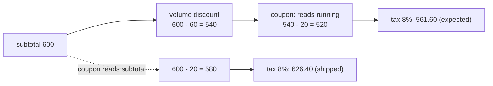

import Scenario from "../../../components/Scenario.astro";
import LevelIntro from "../../../components/LevelIntro.astro";
import Checkpoint from "../../../components/Checkpoint.astro";
import PracticeCheck from "../../../components/PracticeCheck.astro";

export const unit = {
  track: "software-design",
  unitSlug: "evolutionary-design",
};

<Scenario label="Fernbridge, a made-up invoicing shop, traces its coupon bug">
  <Fragment slot="facts">
    <div class="not-prose flex flex-col gap-2 text-sm text-slate-700 dark:text-slate-300">
      <div class="flex items-center gap-1.5"><span>🏗️</span> <strong>Round 0</strong> — items + 8% tax. Nothing to extend.</div>
      <div class="flex items-center gap-1.5"><span>➕</span> <strong>Round 1</strong> — 10% off over $500. Correctly no seam.</div>
      <div class="flex items-center gap-1.5"><span>💥</span> <strong>Round 2</strong> — $20 coupon overwrites the discount.</div>
      <div class="flex items-center gap-1.5"><span>🧩</span> <strong>Round 3</strong> — VIP rule appends; regional tax needs its own seam.</div>
    </div>
  </Fragment>

Fernbridge's checkout charged a $600 order with a $20 coupon `$626.40`. The
business expected `$561.60`. Nobody had written a wrong formula on purpose:
two separate-looking `if` blocks changed the same running number, and the
second one quietly started from the wrong starting point. **Why did stacking
rules produce a bug no single rule contained, and why does a list of rules
remove the cause instead of dodging it once?**

</Scenario>

<LevelIntro
  items={[
    "The round-2 bug traced number by number",
    "Why a shared contract removes the cause",
    "Failure modes: wrong axis, wrong seam, too early, too late",
  ]}
/>

## Round 0 and round 1: nothing to abstract yet

**With one rule, is there anything worth abstracting?** No. Round 0 is
subtotal plus 8% tax. Round 1 adds one `if` for 10% off over $500. A $600
order becomes 600 - 60 = 540, taxed to 583.20. This is correct, cheap code,
and it is not a mistake to ship it this way. The mistake would be still
building it this way two requirements later.

<Checkpoint question="At round 1 a reviewer asks for the extensible rules system 'while you are in here, so we do not touch this again'. Is that good advice?">

No. There is exactly one rule and no evidence that a second is coming. The
abstraction would be paid for every day (an extra shape, a list, another hop
to read) for a benefit that may never arrive. Nobody can yet tell whether this
axis will have a second variant, which is exactly why the next requirement
is the thing that should decide.

</Checkpoint>

## Round 2: what exactly went wrong?

Two stacked blocks ended up like this. The only lines that matter are the
two that assign `running`:

```js
let running = subtotal - volumeDiscount; // 600 - 60 = 540
if (order.couponAmount) {
  running = subtotal - order.couponAmount; // 600 - 20 = 580, discount erased
}
```

The coupon branch restarted from `subtotal` instead of continuing from
`running`. The same order, followed through both versions:



| Step               | Intended            | Shipped             |
| ------------------ | ------------------- | ------------------- |
| Subtotal           | 600                 | 600                 |
| After 10% discount | 540                 | 540                 |
| After coupon       | 540 - 20 = 520      | 600 - 20 = 580      |
| After 8% tax       | 520 × 1.08 = 561.60 | 580 × 1.08 = 626.40 |

<PracticeCheck
  track={unit.track}
  unitSlug={unit.unitSlug}
  topicId="shared-state-bug"
/>

## Why does the list remove the cause, not just this instance?

**Fixing the coupon line to read `running` would repair this pair. What
would the next rule do?**

The structural flaw is a shared mutable value with no stated contract for
what each block may assume about it. Any new block could guess wrong again.
The fix changes the shape: every rule has the identical contract "receive the
running total after all earlier rules, return the new running total".

```js
const volume = (t) => (t > 500 ? t - t / 10 : t);
const coupon = (t) => Math.max(0, t - 20);
const rules = [volume, coupon]; // this order IS the business decision
const total = rules.reduce((t, rule) => rule(t), subtotal);
```

A rule cannot read `subtotal` by mistake because it is never handed it. And
the order is now one visible list instead of an accident of line order.

<Checkpoint question="Two rules both change the total: A takes 10% off, B subtracts $20. A 600 order goes through them. Does it matter whether the list is [A, B] or [B, A]?">

Yes. A then B gives 600 - 60 = 540, then 520. B then A gives 580, then 580 -
58 = 522. The totals differ by 2, so the order is a business decision and
the seam does not make it for you. What the seam does is put that decision in
one visible place, where it can be reviewed, instead of hiding it in the
order of statements inside a function.

</Checkpoint>

<PracticeCheck
  track={unit.track}
  unitSlug={unit.unitSlug}
  topicId="rule-pipeline"
/>

## Round 3: one rule absorbs, one needs a new seam

**(a) VIP customers get an extra 5% off.** Same kind of thing as the other
rules, so it is appended. The $600 VIP order becomes 540, then 513, then 513
× 1.08 = 554.04. Every earlier rule and its tests are untouched.

**(b) EU orders are taxed at 20% instead of 8%.** Is this the same axis? No.
It does not adjust the total before tax, it changes how tax is computed. A
second small seam is added for it, now that it has real evidence: a 200
order becomes 200 × 1.20 = 240.

| Requirement   | Same kind as existing rules? | Treatment               |
| ------------- | ---------------------------- | ----------------------- |
| VIP 5% off    | Yes: adjusts total pre-tax   | Append to the rule list |
| EU tax at 20% | No: changes how tax is made  | Its own small seam      |

## Where does this go wrong?

| Failure mode                 | What it looks like                                                               | Why it happens                                           |
| ---------------------------- | -------------------------------------------------------------------------------- | -------------------------------------------------------- |
| **Guessing the wrong axis**  | A multi-currency seam at round 0; no foreign customer ever signs                 | Speculative flexibility, paid daily, redeemed never      |
| **Reusing the wrong seam**   | EU tax forced through the rule list "because we already have an extension point" | An axis mismatch disguised as reuse                      |
| **A seam nobody uses twice** | The rule list stays at one rule for two years                                    | Permanent indirection for a variant that never showed up |
| **Too-late extraction**      | A fifth and sixth `if` after the round-2 bug already shipped                     | Each new `if` interacts with every earlier one           |

The two real directions are symmetric. Build the seam before a second
variant and you pay indirection forever. Wait past it and every extra special
case is harder to add and riskier to get wrong.

<Checkpoint question="A year later the rule list has nine rules and a new engineer proposes splitting it into 'discount rules' and 'fee rules'. Is that the same timing question?">

Yes, one level up. The question was "has a second real variant of this kind
of thing appeared?" The same question now applies to the list itself. If
discounts must always run before fees and that ordering is being worked
around by hand, that is concrete evidence for a split, as the coupon bug was
for the list. If the reason is only "two lists would probably be cleaner",
it is the same speculation as building the list at round 1.

</Checkpoint>

**This is one case, not the whole territory.** Fernbridge's story is a clean
one: rules arrive one at a time and each is obviously the same kind or a
different kind. **Extend it yourself:** what changes if round 4 is a
**subscription plan**, a recurring monthly charge with no line items and no
one-time discount rules, but the same tax logic? Does it fit the rule list,
need a third seam, or show that the checkout function itself now has two real
variants (one-time orders and subscriptions) and is the thing that needs a
seam? And what changes if the news is worse, and the second rule arrives with
a deadline of one day, so there is no time to reshape anything first?
