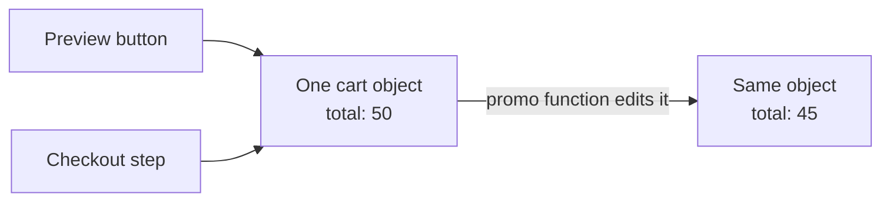

import Scenario from "../../../components/Scenario.astro";
import LevelIntro from "../../../components/LevelIntro.astro";
import PracticeCheck from "../../../components/PracticeCheck.astro";

export const unit = { track: "software-design", unitSlug: "immutability" };

<Scenario label="A shopper clicked “preview discount”, changed their mind, and still paid the discounted price.">
  <Fragment slot="facts">
    

      
🛒 <strong>Real cart</strong> — total $50, no discount

      
👀 <strong>Preview button</strong> — runs the promo function to show a total

      
💳 <strong>Checkout</strong> — reads the same cart later

      
❓ <strong>Surprise</strong> — checkout sees $45

    

    

      
One cart, two readers

      the preview edited the only copy that exists
    

  </Fragment>

Picture two people sharing one paper shopping list. One of them crosses
out milk "just to see how short the list gets", then puts the pen down.
The other person walks into the shop with a list that no longer says
milk. Nobody did anything unreasonable, yet the list changed under
someone who never touched it.

A checkout page has the same shape. A function `applyPromoCode(cart, code)`
powers a "preview" button and is also used at checkout. A shopper types
a code, looks at the preview, backs out, and is charged $45 instead of
$50. **The preview and the checkout never exchanged a message, so how
did one change the other?**

</Scenario>

<LevelIntro
  items={[
    "Mutation versus a new object",
    "Aliasing and shared references",
    "Pure functions and side effects",
  ]}
/>

## Why did the preview reach checkout?

The discount math was right. The mistake was where the answer went:
the function wrote `$45` into the cart object it was handed, and the
preview and checkout both held that very object.

| Shared paper list                        | The cart                                    |
| ---------------------------------------- | ------------------------------------------- |
| One sheet, two people                    | One object, two parts of the program        |
| Crossing out an item changes it for both | Changing `total` changes it for both        |
| A photocopy lets you scribble freely     | A new object lets the preview change freely |

<PracticeCheck
  track={unit.track}
  unitSlug={unit.unitSlug}
  topicId="shared-reference"
/>

## What does the fix look like?

Instead of editing the cart it was given, the function builds a second
cart that carries the discount and returns it. The preview shows the
second cart. The real one stays at $50 until some step decides to use
the new one.

| Style               | What happens to the original cart | Who sees the change                  |
| ------------------- | --------------------------------- | ------------------------------------ |
| Mutating            | Edited in place                   | Everyone holding it                  |
| Returning a new one | Left exactly as it was            | Only the caller that kept the result |

This habit is called **immutability**: once a piece of data exists,
it is not edited; a "change" produces a new value.

<PracticeCheck
  track={unit.track}
  unitSlug={unit.unitSlug}
  topicId="new-object-fix"
/>

## Key terms

- **Mutation**: changing an existing object or array in place.
- **Aliasing**: two names pointing at the same object, so a change through one is visible through the other.
- **Pure function**: the output depends only on the inputs, and nothing outside is changed.
- **Side effect**: anything a function does besides returning a value (editing shared data, saving, sending, logging).

## What the later levels cover

L2 shows how aliasing turns a local edit into a distant surprise, what
purity requires beyond "no `var`", and how a real program keeps its
unavoidable side effects in one thin layer. L3 works the cart fix end
to end, shows where a copy is only one level deep, and puts a number on
what copying costs.
