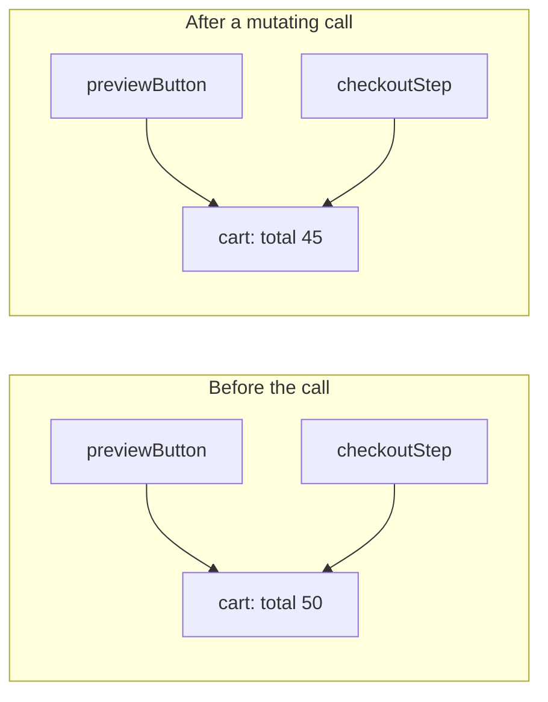
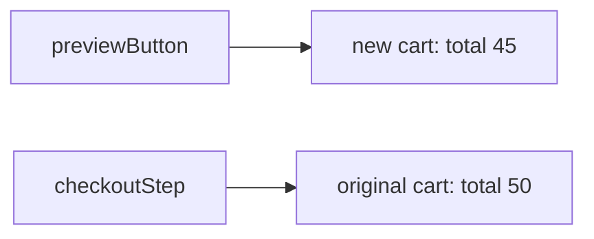
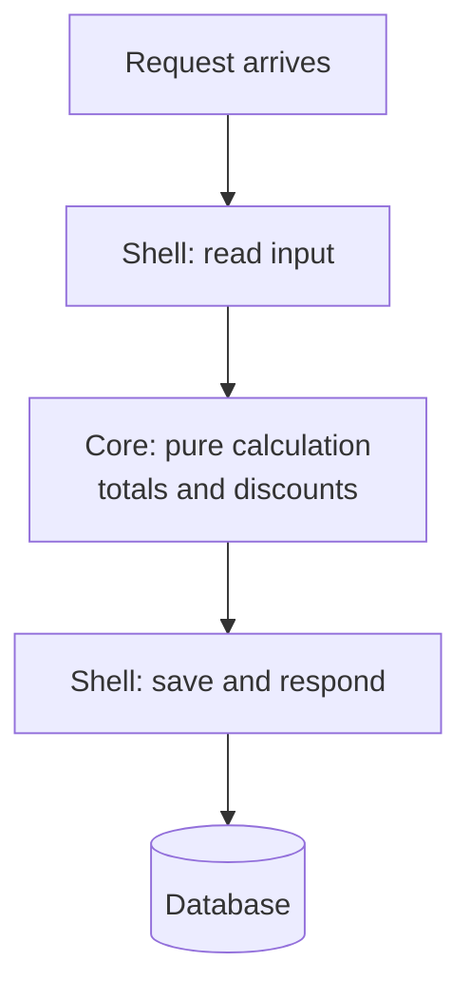

import LevelIntro from "../../../components/LevelIntro.astro";
import Checkpoint from "../../../components/Checkpoint.astro";
import PracticeCheck from "../../../components/PracticeCheck.astro";

export const unit = { track: "software-design", unitSlug: "immutability" };

L1 explained the surprise: the promo function edited the one cart that the
preview and checkout both held. L2 asks why sharing causes that, what makes a
function safe to call, and where a real program puts the changes it cannot
avoid.

<LevelIntro
  items={[
    "Aliasing and action at a distance",
    "What purity really requires",
    "Functional core, imperative shell",
  ]}
/>

## Why does a local edit show up somewhere else?

Names do not hold carts; they hold arrows to carts. The preview and the
checkout were never two carts. They were two arrows into one. Editing the
target through one arrow changes what every other arrow shows, including
arrows held by code that never called the function.

Returning a new cart adds a second box and moves only the caller's own
arrow:

<Checkpoint question="A third part of the program, adminPanel, builds its own copy by spreading the cart into a new object and then edits the copy. Does checkoutStep see the edit?">

No. The spread produces a different object, so `adminPanel` now holds an
arrow to a box that nobody else points at. Aliasing only causes distant
surprises when two arrows lead to the same box, and making a new box is
exactly what breaks that link.

</Checkpoint>

## Is a function pure just because it looks modern?

No. Purity is about behavior, not syntax. Arrow functions, `const` and
`map` can all hide an edit. Two properties together make a function pure:

| Property                   | What it forbids                                                  | Example that breaks it                                   |
| -------------------------- | ---------------------------------------------------------------- | -------------------------------------------------------- |
| Same input, same output    | Reading anything that can change between calls                   | Reading the clock or a random number inside the function |
| No observable side effects | Editing its arguments, writing files, calling a network, logging | `cart.total *= 0.9` inside an arrow function             |

A pure function can be called twice, or called just to see what happens,
with no consequences. That is the property the preview button needed.

<PracticeCheck track={unit.track} unitSlug={unit.unitSlug} topicId="purity" />

## If side effects are the problem, how does anything get saved?

It cannot avoid them: saving, sending and logging are the point of most
programs. The move is to isolate them. Keep the calculation (discounts,
totals) in pure functions and let a thin outer layer do the saving and
calling. The pattern is called **functional core, imperative shell**.

The core never touches the database, so it can be tested with plain
inputs and plain outputs, and it can be reused by a preview, a report or a
checkout without any of them saving anything by accident.

<Checkpoint question="One function both computes the discounted total and writes it to the database. Name the concrete cost of leaving it as one function.">

Every test of the discount math now needs a database, real or fake, and any
place that wants the number without a save (a preview, a report) must
either duplicate the math or accept an unwanted write. Splitting into a pure
calculation and a thin save removes both problems, and the save stays in the
one place that needs it.

</Checkpoint>

<PracticeCheck
  track={unit.track}
  unitSlug={unit.unitSlug}
  topicId="core-and-shell"
/>

## Failure modes at this level

- **Trusting the style.** Code that uses `map` or arrow functions is not automatically pure if the callback edits its argument.
- **Blending calculation and saving.** The mixed function is harder to test and quietly reintroduces unexpected writes.
- **Treating copies as free.** A new object per change has a price on large data; L3 puts a number on it.
