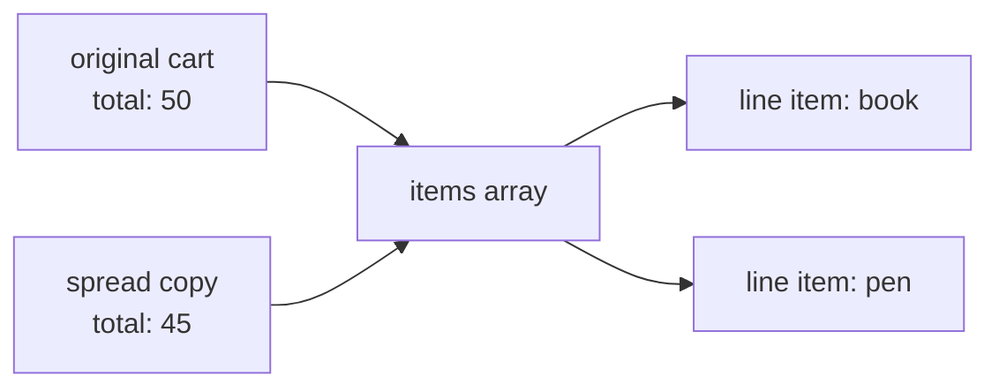
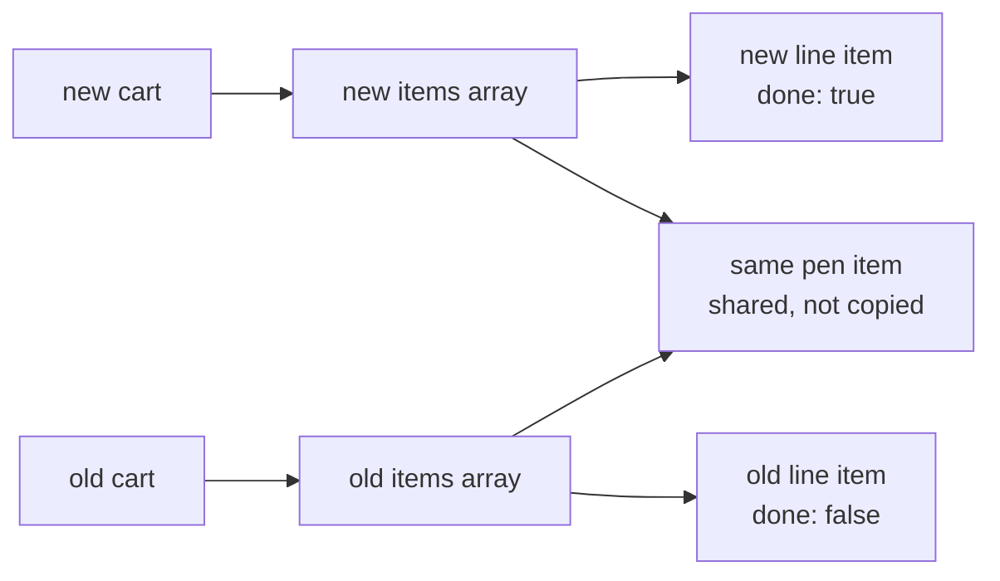

import LevelIntro from "../../../components/LevelIntro.astro";
import Checkpoint from "../../../components/Checkpoint.astro";
import PracticeCheck from "../../../components/PracticeCheck.astro";

export const unit = { track: "software-design", unitSlug: "immutability" };

L2 gave the model: new box instead of editing the shared one, and keep saving
in a thin shell. L3 runs that model against the real cart, finds the place
where a copy is only one level deep, and measures what copying costs when the
list grows.

<LevelIntro
  items={[
    "The pure fix and its shallow edge",
    "Updating one item without editing the list",
    "What a full copy costs as lists grow",
  ]}
/>

## The bug and the fix, side by side

**What exactly makes the original function unsafe to call for a preview?**
It assigns into a parameter, and a parameter is the caller's object, not a
private one.

```js
function applyPromoCodeMutating(cart, code) {
  if (code === "SAVE10") cart.total = cart.total * 0.9; // edits the caller's cart
  return cart;
}

function applyPromoCodePure(cart, code) {
  if (code === "SAVE10") return { ...cart, total: cart.total * 0.9 };
  return { ...cart };
}
```

With a cart whose total is 50, both compute 45 (`50 * 0.9` is exactly 45 in
JavaScript, checked). The difference is only where 45 lands: in the shared
cart, or in a new one the preview alone holds.

| Call                           | Returned cart total | Original cart total afterwards |
| ------------------------------ | ------------------- | ------------------------------ |
| `applyPromoCodeMutating(cart)` | 45                  | 45                             |
| `applyPromoCodePure(cart)`     | 45                  | 50                             |

<PracticeCheck
  track={unit.track}
  unitSlug={unit.unitSlug}
  topicId="new-object-fix"
/>

## Where is the spread only one level deep?

**A cart has `items`, an array of line items. Does the spread copy them?**
It copies the cart's own properties, and for `items` that property holds an
arrow to an array. The copy gets the same arrow.



The `total` copied by value, so the two carts can disagree about it. The
`items` arrow was copied as an arrow, so editing `copy.items[0].price`
edits the original's line item too.

| Field in the cart | Copied by spread as | Edit through the copy reaches the original? |
| ----------------- | ------------------- | ------------------------------------------- |
| `total` (number)  | a value             | No                                          |
| `items` (array)   | the same arrow      | Yes                                         |
| each line item    | the same arrow      | Yes                                         |

<Checkpoint question="A preview function returns a spread copy of the cart, and some code then sets the first line item's price to 0 on that copy. Is the real cart's first price still intact?">

No. The spread copied the arrow to the items array, and the array still
points at the same line-item objects, so the assignment lands on the real
cart's item. Safe for `total`, unsafe for anything nested, until the nested
part is also rebuilt.

</Checkpoint>

<PracticeCheck
  track={unit.track}
  unitSlug={unit.unitSlug}
  topicId="shallow-copy"
/>

## How do you change one item without editing the list?

**If every level of a path needs a new box, which boxes do?** Only the ones
on the path to the change: the cart, the items array, and the one line item.



The rebuilt array shares every untouched line item with the old one. In code
that is a `map` that returns the same object for non-matches and a changed
copy for the match. Writing that function yourself is the exercise below,
because the shape of "copy the path, share the rest" is easiest to feel by
typing it.

<PracticeCheck
  track={unit.track}
  unitSlug={unit.unitSlug}
  topicId="immutable-array-update"
/>

## What does copying actually cost?

**Does rebuilding the whole items array on every update stay cheap?** The
interactive demo below uses a cost model recorded from a Node benchmark of a
`map`-based array copy: about 0.0000085 ms per item plus 0.001 ms fixed (a
rough, machine-dependent estimate, so trust the order of magnitude, not the
decimals).

| Items in list | Estimated copy time | Share of a 16.6 ms frame |
| ------------- | ------------------- | ------------------------ |
| 10            | 0.0011 ms           | about 0.007%             |
| 1,000         | 0.0095 ms           | about 0.06%              |
| 200,000       | 1.70 ms             | about 10%                |

At everyday sizes a full copy is negligible. Around the hundred-thousand
mark it starts competing with everything else a frame must do, and doing it
on every keystroke would add up. This is where **structural sharing** earns
its keep: a data structure arranged so an update rebuilds only the path to
the change (as in the diagram above) and shares everything else, rather than
copying all items each time.

<PracticeCheck
  track={unit.track}
  unitSlug={unit.unitSlug}
  topicId="copy-cost"
/>

## A case, not the whole territory

The cart is one case. The same reasoning applies to any shared mutable
thing: a settings object read by many modules, a cached response reused
across requests, a component's props. What is specific here is the tool:
spread and `map` suit plain objects at modest sizes; other languages and
larger data want persistent structures.

Try extending it yourself. If the list held 200,000 items and the user
edited one on every keystroke, would you copy the array, share the
untouched items, or change the design so the list is not rebuilt per
keystroke at all? What would you want to measure before choosing?

## Failure modes

| Failure mode                                   | What it gets wrong                                              |
| ---------------------------------------------- | --------------------------------------------------------------- |
| Editing a parameter because it is "just local" | A parameter is the caller's object                              |
| Believing spread copies nested data            | Only the first level is new; nested objects are still shared    |
| Mixing calculation and saving                  | Hard to test, and surprises callers that wanted only the number |
| Copying everything, always, on large data      | Full copies scale with size; share the unchanged parts instead  |
