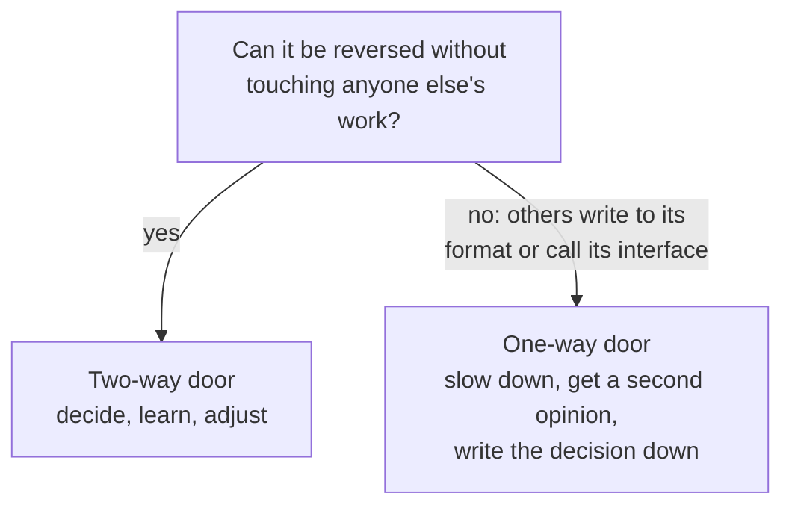
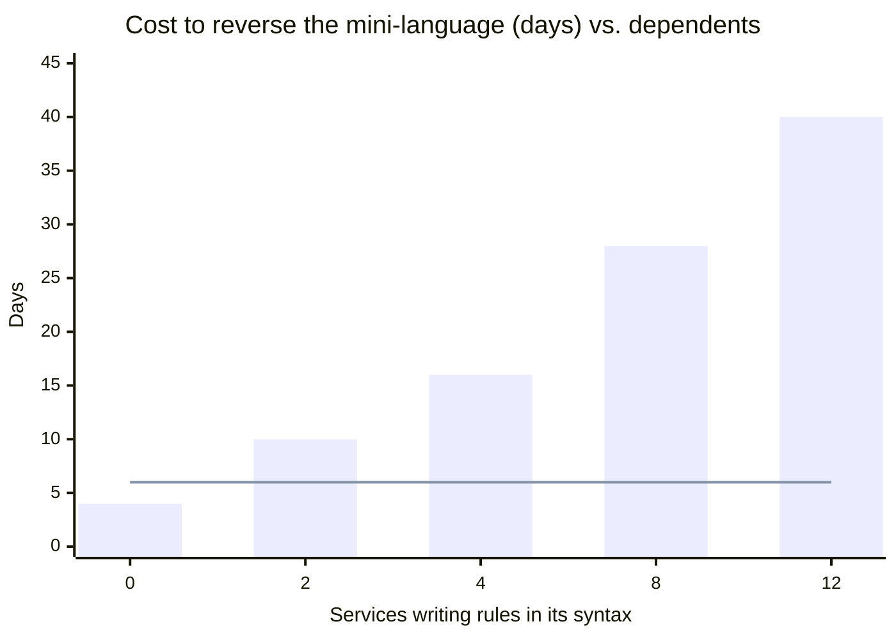

import Scenario from "../../../components/Scenario.astro";
import LevelIntro from "../../../components/LevelIntro.astro";
import PracticeCheck from "../../../components/PracticeCheck.astro";

export const unit = {
  track: "software-design",
  unitSlug: "long-term-design-judgment",
};

<Scenario label="A shorthand only its author can read">
  <Fragment slot="facts">
    

      

        🗓️ <strong>Timeline</strong> — Renata moves to another team in 6 months; the design stays.
      

      

        ⚡ <strong>Option A</strong> — rules written in a mini-language she invented, stored as config. Compact, flexible.
      

      

        🧱 <strong>Option B</strong> — one plain, named function per rule. More lines, nothing new to learn.
      

      

        👤 <strong>The reader</strong> — someone who never met her and cannot ask her anything.
      

    

  </Fragment>

Imagine a colleague who keeps her notes in a private shorthand. Writing them
is quick, and she reads them effortlessly. The day she leaves, the notebook
is still on the desk, and nobody can tell what half the symbols mean.

Renata, an engineer at a project-tracking product called Northlane, is about
to build that notebook in code. She has to decide how the product works out
which features a workspace may use (by plan, paid add-on, or old contract).
Her first version stores the rules as short strings in a mini-language she
designed. Her second is an ordinary list of named functions. **Both work. Which one will the
person who inherits it in two years be able to change safely, and what
should Renata leave behind either way?**

</Scenario>

<LevelIntro
  items={[
    "Legible versus clever designs",
    "One-way versus two-way doors",
    "Why a decision gets harder to undo over time",
  ]}
/>

## What is the real test of a long-lived design?

**Both of Renata's versions pass every test today, so what separates them?**
Who can change them later. A design is judged by the reader who arrives after
the author is gone, not by the author who understands it fully.

| Term             | Meaning here                                                                          |
| ---------------- | ------------------------------------------------------------------------------------- |
| **Legibility**   | A reader with no prior context can read the design and correctly predict what it does |
| **Cleverness**   | More compact or more general, but it relies on insight that mostly the author has     |
| **ADR**          | A short written record of what was decided, why, and which alternatives were rejected |
| **One-way door** | A decision that is expensive or impossible to reverse once other things depend on it  |
| **Two-way door** | A decision that is cheap to reverse if it turns out wrong                             |
| **Lock-in**      | The state where undoing a decision costs far more than it cost to make                |

Renata's mini-language is a legitimate, well-known pattern, so it is not wrong
for being clever. It is risky here because of who inherits it and when she
stops being available to explain it.

<PracticeCheck
  track={unit.track}
  unitSlug={unit.unitSlug}
  topicId="legibility-vs-cleverness"
/>

## Which decisions deserve the most caution?

**Does every design choice need the same care?** No. Caution should follow how
costly the choice is to take back:

The trap is a one-way door that looks like a two-way one. Renata's
mini-language is "just an implementation detail" until other services start
writing rules in its syntax. After that, the syntax is a contract.

<PracticeCheck
  track={unit.track}
  unitSlug={unit.unitSlug}
  topicId="door-types"
/>

## The shape of the answer

Four moves, built out in L2 and L3:

- **Prefer legible over clever** when the two are close in cost.
- **Write down the why**, including the alternatives you rejected. Code shows
  what was built, never what was considered and dropped.
- **Spend caution in proportion to reversibility.**
- **Watch lock-in grow.** A reversible decision becomes permanent as more
  things depend on it, even though the decision itself never changed.

## How fast does lock-in grow?

The unit's interactive demo models the cost of removing Renata's mini-language
as a base cost plus a migration cost for each dependent. These are assumed
numbers for illustration, not measurements: 4 days to remove the interpreter,
3 days per dependent, and 6 days as the cost of having built the plain version
in the first place.

The bars are the cost to undo the clever design (`4 + 3 × dependents`). The flat
line is the 6-day cost of the plain design. With no dependents, reversing
costs 4 days, less than building the plain version. With the first dependent it
costs 7, and with two it costs 10. Nothing about the decision changed; the
things around it did.
