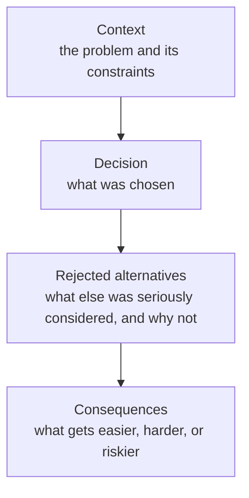

import LevelIntro from "../../../components/LevelIntro.astro";
import Checkpoint from "../../../components/Checkpoint.astro";
import PracticeCheck from "../../../components/PracticeCheck.astro";

export const unit = {
  track: "software-design",
  unitSlug: "long-term-design-judgment",
};

L1 named four moves: prefer legible over clever, write down the why, spend
caution in proportion to reversibility, and watch lock-in grow. This level
builds the model behind each, in the order Renata would apply them to her
entitlement design.

<LevelIntro
  items={[
    "Legibility as a design criterion",
    "What a decision record preserves",
    "Why reversal cost climbs after shipping",
  ]}
/>

## Why does "it works" stop being enough?

**Renata's mini-language passes every test. Why isn't that the bar?** Because
"works" measures the present, and this decision's cost arrives later, in a
future where Renata is not in the room. A design that needs its author's memory
to be extended safely has deferred part of its cost to the next person, who
will pay it with less context and no one to ask.

The question changes from "what is the best design I can build?" to "what is
the best design a stranger, arriving after I leave, can safely operate and
extend?"

| Question a reader asks            | Rule written in a mini-language        | Rule written as a named function       |
| --------------------------------- | -------------------------------------- | -------------------------------------- |
| What must I learn first?          | The grammar, which exists nowhere else | Nothing beyond the language they know  |
| What does a typo produce?         | A parse failure found at run time      | A compiler error found before shipping |
| Who can review a change?          | Mostly the author                      | Any teammate                           |
| How much text per rule?           | Short                                  | Longer                                 |
| Can a rule change without deploy? | Yes                                    | No                                     |

Power and legibility answer different questions. Power asks what the design
can express. Legibility asks who can safely change what it already expresses.
The mini-language buys compactness for someone who understands it; the plain
version buys correctness for someone who does not. For a design meant to
outlive its author, the person changing it is usually the second kind.

<Checkpoint question="The mini-language can express rules the plain version would need extra code for. Does that make it the better long-term design?">

Not by itself. Extra power the team does not currently need is paid for in
legibility, and that bill keeps arriving after the author leaves. The deciding
fact is whether Northlane's rules genuinely need that expressiveness today. If
the plain version already covers every rule anyone has asked for, the extra
power is speculative while its cost is real.

</Checkpoint>

## Why can't the code explain itself?

**Suppose Renata ships the plain version. Two years later a new engineer admires
how tidy a mini-language would be and proposes one. What stops them?**
Nothing in the code. It shows what was built, never why one working alternative
was chosen over another. That reasoning lived in Renata's head or a chat
thread, and both disappear long before the code does.

An **ADR (Architecture Decision Record)** is a short document kept next to the
code that answers the question someone will ask later: "why didn't we do the
obvious clever thing?"

Teams skip the third box most often, and it matters most here: it is the only
part that pre-empts the exact proposal a future reader will rediscover.

<PracticeCheck track={unit.track} unitSlug={unit.unitSlug} topicId="adr-why" />

## How much caution does a decision deserve?

**How should Renata choose between a chat message, a design review, and
something in between?** By asking what undoing the decision would cost once
others have built on it. Two-way doors are cheap to walk back through; one-way
doors are a real commitment.

| Question                                     | Two-way door        | One-way door                              |
| -------------------------------------------- | ------------------- | ----------------------------------------- |
| Can it change without touching others' work? | Yes                 | No, others build on top of it             |
| Does it define a format others write to?     | No                  | Yes (config syntax, wire format, API)     |
| Cost to reverse in year 1 vs. year 2         | About the same      | Much higher in year 2                     |
| Scrutiny it deserves now                     | Ship, learn, adjust | Slow down, second reviewer, write it down |

Renata's mini-language is a one-way door disguised as a two-way one. Once other
services store rules in its syntax, reversing it means rewriting every stored
rule, not deleting one file.

<Checkpoint question="A teammate says the mini-language is a two-way door because 'we can always delete the interpreter'. What does that argument miss?">

Reversibility is not whether the owner could delete their own code. It is what
reversing costs once other parties depend on the decision. Deleting the
interpreter does not delete the rules other services stored in its syntax; it
breaks them. The measure is what has come to depend on the decision by the time
someone wants to change it.

</Checkpoint>

## When does the cost of reversing actually arrive?

**If the risk is in dependents, when does it show up: at shipping or later?**
Later, and that delay is what makes lock-in dangerous. On day one the
mini-language has no dependents and reversing costs almost nothing. The risk is
the slope: each week more rules get written in its syntax, and the cost to
reverse climbs.

The interactive demo below models the slope as a base cost plus a per-dependent
migration cost (assumed numbers, not measurements):

| Dependents | Cost to reverse (4 + 3 per dependent) | Compared with the 6-day plain build |
| ---------- | ------------------------------------- | ----------------------------------- |
| 0          | 4 days                                | cheaper than the plain build        |
| 1          | 7 days                                | already more                        |
| 2          | 10 days                               | 4 days more                         |
| 8          | 28 days                               | about 4.7 times as much             |

A decision that looked reversible in month one can be functionally permanent by
month eight, with no change to the decision itself. That is why the framings
above matter before shipping: the leverage over a one-way door is at the moment
it is still cheap to walk back, which is earlier than it feels necessary.

<PracticeCheck
  track={unit.track}
  unitSlug={unit.unitSlug}
  topicId="lock-in-slope"
/>

## What L3 does with this

L3 works Renata's decision end to end: the written ADR she leaves, how the
cost slope plays out over eight months, and where "prefer legible" can be
taken too far.
