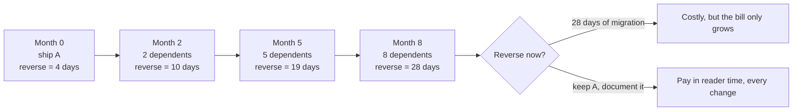

import Scenario from "../../../components/Scenario.astro";
import LevelIntro from "../../../components/LevelIntro.astro";
import Checkpoint from "../../../components/Checkpoint.astro";
import PracticeCheck from "../../../components/PracticeCheck.astro";

export const unit = {
  track: "software-design",
  unitSlug: "long-term-design-judgment",
};

<Scenario label="Eight months after Renata left">
  <Fragment slot="facts">
    <div class="not-prose flex flex-col gap-2 text-sm text-slate-700 dark:text-slate-300">
      <div class="flex items-center gap-1.5">
        <span>🎯</span> <strong>System</strong> — Northlane's check: may workspace X use feature Y?
      </div>
      <div class="flex items-center gap-1.5">
        <span>⚙️</span> <strong>Option A</strong> — rules as strings in a custom mini-language, kept in config.
      </div>
      <div class="flex items-center gap-1.5">
        <span>🧾</span> <strong>Option B</strong> — an ordered list of named rule functions.
      </div>
      <div class="flex items-center gap-1.5">
        <span>🚪</span> <strong>Door type</strong> — A becomes one-way once others write rules in its syntax; B stays two-way.
      </div>
    </div>
    <div class="not-prose mt-3 flex flex-col gap-1.5 text-xs text-slate-700 dark:text-slate-300">
      <div>
        <div class="flex justify-between"><span>Cost to reverse A at 8 dependents (assumed)</span><span>28 days</span></div>
        <div class="h-2 w-full overflow-hidden rounded-full bg-slate-200 dark:bg-slate-700"><div class="h-full rounded-full bg-rose-500 animate-fill-bar" style="--target-width: 100%"></div></div>
      </div>
      <div>
        <div class="flex justify-between"><span>Cost of building B up front (assumed)</span><span>6 days</span></div>
        <div class="h-2 w-full overflow-hidden rounded-full bg-slate-200 dark:bg-slate-700"><div class="h-full rounded-full bg-emerald-500 animate-fill-bar" style="--target-width: 21%"></div></div>
      </div>
    </div>
  </Fragment>

Picture the person who inherited Renata's work, standing in front of a rules
file full of strings in a grammar nobody documented. The strings work. Eight
other services now store rules written in them. **Was this avoidable, and what
would Renata have needed to leave behind so the inheritor could decide calmly?**

This level follows the decision from the choice itself to the record she
writes, then to the places the judgment goes wrong.

</Scenario>

<LevelIntro
  items={[
    "The cost slope over eight months",
    "A decision record written for a stranger",
    "Where the judgment fails in both directions",
  ]}
/>

## What does the slope look like when you follow one decision through time?

**What does Option A cost on the day it ships, and what does it cost once the
organisation has used it?** Using the unit's assumed numbers (4 days to remove
the interpreter, 3 days of migration per dependent, 6 days to have built the
plain version instead):

| Month | Services storing rules in A's syntax | Cost to reverse A | Cost of B built on day one |
| ----- | ------------------------------------ | ----------------- | -------------------------- |
| 0     | 0                                    | 4 days            | 6 days                     |
| 2     | 2                                    | 10 days           | 6 days                     |
| 5     | 5                                    | 19 days           | 6 days                     |
| 8     | 8                                    | 28 days           | 6 days                     |



Only the first row favours Option A, and only in the sense that undoing it is
cheap. Every later row says the same thing: the cheapest moment to decide
was the first one, when Renata was present. That is the leverage of treating
the decision as a one-way door early.

<Checkpoint question="At month 5, a teammate says 'we have not paid anything yet, so it is still cheap'. What is wrong with that reading?">

The cost has not been paid, but it has been incurred. Each rule written in the
syntax added to the bill for removing it, and 19 days is more than three times
the 6 days the plain version would have taken. Reversal cost is a property of
what depends on the decision, not of whether anyone has felt pain yet.

</Checkpoint>

## What does Renata write down so the inheritor can decide?

Renata chooses Option B and writes a decision record before merging. She writes
it not as review theatre but because she knows nobody will be able to ask her.

```markdown
# ADR-014: Entitlement checks as named rule functions, not a config language

Status: Accepted

Context: Rules depend on plan tier, purchased add-ons and a fixed set of
grandfathered contracts. They change a few times a quarter, driven by product
decisions. The team is six people and none has maintained an interpreter.

Decision: An ordered list of named rule functions, one per rule. A new rule is
a new list entry and a deploy.

Rejected: A config-driven mini-language (prototyped and working).

- Readers must learn a grammar that exists nowhere else.
- Once any stored rule uses its syntax, the syntax is a contract; reversing
  means migrating every stored rule.
- Current need (a few changes per quarter) does not require config-time edits.

Rejected: A third-party rules library. Same learning cost, plus a dependency.

Consequences: Rule changes need review and a deploy. Same-day sales exceptions
are handled by a separate, narrower overrides table (ADR-015). If per-workspace
rules are ever needed, that is a new decision to make deliberately, not a
silent drift back toward a language.
```

The record does what the code cannot: it tells a future reader that the
obvious clever option was already considered and turned down, and on what
grounds. It also draws a boundary. The overrides line answers "why doesn't this
handle same-day exceptions?" before anyone asks it.

<Checkpoint question="Why does the 'Consequences' section mention the separate overrides table, rather than leaving it for a later record?">

Because it closes a gap the next reader would otherwise have to guess at.
Without that line, someone facing a same-day exception might assume the rule
list was meant to handle it and force a bad fit, or reopen the mini-language
question that was already resolved. Naming what this decision does not cover
pre-empts both "why not the clever thing?" and "why doesn't it handle case Y?".

</Checkpoint>

## Where does this judgment go wrong?

**If "prefer legible" is the rule, can it be over-applied?** Yes, in both
directions.

| Failure mode                           | What it looks like                                                                  | Guard                                                                                  |
| -------------------------------------- | ----------------------------------------------------------------------------------- | -------------------------------------------------------------------------------------- |
| Over-applying legibility               | Refusing a necessary abstraction and building a giant if/else block nobody can hold | Match complexity to the real problem; simple but wrong for the need is not legible     |
| A one-way door disguised as two-way    | Treating a stored format or public syntax as "just an implementation detail"        | Ask what already depends on the format, not only on the code                           |
| A record nobody reads                  | The decision record exists but is not linked from the code and goes stale           | Link it from the module; mark superseded records explicitly with a new one             |
| Designing for a reader who never comes | Adding flexibility "for the inheritor" that nobody ever needs                       | Build the general version when a second concrete case appears, not for an imagined one |

<PracticeCheck
  track={unit.track}
  unitSlug={unit.unitSlug}
  topicId="judgment-limits"
/>

## Extend it yourself

This worked example is one case, not the whole territory. Renata's team was six
people with a few rule changes per quarter. Two changes to sit with:

**What if the audience were much larger?** Suppose Northlane grows to 40
engineers across six teams who all touch these rules. Does "add a list entry and
deploy" still hold up, or does review and deploy cost start to look like the
case for config-time flexibility, for reasons other than same-day urgency?

**What if the news were worse?** Suppose the mini-language had already shipped
for eight months with eight services depending on it before anyone wrote this
record. Does the right decision change? Is reversing still the goal, or does the
record's job shift from choosing a design to documenting what migrating off it
would cost?

There is no single correct answer to either. The point is that you have practised
the reasoning on one case, and it applies wherever someone else will inherit
your work.
