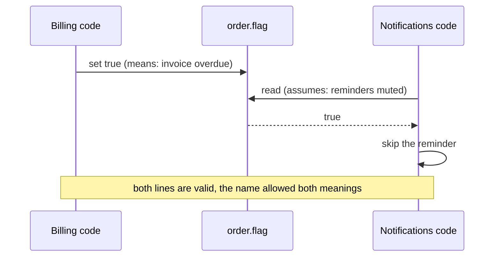

import Scenario from "../../../components/Scenario.astro";
import LevelIntro from "../../../components/LevelIntro.astro";
import PracticeCheck from "../../../components/PracticeCheck.astro";

export const unit = {
  track: "software-design",
  unitSlug: "naming",
};

<Scenario label="One field called flag, two teams, one silent bug">
  <Fragment slot="facts">
    

      
💳 <strong>Billing team</strong> — sets <code>order.flag = true</code> to mean "this invoice is overdue"

      
🔔 <strong>Notifications team</strong> — reads <code>order.flag</code>, assuming it means "customer muted reminders"

      
🐛 <strong>Result</strong> — the reminder is skipped for exactly the customers who need it most

    

  </Fragment>

Picture a drawer labelled "stuff". You put the spare house key in it. Months
later a housemate, who has never seen you do that, assumes it holds takeaway
menus and clears it out. Nobody did anything unreasonable. **The label allowed
both beliefs, so which of you was wrong?**

Code has the same drawer. The Billing team adds a field called `flag` to an
`order` and uses it to mean "this invoice is overdue". Later the Notifications
team builds a "let customers mute reminders" feature, sees `order.flag` right
there, assumes it is for muting, and writes "if flag is set, skip the reminder".
Everything compiles and every test of the skip behaviour passes. **Who does the
bug hit first?**

Every overdue customer, the ones the reminders exist to reach, silently stops
getting them. No crash and no error log. Someone only notices when collections
dip.

</Scenario>

<LevelIntro
  items={[
    "A name as a promise about meaning",
    "Why negation makes ambiguity worse",
    "Structure as documentation that cannot drift",
  ]}
/>

## Why did a perfectly valid line of code do harm?

The skip logic had no mistake of its own. The only flaw was a name vague enough
for two readers to be completely confident and completely wrong at once.

- **A name is a promise about what a piece of code means.** `flag` promises
  nothing, so nothing stopped a second reader from filling in a plausible guess.
- **The cost of a bad name is paid by the next reader**, often long after the
  author has moved on and can no longer be asked.
- **A specific name prevents this exact class of bug.** With `order.isOverdue`
  and `order.notificationsMuted` as separate fields, the wrong assumption could
  not even be written.
- **Boolean names need extra care.** Negating an ambiguous name (`!order.flag`)
  stacks two uncertain steps: first work out what `flag` means, then flip it.
- **The skill to build:** treat a name as load-bearing documentation, and ask
  "does this name make the wrong reading impossible, or only less likely?"

<PracticeCheck
  track={unit.track}
  unitSlug={unit.unitSlug}
  topicId="name-as-promise"
/>

## What the generic name actually cost

|                                                    | `order.flag` (one shared, generic field) | `order.isOverdue` and `order.notificationsMuted` |
| -------------------------------------------------- | ---------------------------------------- | ------------------------------------------------ |
| Can two teams silently disagree about its meaning? | Yes, and here they did                   | No, each name states its own meaning             |
| How the bug surfaces                               | Months later, by accident                | It cannot take the same shape                    |
| What a new reader must know before touching it     | Tribal knowledge, or a risky guess       | Only what the name says                          |

The demo below uses an assumed, illustrative rate (150 overdue customers a
month, nothing measured) to show how a silent bug accumulates. At the default of
3 months undetected that is 450 customers who never got a reminder. Drag
the months to see the total grow the longer nobody notices.
