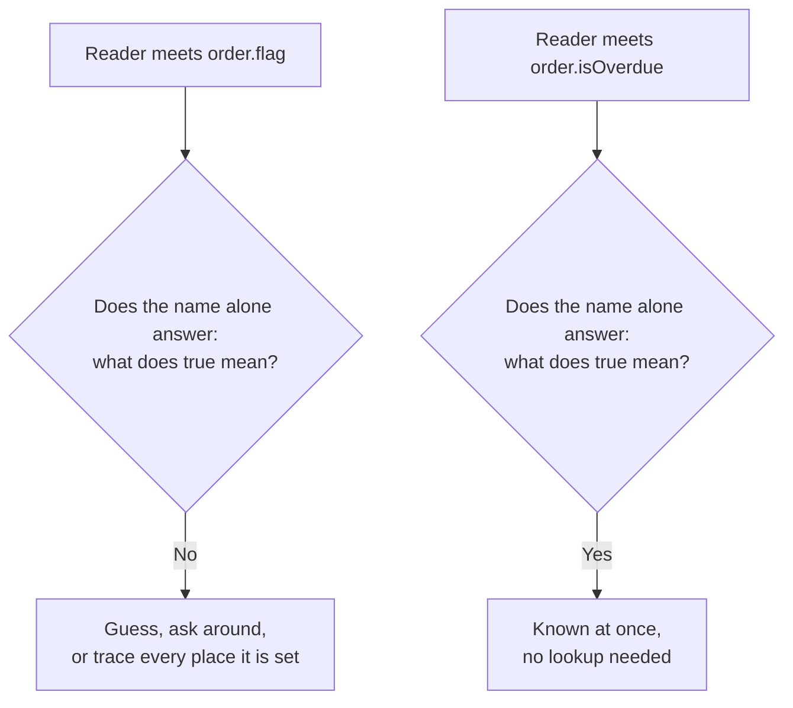
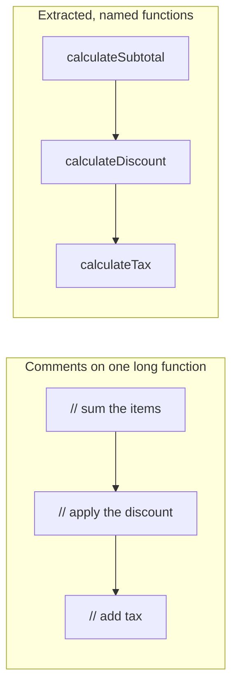

import LevelIntro from "../../../components/LevelIntro.astro";
import Checkpoint from "../../../components/Checkpoint.astro";
import PracticeCheck from "../../../components/PracticeCheck.astro";

export const unit = {
  track: "software-design",
  unitSlug: "naming",
};

L1 showed what `flag` cost once two teams loaded it with opposite meanings. L2
works out the mechanics behind that failure: what makes a name
"intention-revealing", why negation makes ambiguity worse instead of neutral,
and why giving a block of code a name documents it more reliably than a comment.

<LevelIntro
  items={[
    "What makes a name intention-revealing",
    "Why negation compounds ambiguity",
    "Extraction over comments, and how far a name travels",
  ]}
/>

## What makes a name "intention-revealing"?

**`order.flag` and `order.isOverdue` are both valid identifiers of similar
length, so why does only one of them tell you anything?**

An intention-revealing name answers the question a future reader will actually
ask ("what does this represent?", "what does `true` mean here?") inside the
name itself, without opening the implementation or interrupting a colleague.
`flag`, `data`, `temp`, `value` and `handle` all fail, and not because they are
short. None of them answers any of those questions.

<Checkpoint question="Why does order.isOverdue pass the intention-revealing test while order.flag fails it, when both are equally short and equally valid?">

Length and validity are not what decide it. What decides it is whether the name
answers the question a reader will ask. `order.isOverdue` states what `true`
means. `order.flag` answers a useless question ("is there a flag here?") and
leaves the real meaning outside the name, recoverable only by reading the code
that sets it or asking its author. Two names of the same length can carry very
different amounts of information.

</Checkpoint>

<PracticeCheck
  track={unit.track}
  unitSlug={unit.unitSlug}
  topicId="intention-revealing"
/>

## Why does negation make a vague name worse?

**Why is a boolean named `isNotDisabled` harder to use correctly than one named
`isEnabled`?** Negation adds a second step the reader must get right.

| Expression                  | Questions the reader must answer                  | Chances to go wrong   |
| --------------------------- | ------------------------------------------------- | --------------------- |
| `!order.flag`               | What does `flag` mean? Then, what is its opposite | 2                     |
| `order.isOverdue`           | Is the invoice overdue                            | 1                     |
| `!order.notificationsMuted` | Is it muted? Then flip it, which is easy          | 1 (the name is clear) |

Negation itself is not the problem: `!order.notificationsMuted` reads fine
because the name underneath is unambiguous. The problem is negation stacked on
an already ambiguous name, which forces two uncertain readings in sequence. The
practical rule is to name booleans as direct positive assertions (`isX`,
`hasX`, `canX`). Negating a clear assertion stays clear; negating an unclear one
compounds the confusion.

<PracticeCheck
  track={unit.track}
  unitSlug={unit.unitSlug}
  topicId="boolean-negation"
/>

## Why name a block instead of commenting it?

**A function sums items, applies a discount, then adds tax. Is a comment above
each step the right way to explain that?**

A comment that describes what a block does lives apart from the code and can
silently fall out of sync, because nothing stops the code from changing while
the comment stays put. An extracted, well-named function _is_ the description:
its name and its behaviour are the same artifact, so there is nothing to drift.
Comments still earn their place for explaining _why_ something non-obvious is
done, a fact the code cannot express.

<Checkpoint question="A teammate wants a comment above each step instead of extracting functions, because it is faster to write. What is the concrete risk beyond comments being less tidy?">

The risk is drift. A comment sits in a separate place from the logic it
describes, so if someone reorders the discount and tax steps, or changes what
a step does, the comment can stay exactly as written and the code still runs.
The reader gets no signal that it is now wrong. With extracted functions,
reordering the calls shows the new sequence in the function names themselves,
leaving nothing to fall out of date.

</Checkpoint>

<PracticeCheck
  track={unit.track}
  unitSlug={unit.unitSlug}
  topicId="extraction-vs-comments"
/>

## Does every name deserve this much care?

**Should a codebase never contain a short or generic-sounding name?** Not quite.
A variable scoped to three lines inside a small, obviously named function (`i`
in a simple loop) needs no long name, because its whole meaning is visible in
that small scope. What matters is **how far a name travels and how much context
surrounds it.**

| Where the name lives                              | Who can misread it                     | Care it deserves |
| ------------------------------------------------- | -------------------------------------- | ---------------- |
| Loop variable inside a 3-line function            | Anyone, but the context is in view     | Low              |
| Private helper inside one file                    | Maintainers of that file               | Medium           |
| Field shared across teams or stored in a database | Everyone, years later, without context | High             |

A shared field like `order.flag` sits in the bottom row, which is why its
vagueness did real damage.

<PracticeCheck
  track={unit.track}
  unitSlug={unit.unitSlug}
  topicId="name-reach"
/>
