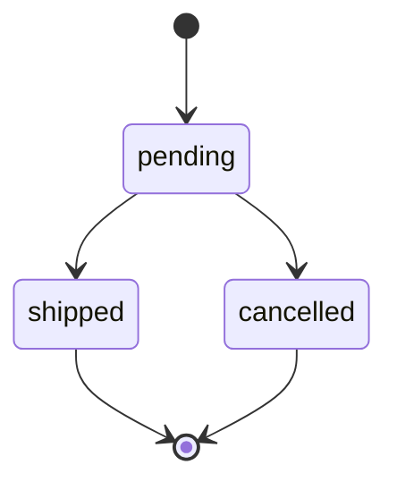

import Scenario from "../../../components/Scenario.astro";
import LevelIntro from "../../../components/LevelIntro.astro";
import Checkpoint from "../../../components/Checkpoint.astro";
import PracticeCheck from "../../../components/PracticeCheck.astro";

export const unit = {
  track: "software-design",
  unitSlug: "naming",
};

<Scenario label="One field, two meanings, replayed row by row">
  <Fragment slot="facts">
    

      
💳 <strong>Billing sets</strong> — <code>flag = true</code> meaning "invoice overdue"

      
🔔 <strong>Notifications reads</strong> — <code>flag</code> as "reminders muted"

      
🔢 2 real facts, 4 combinations to check against the rule

    

  </Fragment>

**Before reading on, predict: does the buggy "skip if flag" rule contain a
mistake in its own logic, or is the entire bug in what the name let a reader
assume?** Then predict how many of the four real-world situations the buggy
rule gets right only by luck.

</Scenario>

<LevelIntro
  items={[
    "Replaying the bug against every real situation",
    "Fixing it with two explicit fields and a positive predicate",
    "When separate booleans should become one enumerated field",
  ]}
/>

## Replaying the bug against every real situation

Two real facts exist about an order: is it overdue, and has the customer muted
reminders. That gives four situations. The correct rule is "skip the reminder
exactly when the customer has muted them". The buggy code reads `flag`, which
Billing sets from the _overdue_ fact, as if it were the _muted_ fact.

| Overdue? | Muted? | Should the reminder be skipped? | `flag` holds (Billing sets it) | Buggy "skip if flag" does | Result         |
| -------- | ------ | ------------------------------- | ------------------------------ | ------------------------- | -------------- |
| yes      | no     | no                              | true                           | skips                     | wrong          |
| yes      | yes    | yes                             | true                           | skips                     | right, by luck |
| no       | no     | no                              | false                          | does not skip             | right, by luck |
| no       | yes    | yes                             | false                          | does not skip             | wrong          |

Two of the four rows are wrong, and the two that look right do so only because
the two facts happened to agree. The worst row is the first: an overdue,
unmuted customer is silently dropped. The rule `skip if flag` is perfectly
well-formed. **The function has no logic bug; the name allowed the wrong fact
to be put in the slot.** Nothing in the code could catch that, because both
usages are syntactically valid.

<Checkpoint question="If the buggy function's logic is correct as written, what exactly does a fix have to change, and what does it leave alone?">

It has to change the names and the data, not the logic. The skip rule
("if this field is true, skip") stays identical. What changes is that the two
facts get two fields, `isOverdue` and `notificationsMuted`, so the rule can read
the field that actually means "muted". The root cause was one name serving two
purposes, so the fix removes the shared name. Rewriting the condition without
splitting the field would leave the collision in place for the next reader.

</Checkpoint>

## The fix: two explicit fields and a positive predicate

With separate fields, the rule becomes "skip if `notificationsMuted`", and the
combined question "should a reminder go out?" becomes a positively phrased
check, `isOverdue` and not `notificationsMuted`.

| `isOverdue` | `notificationsMuted` | Reminder goes out? |
| ----------- | -------------------- | ------------------ |
| true        | false                | yes                |
| true        | true                 | no                 |
| false       | false                | no                 |
| false       | true                 | no                 |

The single negation here is safe precisely because `notificationsMuted` is
unambiguous. A reviewer can guess the behaviour from the predicate's name before
reading its body.

## Extraction over comments, with numbers

Take an order of 2 items at 100 each, a 10 percent discount and 8 percent tax.
Both versions of the total function (one long body with three comments, or three
named steps) must give the same answer.

| Step     | Named function        | Working         | Result    |
| -------- | --------------------- | --------------- | --------- |
| Subtotal | `calculateSubtotal`   | 2 x 100         | 200       |
| Discount | `calculateDiscount`   | 10% of 200      | 20        |
| Tax      | `calculateTax`        | 8% of 180       | 14.4      |
| Total    | `calculateOrderTotal` | 200 - 20 + 14.4 | **194.4** |

The behaviour is identical. The difference shows up at the next edit. If someone
reorders the discount and tax steps, the named calls show the new sequence
immediately, while stale comments would keep describing the old one until
someone remembers to fix them.

## Extend the example: what if the states are mutually exclusive?

**The fix assumed `isOverdue` and `notificationsMuted` are two independent
facts. What if a field truly is "exactly one of several values", like an order
being pending, shipped or cancelled?** Splitting that into three booleans
creates combinations the real world never allows.

| `isPending` | `isShipped` | `isCancelled` | Valid state?                    |
| ----------- | ----------- | ------------- | ------------------------------- |
| true        | false       | false         | yes, pending                    |
| false       | true        | false         | yes, shipped                    |
| false       | false       | true          | yes, cancelled                  |
| true        | true        | false         | no, pending and shipped at once |
| false       | false       | false         | no, no state at all             |

The table shows the 3 valid rows and 2 examples of the invalid ones. Three booleans give 2 x 2 x 2 = 8 combinations, of which only 3 are valid, so 5
are nonsense the code must now defend against. A single enumerated field removes
them by construction:

One field, `status`, holds exactly one of three named values. The "exactly one at
a time" guarantee is built into its shape, while the name still says what it
means, so `flag`'s original failing is avoided too.

<Checkpoint question="Splitting one field into two booleans fixed the notification bug. Why would the same move make an order's pending/shipped/cancelled status worse?">

The two cases look alike (one field doing too much), but they differ in whether
the states are independent or mutually exclusive. Overdue and muted are
independent: all four combinations are meaningful. Pending, shipped and
cancelled are exclusive: an order is exactly one at a time. Three loose booleans
allow 8 combinations and only 3 mean anything, so every reader and every write
must guard against the other 5. An enumerated field keeps the "exactly one"
guarantee inside its type, which loose booleans cannot express.

</Checkpoint>

<PracticeCheck
  track={unit.track}
  unitSlug={unit.unitSlug}
  topicId="enum-vs-booleans"
/>

## A case, not the whole territory

This unit followed one bug through one pair of fields. It is a case, not the
whole territory, so test the idea on others:

- **What changes if three teams read `flag` instead of two?** Does the number of
  possible wrong readings stay the same, or grow?
- **What changes if the bug had crashed loudly instead of skipping silently?**
  How would the months-undetected total in the demo change, and what does that
  say about which naming failures are the most expensive?
- **What if the field is already in production data under the old name?**
  Renaming costs a migration; which readers and writers must change together?

## Failure modes

| Failure mode                                                                  | What it gets wrong                                                               |
| ----------------------------------------------------------------------------- | -------------------------------------------------------------------------------- |
| Reusing a generic field name (`flag`, `data`, `value`) across unrelated ideas | Nothing stops two readers from loading it with contradictory meanings            |
| Negating an already ambiguous name (`!order.flag`)                            | Turns one uncertain question into two, doubling the chance of a reversed reading |
| Explaining a block with a comment instead of extracting a named function      | The comment can drift from the code; a function's name cannot                    |
| Splitting a true either/or state into several independent booleans            | Allows invalid combinations that an enumerated field rules out by construction   |
| Giving every name the same care regardless of reach                           | A shared field and a 3-line loop variable carry very different risk              |
