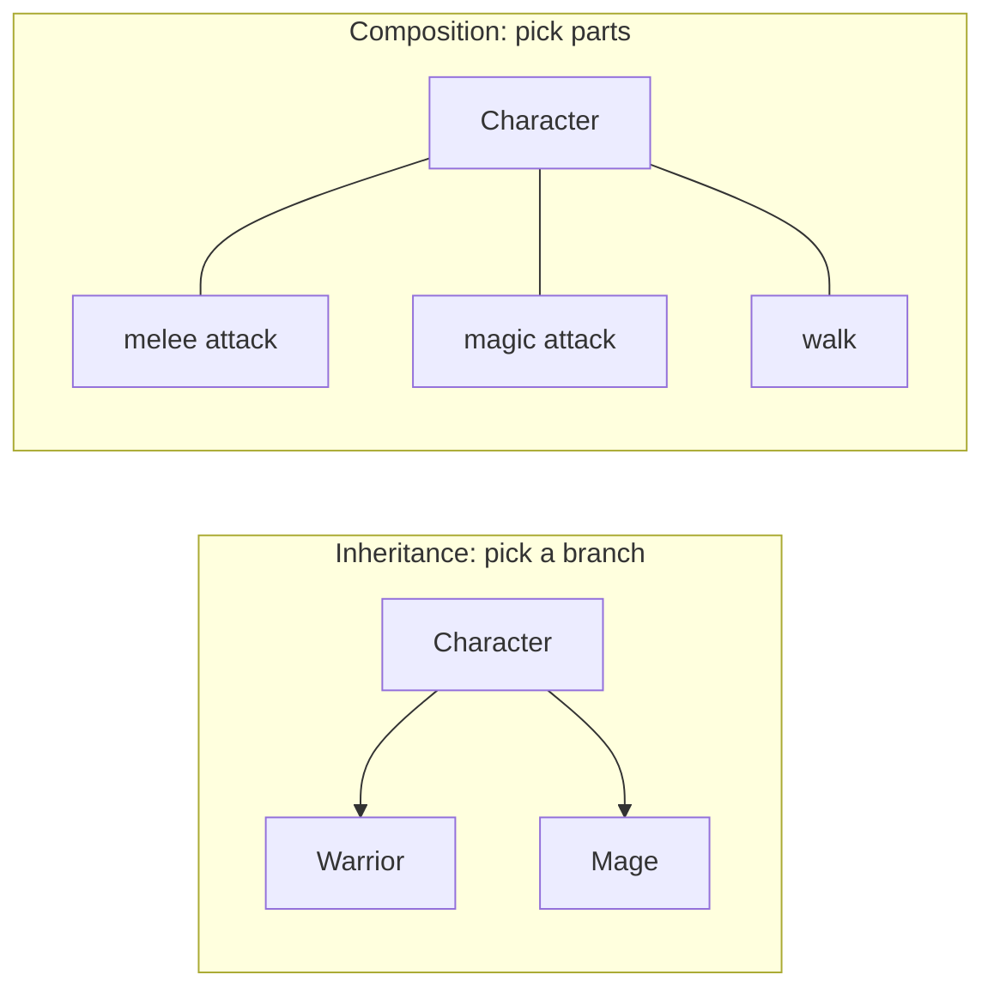

import Scenario from "../../../components/Scenario.astro";
import LevelIntro from "../../../components/LevelIntro.astro";
import PracticeCheck from "../../../components/PracticeCheck.astro";

export const unit = {
  track: "software-design",
  unitSlug: "oop-design-trade-offs",
};

<Scenario label="A clean class tree meets a character that needs two parents">
  <Fragment slot="facts">
    

      
🏗️ <strong>The tree</strong> — Warrior and Mage both extend Character, one attack style each

      
🧙‍♂️ <strong>The request</strong> — a Battle Mage who fights in melee AND casts spells

      
🚧 <strong>The catch</strong> — a class may extend exactly one parent

    

    

      

        
Parents a class may extend1

        

      

      

        
Parents Battle Mage needs2

        

      

    

  </Fragment>

A small game has a `Character` base class. `Warrior` extends it and swings a
sword. `Mage` extends it and casts spells. It works well, until design asks
for a **Battle Mage** who does both. **Should `BattleMage` extend `Warrior` or
`Mage`?** Whichever you pick, you have to copy the other class's attack code
into it, because a class can only extend one parent.

The tree was built on the quiet assumption that every character has exactly
one attack style, forever. The new request does not fit "is a Warrior or is a
Mage", because the real relationship was never "is a" in the first place.

</Scenario>

<LevelIntro
  items={[
    "Inheritance ('is-a') vs. composition ('has-a')",
    "Why the Battle Mage broke the tree",
    "Why more independent traits multiply the cost",
  ]}
/>

## What are the two ways to relate objects, and which fits when?

**If one relationship broke the design, what is the other choice?** Two models
cover most object design:

| Model       | Reads as | How an object gets its behavior   | Fits when                                      |
| ----------- | -------- | --------------------------------- | ---------------------------------------------- |
| Inheritance | "is-a"   | Extends a parent class            | One stable way things differ, true by nature   |
| Composition | "has-a"  | Is handed small independent parts | Several traits must be mixed freely per object |

The failure is not that inheritance is bad. Inheritance commits early to
**one** dimension of variation (the one parent you extend). Composition lets
several independent dimensions combine without a new class for each pairing.

<PracticeCheck
  track={unit.track}
  unitSlug={unit.unitSlug}
  topicId="is-a-vs-has-a"
/>

## Key terms

- **Inheritance** — a subclass extends a parent, reusing and overriding its behavior; models "is-a."
- **Composition** — an object is assembled from independent parts handed to it; models "has-a."
- **Axis of variation** — one independent way objects differ (movement style, attack style).
- **Combinatorial explosion** — when independent axes are each modeled as class trees, the classes needed to cover every pairing multiply instead of add.
- **Strategy pattern** — the common way to apply composition: pass the behavior in as a swappable part instead of hardcoding it.

## What this unit covers

L2 explains why one axis fits a tree but two do not, and puts numbers on the
cost. L3 shows the composition rewrite as a minimal piece of code, then asks
you to extend it with a third axis.
