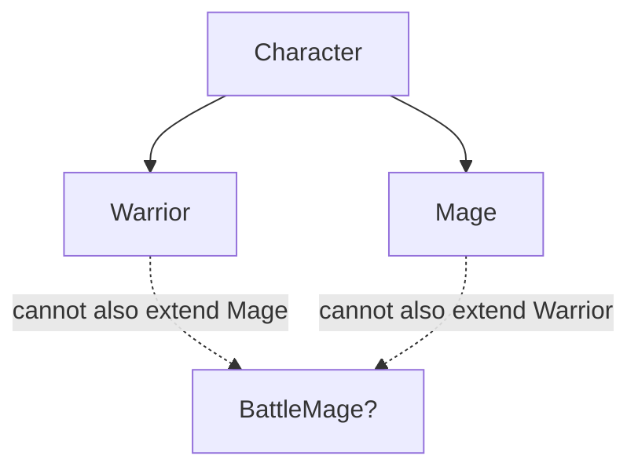
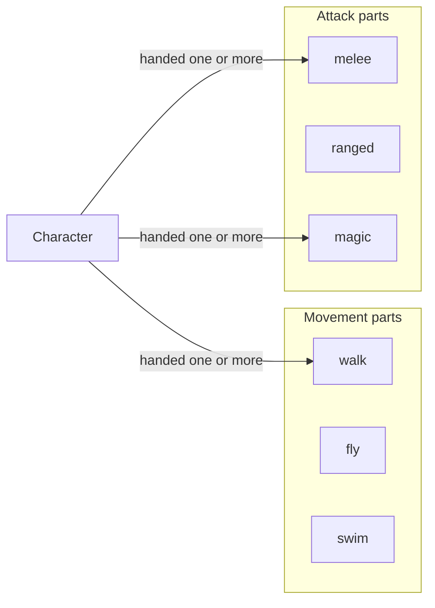
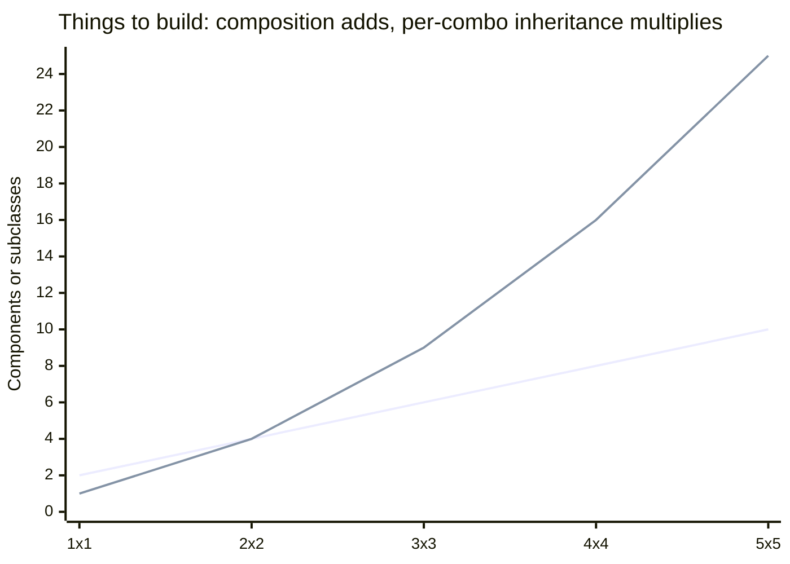

import LevelIntro from "../../../components/LevelIntro.astro";
import Checkpoint from "../../../components/Checkpoint.astro";
import PracticeCheck from "../../../components/PracticeCheck.astro";

export const unit = {
  track: "software-design",
  unitSlug: "oop-design-trade-offs",
};

L1 named the two models, "is-a" and "has-a", and showed the Battle Mage
breaking a tree. L2 works out exactly why it broke, and what the failure costs
once more traits are added.

<LevelIntro
  items={[
    "Why one axis fits a tree and two do not",
    "Composing behaviors instead of inheriting them",
    "How the cost grows as axes multiply",
  ]}
/>

## Why does one axis fit a tree, and two do not?

**If Warrior and Mage worked fine, why did a second need break them?** Because
a tree has exactly one path from any node back to the root. Each subclass picks
one branch, which is perfect for **one** axis (attack style) and wrong for
something that must combine two.

The dotted lines are not valid inheritance. They show the two directions
`BattleMage` would need to reach, and single inheritance allows only one.

<Checkpoint question="Why can't BattleMage just extend both Warrior and Mage, or implement two interfaces to get both attacks?">

Most mainstream languages allow exactly one `extends` per class. Even where a
class may implement several interfaces, an interface only declares a contract.
The attack code itself still has to live in some class, and a class cannot
inherit two separate implementations at once. The limit comes from the tree
shape of inheritance, so the fix has to change the shape, not loosen which
classes may extend which.

</Checkpoint>

<PracticeCheck
  track={unit.track}
  unitSlug={unit.unitSlug}
  topicId="one-axis-vs-two"
/>

## What shape fits "needs both melee and magic"?

**If a tree is the wrong shape, what is the right one?** A set of independent
parts, chosen per object, with no shared ancestry between the parts:

A `Character` does not inherit a movement or attack style. It is handed them.
A Battle Mage is not a special subclass at all: it is a `Character` handed a
melee part and a magic part. Nothing about "has-a" limits an object to one part
of each kind.

## What does it cost to model two axes as class trees instead?

**If a game ends up with 3 movement styles and 3 attack styles, how many things
must exist?** Under composition each style is one part. Under
inheritance-per-combination, every pairing is its own subclass
(`FlyingMage`, `SwimmingWarrior`, and so on):

| Styles per axis | Composition (n + n) | Inheritance-per-combo (n × n) |
| --------------- | ------------------- | ----------------------------- |
| 1               | 2                   | 1                             |
| 2               | 4                   | 4                             |
| 3               | 6                   | 9                             |
| 4               | 8                   | 16                            |
| 5               | 10                  | 25                            |

Composition costs `n + m` and inheritance-per-combination costs `n × m`. The
demo below uses the same formulas: drag either slider and watch the gap. At
(3, 3) it reads 6 against 9, the exact numbers in the table.

<Checkpoint question="A third independent axis arrives: 3 defense styles (block, dodge, parry), with 3 movement and 3 attack styles already. How do the two approaches compare now?">

Composition adds 3 parts, from 6 to 9. Inheritance-per-combination multiplies
by every new axis: `3 × 3 × 3 = 27` subclasses, up from 9. Composition stays
additive however many axes appear, so the gap does not just persist, it widens
faster with each axis.

</Checkpoint>

<PracticeCheck
  track={unit.track}
  unitSlug={unit.unitSlug}
  topicId="combinatorial-cost"
/>

## When is inheritance still the right tool?

**Does this mean composition should always replace inheritance?** No. When a
category has one stable axis and a true "is-a" relationship, a small tree is
simpler. `SavingsAccount` and `CheckingAccount` really are `Account`s that
share `deposit` and `withdraw` and differ only in how interest is calculated.
No second axis is threatening to combine with "account type," so a shallow tree
is appropriate.

| Situation                                       | Better fit                                 |
| ----------------------------------------------- | ------------------------------------------ |
| One stable axis, true "is-a", small shared core | Inheritance                                |
| Two or more independent traits mixed per object | Composition                                |
| A second axis appearing later is plausible      | Watch for it; switch before the tree grows |

## Failure modes at this level

- **Inheritance as the default tool.** It fits one shape of problem; treating it as universal produces the Battle Mage.
- **Deepening the tree to patch an explosion.** Adding `FlyingBattleMage` and friends treats the symptom. The cause is two axes modeled as one tree.
- **Over-correcting.** A single stable "is-a" does not need composition's extra indirection.
