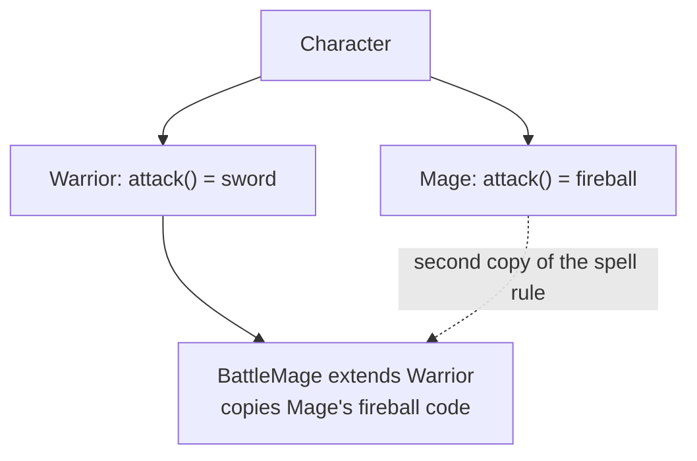
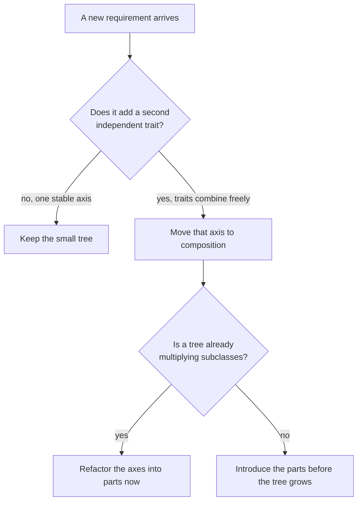

import Scenario from "../../../components/Scenario.astro";
import LevelIntro from "../../../components/LevelIntro.astro";
import Checkpoint from "../../../components/Checkpoint.astro";
import PracticeCheck from "../../../components/PracticeCheck.astro";

export const unit = {
  track: "software-design",
  unitSlug: "oop-design-trade-offs",
};

<Scenario label="Design adds a third trait. Which design absorbs it?">
  <Fragment slot="facts">
    <div class="not-prose flex flex-col gap-2 text-sm text-slate-700 dark:text-slate-300">
      <div class="flex items-center gap-1.5"><span>🚶</span> <strong>Movement</strong> — walk, fly, swim (3)</div>
      <div class="flex items-center gap-1.5"><span>⚔️</span> <strong>Attack</strong> — melee, ranged, magic (3)</div>
      <div class="flex items-center gap-1.5"><span>🛡️</span> <strong>Defense (new)</strong> — block, dodge, parry (3)</div>
    </div>
    <div class="not-prose mt-3 flex flex-col gap-1.5 text-xs text-slate-700 dark:text-slate-300">
      <div>
        <div class="flex justify-between"><span>Composition: parts to write</span><span>9</span></div>
        <div class="h-2 w-full overflow-hidden rounded-full bg-slate-200 dark:bg-slate-700"><div class="h-full rounded-full bg-emerald-500 animate-fill-bar" style="--target-width: 33%"></div></div>
      </div>
      <div>
        <div class="flex justify-between"><span>One subclass per combination</span><span>27</span></div>
        <div class="h-2 w-full overflow-hidden rounded-full bg-slate-200 dark:bg-slate-700"><div class="h-full rounded-full bg-rose-500 animate-fill-bar" style="--target-width: 100%"></div></div>
      </div>
    </div>
  </Fragment>

The game from L1 now has 3 movement styles and 3 attack styles, and design
asks for 3 defense styles on top. **Before writing any code, which design
survives this request with the least rework, and by how much?**

The numbers in the panel are the whole argument in miniature. The rest of this
level shows where the tree breaks, what the rewrite looks like, and what it
does and does not prove.

</Scenario>

<LevelIntro
  items={[
    "Where the inheritance version breaks",
    "The composition rewrite, behaviors as data",
    "What the rewrite proves and what it does not",
  ]}
/>

## Where exactly does the inheritance version break?

**What does the tree look like at the moment the Battle Mage request lands?**
Two sibling classes, each with one hardcoded `attack()`, and nowhere to put a
class that needs both:



Extending `Warrior` and pasting in `Mage`'s spell code leaves two sources of
truth for one spell. When fireball damage changes, one copy gets missed. The
usual next move is `FlyingBattleMage`, `SwimmingBattleMage`, and so on, which is
the combinatorial explosion from L2 growing branch by branch.

<Checkpoint question="Why does adding FlyingBattleMage, SwimmingBattleMage, and similar subclasses not fix the Battle Mage problem?">

Because the problem is structural, not a shortage of classes. Movement and
attack are two independent axes, and a tree can only represent one. Each new
subclass is another pairing of the two axes, so every future movement or attack
style multiplies the class count again. The deeper tree postpones the pain and
raises the price of every later change.

</Checkpoint>

## What does the composition rewrite look like?

**If behaviors are the parts, what does the character class need?** Only a place
to hold them. This is the one place code beats a diagram, because the point is
what the constructor accepts:

```js
const walk = () => "walks across the ground";
const meleeAttack = () => "swings a sword for 10 damage";
const magicAttack = () => "casts a fireball for 15 damage";

class GameCharacter {
  constructor(name, moveBehaviors, attackBehaviors) {
    this.name = name;
    this.moveBehaviors = moveBehaviors;
    this.attackBehaviors = attackBehaviors;
  }
  attack() {
    return this.attackBehaviors.map((b) => `${this.name} ${b()}`);
  }
}

new GameCharacter("Rin", [walk], [meleeAttack, magicAttack]).attack();
// ["Rin swings a sword for 10 damage", "Rin casts a fireball for 15 damage"]
```

`GameCharacter` never says what attacking looks like. It iterates whatever list
it was handed, so a Battle Mage is a longer array at the call site, with zero
new classes.

<Checkpoint question="The Battle Mage needed no new class, just an array with two functions. What about GameCharacter made that possible, which Warrior and Mage lacked?">

Attack behavior is **data passed in**, not a method baked into a subclass.
`attack()` iterates a list, so two behaviors instead of one is a call-site
change. `Warrior` and `Mage` hardcoded one `attack()` body each: there was a
method to override, but no list to extend, and a method cannot "override into
two behaviors at once."

</Checkpoint>

<PracticeCheck
  track={unit.track}
  unitSlug={unit.unitSlug}
  topicId="composition-in-practice"
/>

## How do you write the character from the parts?

**If you were handed only the idea, could you build it?** The next exercise
section asks you to write the small function that turns lists of parts into a
character. It is the one place where writing the code is the understanding.

<PracticeCheck
  track={unit.track}
  unitSlug={unit.unitSlug}
  topicId="compose-behaviors"
/>

## What does this rewrite prove, and what does it not?

**Does it mean the original `Character` base class was a mistake?** Not
necessarily. If the game only ever needed one attack style per character, the
tree would have been simpler and perfectly fine. What the rewrite proves is
narrower: once a second independent axis appears, composition absorbs it
without new classes while single inheritance cannot.



| Failure mode                                           | What it gets wrong                                                      |
| ------------------------------------------------------ | ----------------------------------------------------------------------- |
| Composing every class, even single-axis ones           | Adds indirection to a problem with no second axis                       |
| Patching a broken tree with a deeper tree              | Treats a structural limit as if more branches would help                |
| Believing composition means sharing no code            | `GameCharacter` is still one shared class; only the variation moved out |
| Not noticing a second axis until the tree has exploded | Battle Mage was the signal; noticing earlier avoids the rewrite         |
| Treating strategy as the only form of composition      | Holding another object and delegating to it is composition too          |

## This is a case, not the whole territory

The game is one example of a pattern, and the numbers (3 and 3, then a third
axis) were chosen to be countable. **Try extending it yourself:** the defense
axis arrives. What does `GameCharacter` need to add, and could the tree version
have absorbed it without a third round of subclasses? Then change the
situation: what if two of the axes are not independent, for example a
character that can only parry while walking? Which part of the clean `n + m`
count survives, and what would you now have to decide in code?
