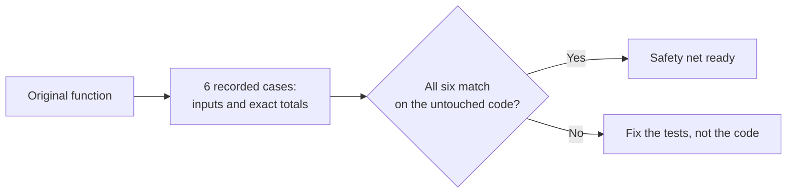
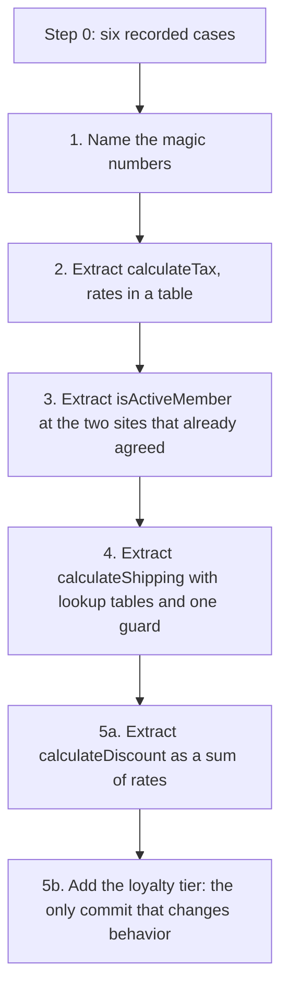

import Scenario from "../../../components/Scenario.astro";
import LevelIntro from "../../../components/LevelIntro.astro";
import Checkpoint from "../../../components/Checkpoint.astro";
import PracticeCheck from "../../../components/PracticeCheck.astro";

export const unit = {
  track: "software-design",
  unitSlug: "refactoring-technique",
};

L2 gave the loop and the catalog. This level runs the loop on Boxtree's
actual `calculateOrderTotal`, mostly as tables and diagrams, because the
point of each step is what it _preserves_, and that is easier to see in a
list of rules and a sequence of commits than in 68 lines of code. Code
appears only where reading it is the point.

<Scenario label="The function Dana has to change, and the tests that already exist">
  <Fragment slot="facts">
    <div class="not-prose flex flex-col gap-2 text-sm text-slate-700 dark:text-slate-300">
      <div class="flex items-center gap-1.5">
        <span>🧾</span> <strong>Inputs</strong> — a customer, a cart of
        items, a shipping region, a gift-wrap flag
      </div>
      <div class="flex items-center gap-1.5">
        <span>🧮</span> <strong>Responsibilities in one function</strong> —
        subtotal, member discount, bulk discount, shipping, tax, gift wrap
        fee (6 things, 1 function)
      </div>
      <div class="flex items-center gap-1.5">
        <span>🧪</span> <strong>Existing tests</strong> — 6 cases, written
        first, before any structural change
      </div>
      <div class="flex items-center gap-1.5">
        <span>🐛</span> <strong>A quirk hiding in plain sight</strong> — one
        of the three membership checks doesn't match the other two
      </div>
    </div>
  </Fragment>

**One of the function's three membership checks disagrees with the other two.
Dana notices while reading it. Should the cleanup fix it?**

The function works. Customers are being charged according to it right now,
in production. "It looks messy" is not the same claim as "it is wrong," and
refactoring only promises to fix the first one. Hold your answer until Step 3.

</Scenario>

<LevelIntro
  items={[
    "Recording today's behavior, quirks included",
    "Five behavior-preserving steps, then one deliberate feature",
    "Failure modes: no tests, deadlines, and when to stop",
  ]}
/>

## Step 0: what does the function do today, and how do we pin it down?

**Before any structural change, what exactly would a test have to record?**
The function's rules, as they are now:

| Part     | Rule as written today                                                                          |
| -------- | ---------------------------------------------------------------------------------------------- |
| Subtotal | Sum of price times quantity                                                                    |
| Discount | Active member: 10%. Over 200: active member adds 5%, anyone else gets a flat 8%                |
| Shipping | US: 4.99, or free over 75. CA: 8.99, or 3.99 over 75. EU: 12.99 always. Anywhere else: 19.99   |
| Tax      | On subtotal minus discount. US 7%, CA 5%, EU 20%, anywhere else 0%                             |
| Gift fee | Member 1.50, everyone else 2.99. This branch checks only `isMember`, not `membershipSuspended` |

"Active member" means `isMember && !membershipSuspended`. The gift fee is the
quirk: it is the one place that never looks at the suspension flag.

The characterization tests, written before touching anything. Totals were
computed by running the original function:

| Case                                        | Input             | Total  |
| ------------------------------------------- | ----------------- | ------ |
| Guest, small US order                       | 50, US            | 58.49  |
| Active member, over 200 (discounts stack)   | 300, US           | 272.85 |
| Guest, over 200 (flat 8%)                   | 300, US           | 295.32 |
| EU: fixed shipping, 20% tax                 | 100, EU           | 132.99 |
| Unknown region: default shipping, 0% tax    | 100, MX           | 119.99 |
| Suspended member with gift wrap (the quirk) | 50, US, gift wrap | 59.99  |



The last row is not there because suspended members _should_ get the cheaper
gift fee. It is there because they currently _do_: 50 + 4.99 shipping + 3.50
tax + 1.50 gift fee = 59.99.

<Checkpoint question="Why does the suite include a test for the suspended-member gift-wrap case, when that looks like it might be a bug rather than intended behavior?">

Because at Step 0 the job is not to decide what the code _should_ do. It is
to record what it _does_, so every later step can be checked against that
exact behavior. If the tests silently encoded what the author assumed was
intended, a refactor that correctly preserved the real behavior would fail
the test, and the test would be the thing that was wrong. Whether the quirk is
a bug worth fixing is a separate decision, made later as its own
behavior-changing commit.

</Checkpoint>

<PracticeCheck
  track={unit.track}
  unitSlug={unit.unitSlug}
  topicId="characterization-quirk"
/>

## Steps 1 to 5: which small moves, in which order?

**Why this order, and what does each commit claim?** Every commit below runs
the same six cases and must match them all before the next one starts.



| Step | Move                                          | Smell addressed           | Behavior change?      |
| ---- | --------------------------------------------- | ------------------------- | --------------------- |
| 1    | Extract Variable (named constants)            | Magic numbers             | No                    |
| 2    | Extract Function (`calculateTax`)             | Long function             | No                    |
| 3    | Remove Duplication (`isActiveMember`)         | Duplicated logic          | No                    |
| 4    | Guard clause and lookup (`calculateShipping`) | Deep nesting              | No                    |
| 5a   | Extract Function, rate-based                  | Sets up the feature       | No                    |
| 5b   | Loyalty tier and capped total                 | None: this is the feature | **Yes, deliberately** |

Step 3 is where the quirk earns its keep. The extracted check is two lines:

```js
function isActiveMember(customer) {
  return customer.isMember && !customer.membershipSuspended;
}
```

It replaces the two sites that already wrote out the full condition. The
gift-fee branch checks only `customer.isMember`, and pointing it at
`isActiveMember` would look like the same harmless cleanup. It is not: a
suspended member's gift fee would jump from 1.50 to 2.99, and the sixth case
would go red.

<Checkpoint question="Step 3 deliberately leaves the gift-wrap branch alone, even though it looks like the same bug the other two branches had. Why not fix all three while already in this code?">

Because "these three checks are inconsistent" and "the gift-wrap one is wrong"
are two different claims, and only the first is something a refactor may act
on. Extracting the shared check at the two matching sites changes no output,
and the recorded cases prove it. Changing the gift-wrap site would change a
real customer's total for a real input, which is a behavior change however
obviously correct it looks. It gets its own commit, with the test updated on
purpose, instead of hiding inside a commit whose whole claim is "nothing
changed."

</Checkpoint>

Step 4 is the one most likely to hide a mistake, so check the mapping rather
than trust it: US over 75 maps to 0, CA over 75 to 3.99, and every other
combination falls back to the base table (US 4.99, CA 8.99, EU 12.99, anything
else 19.99). EU never appears in the discounted table, so it stays 12.99 at
any subtotal, exactly as before.

## Step 5: how does the feature land on the cleaned-up structure?

**Why is the feature cheap now, when it would have been another nested `if`
before?** After step 5a, discount is a sum of rates instead of a pre-summed
amount. The loyalty tier (bronze 0%, silver 5%, gold 10%) is one more rate in
that sum, and the product rule is a cap: the combined discount never exceeds
20%.

```js
const MAX_COMBINED_DISCOUNT_RATE = 0.2;

function combineDiscountRates(...rates) {
  const total = rates.reduce((sum, r) => sum + r, 0);
  return Math.min(total, MAX_COMBINED_DISCOUNT_RATE);
}
```

This is new behavior, so it is honest for it to be its own commit with its own
new test. Gold member, order of 300 in the US:

| Rate    | Value                                      |
| ------- | ------------------------------------------ |
| Member  | 10%                                        |
| Bulk    | 5%                                         |
| Loyalty | 10%                                        |
| Sum     | 25%, capped to 20%, so discount = 60       |
| Total   | 300 - 60 + 0 shipping + 16.80 tax = 256.80 |

A test that has to be added or changed to pass is the tell that a commit
changed behavior, which a refactor commit must never require.

<PracticeCheck
  track={unit.track}
  unitSlug={unit.unitSlug}
  topicId="capped-rates"
/>

## Trade-offs, edge cases, failure modes

| Situation                                | What goes wrong                                                       | What to do instead                                                         |
| ---------------------------------------- | --------------------------------------------------------------------- | -------------------------------------------------------------------------- |
| No tests exist yet                       | Every "refactor" is an unverified rewrite wearing the name            | Write characterization tests for current behavior first                    |
| Deadline with no slack for a false start | A step goes wrong mid-way with no time to finish or revert cleanly    | Ship the smallest surgical patch; schedule the refactor when there is room |
| Refactor and feature in one commit       | A failure cannot say whether structure or behavior is at fault        | Structural commits first (tests unchanged), feature commit last            |
| Code scheduled for deletion              | Cleanup effort on code with no future never pays back                 | Skip it, after checking the deletion date is real                          |
| "Fixing" a quirk mid-refactor            | A test goes red and nobody knows if the refactor or the fix caused it | Make the fix its own decision and its own commit                           |

<PracticeCheck
  track={unit.track}
  unitSlug={unit.unitSlug}
  topicId="when-to-skip"
/>

**One worked example is a case, not the whole territory.** Two questions to
carry beyond what is shown. What changes about this sequence if
`calculateOrderTotal` had _zero_ tests when Dana inherited it: where would
characterization tests come from, and what does "current behavior" even mean
for inputs nobody has ever tried? And if a seventh region needed support next,
would you extend `calculateShipping`'s tables the same way Step 4 built them,
or does a seventh case suggest the tables have outgrown their shape?
