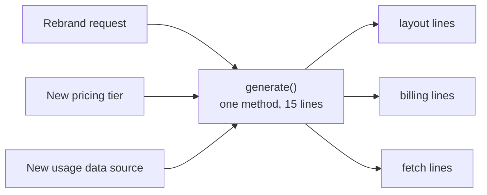

import Scenario from "../../../components/Scenario.astro";
import LevelIntro from "../../../components/LevelIntro.astro";
import PracticeCheck from "../../../components/PracticeCheck.astro";

export const unit = {
  track: "software-design",
  unitSlug: "single-responsibility",
};

<Scenario label="The stray edit that overbilled every customer">
  <Fragment slot="facts">
    

      
🎨 <strong>Request</strong> — rebrand the PDF: new fonts, new header, a logo

      
✍️ <strong>Edit made</strong> — layout lines, in a method that also computes billing

      
💥 <strong>Stray change</strong> — one adjacent line: <code>0.001</code> → <code>0.01</code>

      
📉 <strong>Impact</strong> — every API-call customer billed 10x for a month

    

    

      

        
Lines in the method unrelated to a layout edit10 of 15

        

      

    

    

      Nobody touched billing on purpose. The billing math just happened to live in the same method as the layout code someone else needed to change. (An illustrative case, with round numbers chosen for the example.)
    

  </Fragment>

A designer asks for a rebrand: new fonts, a new header, a logo on the monthly
invoice PDF. An engineer opens `MonthlyReportGenerator.generate()` to make the
change, and while editing the layout lines brushes past an adjacent line that
sets the billing rate. The rate goes from `0.001` to `0.01` by accident. The
rebrand ships. Two weeks later, finance finds every API-call customer was
billed 10 times too much.

**The engineer never meant to touch billing. So what actually caused this:
carelessness, or something about how the code was organized that made billing
easy to hit while doing something unrelated?**

</Scenario>

<LevelIntro
  items={[
    "The real test: reasons to change",
    "Why the boundary depends on the codebase",
    "The overcorrection to avoid",
  ]}
/>

## What does "one responsibility" actually mean?

**If the method reads top to bottom as "generate the report", why does it still
count as a problem?** Because "does one thing" is a feeling about how code
reads, and the incident came from how code _changes_. The test that predicts
the incident is different:

> A unit of code has a **single responsibility** if only one kind of change
> would ever require editing it.

Name the reasons someone might open `generate()` to edit it, and the count
appears:

Three unrelated requests, three unrelated owners, one place to edit. That is
the shape to look for. This test comes from `software-design/cost-design`, which
explains why coupling like this is expensive. This unit makes it a repeatable
procedure.

| Reading "does one thing" as...           | `generate()` verdict                                                                 |
| ---------------------------------------- | ------------------------------------------------------------------------------------ |
| One literal block of code, one method    | Passes: a single method that reads as "generate the report"                          |
| One reason to change (the real SRP test) | Fails: a rebrand, a pricing change and a new data source are three unrelated reasons |

A function can have several literal steps and still pass, if every step serves
one purpose. A ten-line function can fail if two of those lines answer to
different owners.

<PracticeCheck
  track={unit.track}
  unitSlug={unit.unitSlug}
  topicId="reasons-to-change"
/>

## Is the boundary the same in every codebase?

**Two teams both have validation rules and error-message wording in one
function. One should split them and one should not. What decides which?** The
people and schedules behind the changes, not the code:

| System                                                            | Who changes the rules | Who changes the wording | Same reason to change? |
| ----------------------------------------------------------------- | --------------------- | ----------------------- | ---------------------- |
| Small app, one developer owns both                                | The developer         | The developer           | Yes: keep together     |
| Larger product, compliance owns rules, a writer owns the messages | Compliance team       | A UX writer             | No: separate           |

So the same code can be correctly unsplit in one system and a violation in
another. SRP is a judgment about what is likely to change independently _here_,
not a rule with one universal answer.

<PracticeCheck
  track={unit.track}
  unitSlug={unit.unitSlug}
  topicId="context-boundary"
/>

## What goes wrong if you overcorrect?

- **The overcorrection**: splitting code into many tiny functions because each
  "does less", without checking that the pieces have independent reasons to
  change. You get more files and more jumps while reading, and none of the
  benefit. This is the over-engineering failure mode from `cost-design`.
- **The symptom of a real violation**: a change requested for one reason forces
  an edit to code that also handles something unrelated, and the unrelated part
  is at risk only because it sits nearby.
- **The practical skill**: before splitting or merging, name the actual reasons
  the code might change, and let those, not line count or a feeling that it
  "does a lot", decide where the boundary goes.

L2 turns this into a step-by-step procedure with a worked split, and L3 returns
to the billing incident to see what the fix changes.
