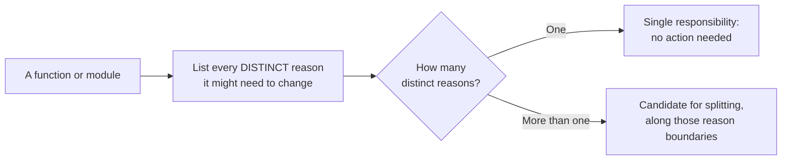
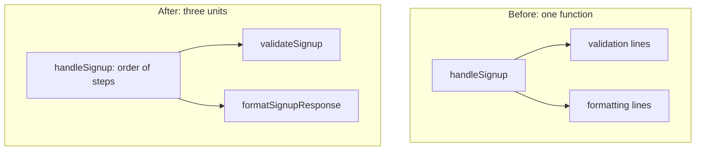
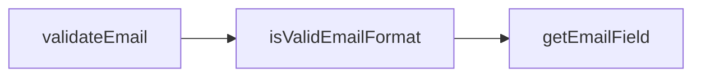

import Scenario from "../../../components/Scenario.astro";
import LevelIntro from "../../../components/LevelIntro.astro";
import Checkpoint from "../../../components/Checkpoint.astro";
import PracticeCheck from "../../../components/PracticeCheck.astro";

export const unit = {
  track: "software-design",
  unitSlug: "single-responsibility",
};

<Scenario label="One signup function, two engineers, one Friday">
  <Fragment slot="facts">
    

      
🔐 <strong>Reason 1</strong> — password policy needs a special-character rule

      
📦 <strong>Reason 2</strong> — response envelope needs an API-version field

      
👥 <strong>Both land</strong> — in the same function, same week, different engineers

    

    

      Both changes are individually simple. The risk is that each engineer has to read past the other's logic to make theirs.
    

  </Fragment>

`handleSignup(request)` validates the request and formats the success
response, all in one function. This week, one engineer must add a
special-character rule to the password policy, and a second, unrelated
engineer must add an API-version field to the response envelope. Neither
change is hard on its own.

**Both changes touch the same function. Is that a coincidence of timing, or a
sign the function was carrying two responsibilities all along, and how would
you tell the difference?**

</Scenario>

<LevelIntro
  items={[
    "The decision procedure: count distinct reasons",
    "Why the orchestrator still has one reason",
    "Splitting too far: no independent reason to change",
  ]}
/>

## What is the decision procedure?

**What do you actually do at the keyboard when you suspect a function is doing
too much?** You do not count lines. You list the reasons it could change and
count the distinct ones:

The word "distinct" does the real work. "The validation rules changed" and "the
validation error messages changed" can be one reason in a small team (one
person owns both and they move together) or two reasons in a larger one (a
compliance team owns the rules, a UX writer owns the wording, on unrelated
schedules). The same code can pass in one context and fail in another.

Run the procedure on `handleSignup`:

| Part of the function                    | Who asks for a change       | Reason          |
| --------------------------------------- | --------------------------- | --------------- |
| Email must contain `@`; password length | Business and security rules | Validation      |
| Shape of the returned envelope          | API consumers, versioning   | Response format |

Two rows, two owners, two schedules. A password-policy rule and an envelope
field are not variations of one concern.

## Where does the split go, and what is left over?

**Doesn't `handleSignup` still do both things, just by calling them?** No. After
the split it owns a different reason to change: the _sequence_ of signup steps
(for example, adding a third step). Calling other units is not the same as
owning their logic.

| Function               | Its one reason to change             | Untouched by                                   |
| ---------------------- | ------------------------------------ | ---------------------------------------------- |
| `validateSignup`       | Business validation rules change     | Response format changes, step ordering changes |
| `formatSignupResponse` | Response envelope shape changes      | Validation rule changes, step ordering changes |
| `handleSignup`         | The sequence of signup steps changes | Validation rules, response format              |

<Checkpoint question="A third engineer must add rate-limiting (reject a signup if the same IP has tried more than 5 times in a minute). In the split version, does that change belong inside validateSignup, formatSignupResponse, or handleSignup, and why?">

None of the three, cleanly. Rate-limiting is a fourth distinct reason to
change (abuse policy, not business validation and not response formatting), so
forcing it into `validateSignup` recreates the same problem one level down: a
function with two unrelated reasons again. The test keeps applying after a
split. A new kind of change is a signal to ask the same question again, this
time about a `checkRateLimit` step that `handleSignup` would orchestrate
alongside the other two.

</Checkpoint>

<PracticeCheck
  track={unit.track}
  unitSlug={unit.unitSlug}
  topicId="decision-procedure"
/>

## When should you not split?

**If splitting along reasons to change is good, is splitting further always
better?** Apply the same test to a function that checks an email:

`getEmailField` exists only to feed `isValidEmailFormat`, and both exist only to
implement `validateEmail`. None has a reason to change independently of the
others. The split buys no independent evolution; it adds three names to track
and three extra jumps to follow when reading, which is a real ongoing cost.

<Checkpoint question="handleSignup before the split and the three-function email chain are both 'wrong' by the reasons-to-change test, but for opposite reasons. What is the one-sentence difference between the two mistakes?">

`handleSignup` bundled two _genuinely independent_ reasons to change into one
place; the email chain broke _one_ reason to change into three places with no
independent existence. The test is not "more functions is safer" or "fewer is
safer". It is whether each resulting unit maps to exactly one reason, and both
directions of getting that wrong carry a cost.

</Checkpoint>

The `handleSignup` split paid off because validation and formatting plausibly
change independently, for different reasons, owned by different people. The
email chain did not, because its pieces have no independent existence. The test
is never "can this be split": almost anything can be split further. It is
"would splitting let two different future changes happen without touching each
other's code."

<PracticeCheck
  track={unit.track}
  unitSlug={unit.unitSlug}
  topicId="overcorrection"
/>
