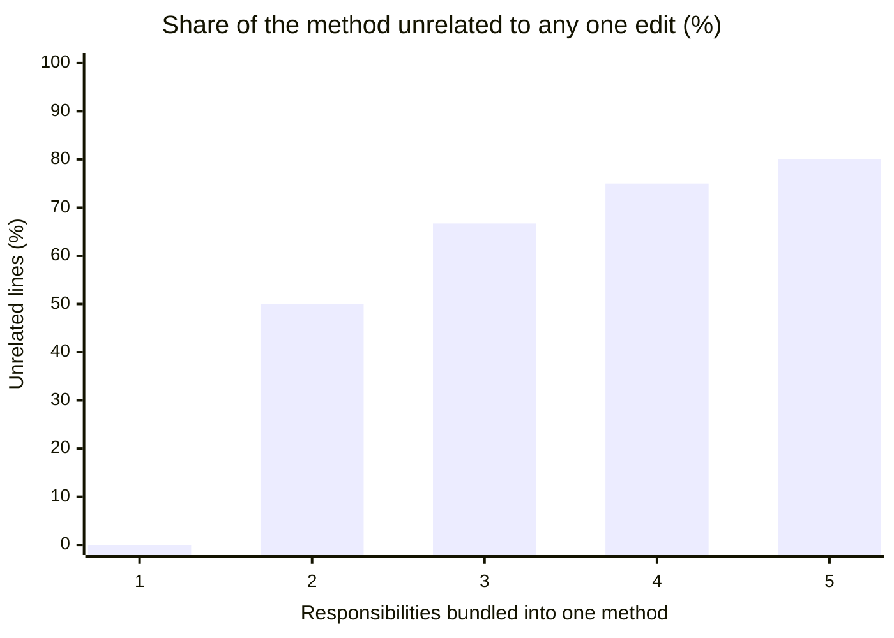
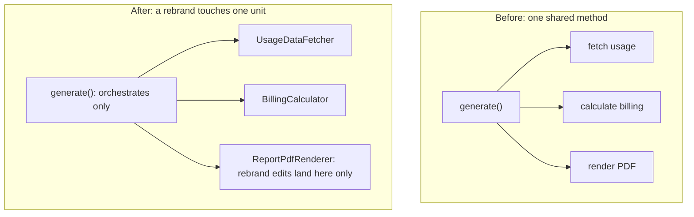
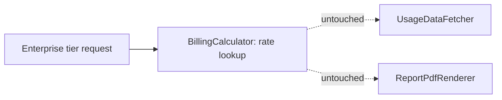

import Scenario from "../../../components/Scenario.astro";
import LevelIntro from "../../../components/LevelIntro.astro";
import Checkpoint from "../../../components/Checkpoint.astro";
import PracticeCheck from "../../../components/PracticeCheck.astro";

export const unit = {
  track: "software-design",
  unitSlug: "single-responsibility",
};

<Scenario label="Three jobs in one 15-line method">
  <Fragment slot="facts">
    <div class="not-prose flex flex-col gap-1.5 text-sm text-slate-700 dark:text-slate-300">
      <div class="flex items-center gap-1.5"><span>📥</span> <strong>Fetch</strong> — read usage events for an account and month (5 lines)</div>
      <div class="flex items-center gap-1.5"><span>🧮</span> <strong>Calculate</strong> — turn events into a billing total (5 lines)</div>
      <div class="flex items-center gap-1.5"><span>🖨️</span> <strong>Render</strong> — lay the total out as a PDF (5 lines)</div>
    </div>
    <div class="not-prose mt-3 flex flex-col gap-1.5 text-xs text-slate-700 dark:text-slate-300">
      <div>
        <div class="flex justify-between"><span>Unrelated to a rebrand</span><span>10 of 15 lines</span></div>
        <div class="h-2 w-full overflow-hidden rounded-full bg-slate-200 dark:bg-slate-700"><div class="h-full rounded-full bg-rose-500 animate-fill-bar" style="--target-width: 66.7%"></div></div>
      </div>
    </div>
  </Fragment>

A `MonthlyReportGenerator` fetches usage data, calculates billing totals and
renders a PDF. All three steps "belong to generating the report", yet each
answers to a different change: a new usage-tracking system, a new pricing tier,
a rebrand. They sit as adjacent lines in one method, and nothing marks which
lines are safe to touch for which request.

**If a rebrand landed tomorrow, which lines would an editor have to scroll past
to make it, and which of those could cost real money if touched by accident?**

</Scenario>

<LevelIntro
  items={[
    "How a bundled method caused the incident",
    "How the risk scales with responsibilities bundled",
    "The split, and what it does to future edits",
  ]}
/>

## What actually caused the incident?

A designer requests a rebrand. An engineer edits the PDF-layout lines of
`generate()`. In the same scroll, a stray edit changes the adjacent billing
line from `0.001` to `0.01` for `api_call` events. That is a factor of
10 (0.01 / 0.001). The rebrand ships; two weeks later finance sees API-call
billing ten times too high for every customer that month.

**The root cause is not the typo.** Mistakes happen. The root cause is that a
layout-only change required editing a method that also held financially
sensitive billing logic, close enough to touch by accident and with no test
isolating it from layout work.

<Checkpoint question="The engineer never intended to touch billing. Would adding a review checklist item ('did you mean to change the billing line?') have reliably prevented the bug?">

Not reliably. A checklist depends on a reviewer noticing one unrelated line
inside a diff that is mostly about layout, which is exactly the kind of small
edit that slips past review. A checklist adds a chance of catching it;
separating the responsibilities into different files removes the opportunity
for it to appear in the same diff at all. That is the difference between a
process fix and a structural fix: the root cause is that billing was reachable
from a layout-only change, and only a structural boundary removes that.

</Checkpoint>

## How does the risk scale with the number of responsibilities bundled?

**Is one extra bundled concern a small problem or a growing one?** Assume each
responsibility takes 5 lines, as in the scenario. For an edit to any one
responsibility, the unrelated share of the method is (n − 1) / n lines for n
bundled:



At one responsibility there is nothing unrelated to hit, so the risk is
structurally zero. At three, the incident's shape, two thirds of the method is
irrelevant to any single request. The slider demo on this page lets you vary
both the number of bundled concerns and the lines each one takes; the share
depends only on the count, which is why the answer to a bigger method is not
"be more careful" but "bundle fewer reasons".

## What does the split change?



| Unit                | Its one reason to change            | Has its own tests for              |
| ------------------- | ----------------------------------- | ---------------------------------- |
| `UsageDataFetcher`  | How usage data is stored or queried | Query results for an account/month |
| `BillingCalculator` | Pricing rules                       | Rates, directly, with fixed events |
| `ReportPdfRenderer` | Layout and branding                 | Output structure                   |
| `generate()`        | Order or composition of the steps   | That the three steps are called    |

The rebrand now edits `ReportPdfRenderer` only. The rate logic is in another
file, not visually adjacent, and protected by a test that pins `api_call` to
its rate. A layout pull request would not touch it, and if it did, that test
would fail.

<Checkpoint question="generate() still calls all three units in sequence. Does it secretly still own all three responsibilities, just spread across calls?">

No. Its one responsibility is orchestration, and its reason to change differs
from any of theirs: it changes if the _sequence or composition_ of steps
changes (a fourth step, or caching the fetch), not if a rate or a font size
changes. Calling into other units is not the same as owning their logic.

</Checkpoint>

<PracticeCheck
  track={unit.track}
  unitSlug={unit.unitSlug}
  topicId="structural-fix"
/>

## What happens to the next request, and can you write it?

The rebrand is one case, not the whole territory. **What if the next request is
"add an enterprise pricing tier": does the split hold, and which unit absorbs
the change?** Only the billing calculator changes, because only the rate lookup
changes:



Here code is the clearest vehicle, because the claim is "the whole change fits
in one small function". Using whole cents per unit so no floating-point
rounding is involved:

```js
function calculateTotal(usageEvents, tier) {
  const cents =
    tier === "enterprise"
      ? { api_call: 1, storage: 4 }
      : { api_call: 2, storage: 5 };
  return usageEvents.reduce((sum, e) => sum + e.quantity * cents[e.type], 0);
}
```

The rate table is the only thing that moved. The fetcher and renderer do not
know tiers exist.

<PracticeCheck
  track={unit.track}
  unitSlug={unit.unitSlug}
  topicId="pricing-extension"
/>

**Now extend it yourself.** What if the request were "the usage system moves to
a new event schema", or "finance wants a CSV export beside the PDF"? Which unit
absorbs each? And what would you have to believe about the team (who owns what,
how often each changes) before deciding that a CSV export deserves its own
renderer instead of a flag on the existing one? The worked example shows the
method; the answer in your codebase depends on its real change patterns.

## Failure modes

| Failure mode                                        | What it gets wrong                                                                                                                                                             |
| --------------------------------------------------- | ------------------------------------------------------------------------------------------------------------------------------------------------------------------------------ |
| Believing the split alone prevents the bug          | It reduces the chance of an accidental cross-responsibility edit, but does not make it impossible. Real protection is separation plus a billing test that catches a wrong rate |
| Splitting only reactively, after an incident        | The reasons-to-change test from L2 could have flagged the violation in the original review, before anything shipped                                                            |
| Over-rotating into splitting everything defensively | The lesson is "split along genuinely independent reasons", not "prefer more, smaller classes"; the overcorrection reintroduces cost with no matching benefit                   |
| Assuming this class of bug is rare                  | Editing unrelated code that sits nearby is an easy, common mistake, which is why boundaries are a structural safeguard and not an aesthetic preference                         |
