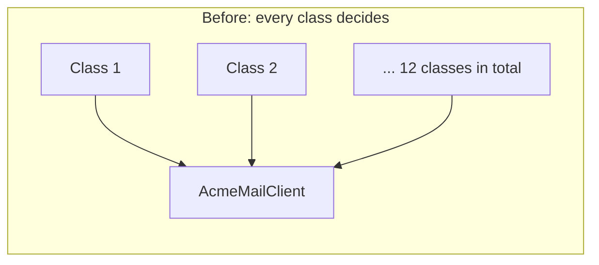

import Scenario from "../../../components/Scenario.astro";
import LevelIntro from "../../../components/LevelIntro.astro";
import PracticeCheck from "../../../components/PracticeCheck.astro";

export const unit = {
  track: "software-design",
  unitSlug: "solid-principles",
};

<Scenario label="One provider switch, twelve files touched">
  <Fragment slot="facts">
    

      
📧 <strong>The change</strong> — switch the email provider from AcmeMail to BoltMail

      
🔍 <strong>What it touched</strong> — 12 classes, each with <code>new AcmeMailClient()</code> written inside it

      
😬 <strong>The risk</strong> — miss one of the 12 and it silently keeps using the old provider

    

    

      

        
Places edited today12 of 12 classes

        

      

      

        
Places that should need editing1 of 12

        

      

    

  </Fragment>

The company decides to switch email providers, from AcmeMail to BoltMail.
On its face that is one vendor decision. Making the change in code means
finding and editing 12 different classes, each of which has
`new AcmeMailClient()` written directly inside it. **The business decision
was one sentence long. Why did carrying it out mean touching 12 unrelated
places?**

</Scenario>

<LevelIntro
  items={[
    "Why one decision rippled across 12 files",
    "The five SOLID principles, one failure mode each",
    "Dependency inversion and injection, defined",
  ]}
/>

## Where did the vendor decision live?

**Each of the 12 classes only wanted to send an email. So what else was it
quietly doing?** It was also deciding _which_ email client to build. Two jobs
sat in the same place, and the second one was copied into every class.

The ripple is not caused by the vendor switch itself. It is caused by _where_
the vendor decision was allowed to live: in 12 places instead of 1. Being more
careful when searching for every `new AcmeMailClient()` does not fix that. The
fix is to restructure so exactly one place makes the decision, and everything
else depends on a description of what an email client can do, not on a specific
vendor.

<PracticeCheck
  track={unit.track}
  unitSlug={unit.unitSlug}
  topicId="ripple-cause"
/>

## The five principles, at a glance

| Letter | Principle             | The failure it guards against                             |
| ------ | --------------------- | --------------------------------------------------------- |
| S      | Single responsibility | One class changes for several unrelated reasons           |
| O      | Open/closed           | Adding a variant forces edits to existing, working code   |
| L      | Liskov substitution   | A stand-in fits the shape but breaks what callers rely on |
| I      | Interface segregation | A class is forced to depend on methods it never calls     |
| D      | Dependency inversion  | Business logic is wired to one specific low-level detail  |

The scenario above is a dependency inversion failure. This unit focuses on
that one and shows where the other four meet it.

## Key terms

- **Abstraction** — a description of _what_ something does ("can send a
  message") without committing to _how_. Several different concrete classes can
  satisfy one abstraction.
- **Dependency inversion principle (DIP)** — high-level code depends on an
  abstraction, not on a specific concrete class, and the concrete class is
  handed in from outside.
- **Dependency injection** — the practical mechanism: instead of constructing
  its dependency internally, a class receives it, usually through its
  constructor.
- **Composition root** — the one place near program startup where concrete
  classes are chosen and wired together.

## What this unit covers

L2 shows what depending on an abstraction changes structurally, which SOLID
principle matches which failure, and when adding an abstraction is not worth
it. L3 rebuilds the email scenario step by step, then works through a Liskov
violation and an interface segregation violation on the same example.
