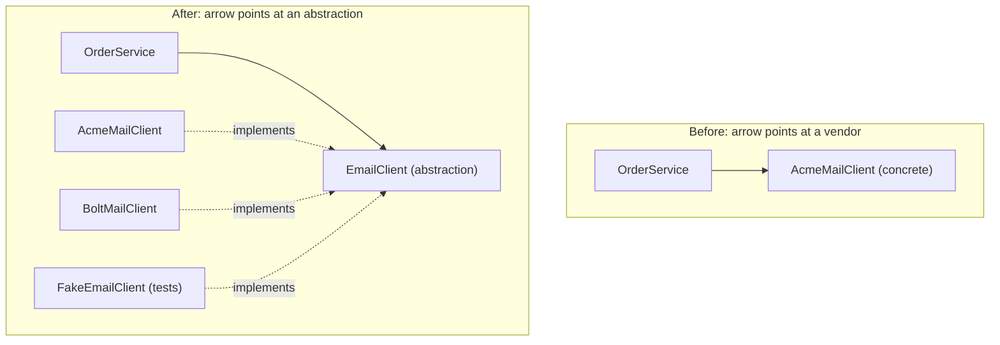

import LevelIntro from "../../../components/LevelIntro.astro";
import Checkpoint from "../../../components/Checkpoint.astro";
import PracticeCheck from "../../../components/PracticeCheck.astro";

export const unit = {
  track: "software-design",
  unitSlug: "solid-principles",
};

L1 named the fix in one sentence: depend on an abstraction, not a concrete
class. L2 shows what that moves structurally, which of the five principles
actually matches which kind of failure, and where adding an abstraction stops
paying for itself.

<LevelIntro
  items={[
    "Matching each SOLID principle to its failure",
    "What 'depend on an abstraction' moves",
    "When an abstraction is not worth adding",
  ]}
/>

## Which principle matches which failure?

**Does fixing the 12-file ripple require mastering all five principles at
once?** No. They answer different questions, and picking the wrong one for a
failure sends you refactoring in the wrong direction.

| Symptom you can observe                                           | Principle that names it |
| ----------------------------------------------------------------- | ----------------------- |
| One class has to change for several unrelated reasons             | Single responsibility   |
| Adding a new variant means editing code that already works        | Open/closed             |
| A stand-in compiles fine but callers behave wrongly with it       | Liskov substitution     |
| A class or test double must stub methods nobody calls             | Interface segregation   |
| Business logic names a concrete vendor class directly, many times | Dependency inversion    |

Single responsibility and open/closed have their own units in this track
(`single-responsibility` and `evolutionary-design`). Liskov and interface
segregation get a worked violation each in L3.

<Checkpoint question="Each of the 12 classes had exactly one job on its own (processing an order), yet the fix was not a single-responsibility fix. Why does this ripple point at dependency inversion instead?">

Single responsibility is about one class doing several unrelated jobs inside
itself, and that is not what went wrong. Each of the 12 classes had one clear
job. The problem was where one decision (which vendor to build) was made: the
same decision, copied into all 12 places. The failure is about _what a class
depends on and where that dependency gets decided_, which is the question
dependency inversion answers and single responsibility does not.

</Checkpoint>

<PracticeCheck
  track={unit.track}
  unitSlug={unit.unitSlug}
  topicId="solid-failure-modes"
/>

## What does "depend on an abstraction" move?

**In the L1 scenario, what exactly was each class doing wrong?** It named
`AcmeMailClient` and built it internally, so high-level business logic was
wired straight to one low-level vendor detail. Think of a lamp with its cord
soldered into the wall versus a lamp with a plug: the plug is the abstraction,
and any socket-compatible supply can be connected from outside.

The "inversion" in the name is about the arrows. The vendor classes used to be
things the business logic pointed _at_. Now they point at the abstraction the
business logic defined, so the dependency arrow between them has flipped.

| Question                             | Depends on a concrete class                   | Depends on an abstraction                        |
| ------------------------------------ | --------------------------------------------- | ------------------------------------------------ |
| Who picks the implementation?        | The class itself, hardcoded inside            | Whoever builds the class, from outside           |
| Adding a new implementation          | Edit every class that builds the old one      | Write the new class; existing classes stay as is |
| Testing without the real service     | Needs the real dependency or fragile patching | Hand in a fake that satisfies the same contract  |
| Where does the vendor decision live? | Scattered across every place a class is built | One place, where the object graph is assembled   |

That one place is the **composition root**: the decision did not disappear, it
was concentrated.

<Checkpoint question="After the change, OrderService receives an email client through its constructor. A third provider is written tomorrow. Which files must change for OrderService to start using it?">

Only the composition root, where the new provider is chosen and passed in.
`OrderService` never mentions a vendor name, so nothing in its source needs to
know the new class exists. This is the structural change from the diagram made
concrete: the arrow points at the abstraction, and the choice of implementation
was moved out to the one place that assembles the program.

</Checkpoint>

<PracticeCheck
  track={unit.track}
  unitSlug={unit.unitSlug}
  topicId="dip-structure"
/>

## Is an abstraction always worth adding?

**Does DIP mean every class should depend on an interface, even when only one
implementation will ever exist?** No. An abstraction costs an extra file and an
extra layer to read through. It earns that cost only when something real pays
it back:

| Situation                                                     | Worth an abstraction? | Why                                              |
| ------------------------------------------------------------- | --------------------- | ------------------------------------------------ |
| Vendor or backend that could realistically be swapped         | Yes                   | The ripple risk from L1 is real                  |
| A test needs to avoid a slow or flaky real call               | Yes                   | A fake can be injected                           |
| A fixed formula with one implementation and no reason to vary | No                    | Indirection with nothing to buy back             |
| A second variant is imagined but not required by anything     | Not yet               | Add it when the second variant actually shows up |

<Checkpoint question="A class computes sales tax with a fixed formula that has never changed and has no second implementation. Should it depend on a TaxCalculator abstraction 'just in case'?">

Not on the strength of DIP alone. DIP pays off where a concrete choice is
likely to vary or a test genuinely needs a substitute, and neither applies
here. The abstraction would add a file and a layer without removing any real
risk. If a second tax jurisdiction appears later, that is the moment to
introduce the abstraction, with a concrete reason for its shape.

</Checkpoint>

<PracticeCheck
  track={unit.track}
  unitSlug={unit.unitSlug}
  topicId="dip-when-worth-it"
/>

## The generalizable lesson

**Is this only about email?** No. The same shape recurs wherever business logic
builds a specific low-level thing that could change: payment processor,
database driver, log destination, third-party API. The diagnostic question is
always the same: if this concrete choice changed, how many unrelated places
would need to know?
