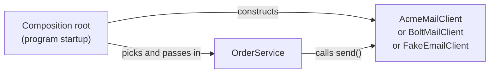
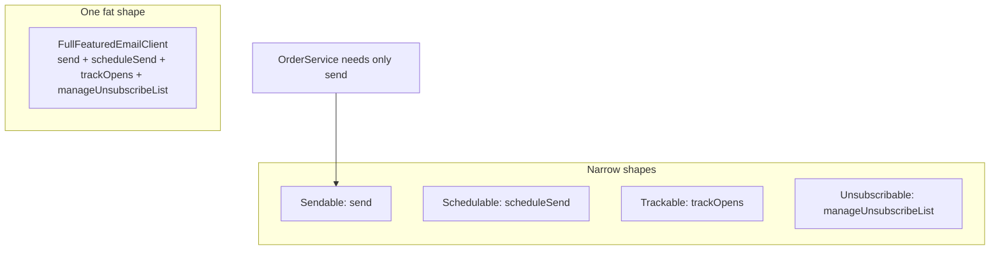

import Scenario from "../../../components/Scenario.astro";
import LevelIntro from "../../../components/LevelIntro.astro";
import Checkpoint from "../../../components/Checkpoint.astro";
import PracticeCheck from "../../../components/PracticeCheck.astro";

export const unit = {
  track: "software-design",
  unitSlug: "solid-principles",
};

<Scenario label="Same behavior, measured before and after">
  <Fragment slot="facts">
    <div class="not-prose flex flex-col gap-2 text-sm text-slate-700 dark:text-slate-300">
      <div class="flex items-center gap-1.5"><span>🔒</span> <strong>Before</strong> — <code>OrderService</code> builds <code>AcmeMailClient</code> itself</div>
      <div class="flex items-center gap-1.5"><span>🔓</span> <strong>After</strong> — it receives any email client through its constructor</div>
      <div class="flex items-center gap-1.5"><span>🎯</span> <strong>Goal</strong> — add a third provider and a test fake without editing <code>OrderService</code></div>
    </div>
  </Fragment>

**Before reading on, predict: once the dependency is inverted, how many lines
of `OrderService`'s own code change when a third provider is added?** Then
test the prediction against a harder question: does every class that _fits_
the abstraction's shape actually behave safely when swapped in?

</Scenario>

<LevelIntro
  items={[
    "OrderService before and after, with a third provider added",
    "Liskov: a stand-in that fits the shape but lies",
    "Interface segregation: narrow shapes instead of a fat one",
  ]}
/>

## Before and after: the whole change is one constructor

The only code worth reading in this unit is the constructor, because that is
where the decision moves:

```js
// Before: the class decides which vendor to build.
class OrderService {
  constructor() {
    this.email = new AcmeMailClient();
  }
}

// After: the class is handed anything with a send() method.
class OrderService {
  constructor(email) {
    this.email = email;
  }
}
```

The rest of `placeOrder()` is unchanged in both versions: it calls
`this.email.send(...)`. That is why the predicted answer is **zero lines**. The
decision about which vendor to use now lives where `new OrderService(...)` is
called, the composition root.



The L3 demo below reproduces L1's numbers: with 12 consumer classes, the
tightly coupled version touches 12 files to switch provider, and the inverted
version touches 1. Drag the slider to 20 and the first line climbs to 20 while
the second stays flat at 1.

| Scenario                       | Tightly coupled                        | Dependency inverted      |
| ------------------------------ | -------------------------------------- | ------------------------ |
| Switch provider (12 consumers) | 12 files edited                        | 1 file edited (the root) |
| Add a third provider           | 12 files edited                        | 1 new class, 1 root line |
| Unit-test `OrderService`       | Needs real client or internal patching | Inject a recording fake  |

<Checkpoint question="A FakeEmailClient that just records what was sent is injected in a test. Why does this still test OrderService's real logic rather than a stub of it?">

Dependency inversion changed _which object_ `OrderService` talks to, not
`OrderService`'s own code. `placeOrder()` still runs exactly as it would in
production and still calls `send()`. Only the far end of that call changed,
from a network client to an in-memory recorder. The test therefore exercises
the genuine class, with a substitutable dependency standing in for the one part
(a real network call) that would make it slow and flaky.

</Checkpoint>

## Liskov substitution: what if the stand-in lies?

**If a new class has a `send()` method that returns an object, is it safe to
inject?** Only if it keeps the promise callers actually rely on, and that
promise is not in the method signature. `OrderService` and everything
downstream treat `sent: true` as "this email really left the building".

| Candidate             | Has `send()` and returns `{ sent, ... }`? | What it reports when nothing is sent | Safe to substitute? |
| --------------------- | ----------------------------------------- | ------------------------------------ | ------------------- |
| AcmeMailClient (real) | Yes                                       | Throws or reports `sent: false`      | Yes                 |
| NullEmailClient       | Yes                                       | `sent: false`, with a reason         | Yes, it is honest   |
| LogOnlyEmailClient    | Yes                                       | `sent: true`, after only logging     | No, it lies         |

`LogOnlyEmailClient` passes every structural check `OrderService` could write
and still breaks the behavioral half of the contract: a caller that shows the
customer a confirmation when `sent` is true now confirms an email that was never
sent. `NullEmailClient` is the same shape and perfectly safe, because it tells
the truth. The difference is behavior, not signature.

<Checkpoint question="LogOnlyEmailClient and NullEmailClient both have a send() method returning the same shape. Only one is safe to inject. What separates them, if not the signature?">

What each return value _means_ to a caller. Callers treat `sent: true` as a
promise the email went out. `NullEmailClient` keeps that promise by reporting
`sent: false` when nothing was sent, so callers react correctly without knowing
it exists. `LogOnlyEmailClient` keeps the shape while breaking the promise, so
every caller that trusted the contract silently believes something false. A
type-correct stand-in is not automatically a safe one.

</Checkpoint>

<PracticeCheck
  track={unit.track}
  unitSlug={unit.unitSlug}
  topicId="liskov-contract"
/>

## Interface segregation: one fat shape or several narrow ones?

**`OrderService` calls exactly one method. What happens if the abstraction it
depends on grows to include every feature an email provider might offer?**



If `OrderService` were declared against the fat shape, `FakeEmailClient` would
stop being a valid stand-in until it carried three extra stub methods that
nothing calls. Splitting the shape lets `OrderService` depend on `Sendable`
alone, while a real campaign client (say, `ScheduledCampaignClient`) can still
implement `Sendable` and `Schedulable` together. Splitting does not forbid one class from offering
several capabilities; it stops every implementer from being forced to offer
all of them.

<PracticeCheck
  track={unit.track}
  unitSlug={unit.unitSlug}
  topicId="interface-segregation"
/>

## Failure modes

| Failure mode                                                              | What it gets wrong                                                         |
| ------------------------------------------------------------------------- | -------------------------------------------------------------------------- |
| Inverting every dependency regardless of need                             | Adds indirection with no payoff where nothing will ever vary               |
| Injecting the dependency but still importing the concrete class elsewhere | Half-fix: other places that build the concrete class still change together |
| An abstraction shaped exactly like one vendor's API                       | A second vendor will not fit cleanly, so the abstraction was not real      |
| "Add an interface" as the whole fix                                       | Useless if the class still constructs its own concrete dependency inside   |
| Believing DIP removes the decision                                        | The decision is concentrated in one place, not eliminated                  |

## Extend the case

This unit followed one worked example, and it is a case, not the whole
territory. Try these on your own:

- **What changes if the dependency is a database instead of an email client?**
  Which behavior would a fake have to be honest about to be a Liskov-safe
  stand-in (for instance, what should a failed write report)?
- **What changes if there were only one provider and 2 consumer classes?** At
  what number of consumers would you add the abstraction, and what evidence
  would convince you?
- **What changes if the news were worse:** a new provider needs a different
  calling style (it sends in batches)? Does the abstraction bend, or was it
  shaped like the first vendor?
