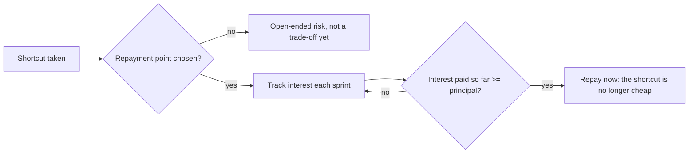

import Scenario from "../../../components/Scenario.astro";
import LevelIntro from "../../../components/LevelIntro.astro";
import PracticeCheck from "../../../components/PracticeCheck.astro";

export const unit = {
  track: "software-design",
  unitSlug: "technical-debt-deliberate-trade-off",
};

<Scenario label="Two days now, or fifteen days now: a shortcut nobody wrote down">
  <Fragment slot="facts">
    

      

        🚀 <strong>Deadline</strong> — 3 weeks, one paying customer, one tenant
      

      

        

          ⏱️ <strong>Cost today</strong>
          2 days (shortcut) vs. 15 days (proper)
        

        

          

        

      

      

        📅 <strong>Needed by</strong> — about 2 quarters out, when two more customers sign
      

      

        💸 <strong>Carrying cost</strong> — about $1,200 of extra friction per 2-week sprint
      

      

        ❓ <strong>Not written down</strong> — that it was a choice, or when it gets repaid
      

    

  </Fragment>

Nadia is a backend engineer at Lumeo, a three-person project-tracking
startup. One customer signs in three weeks if the product is ready. Building
the data layer so it can hold many customers separately takes about fifteen
engineer-days. Assuming there will only ever be one customer takes two.

She knows more customers are coming within two quarters. She takes the
two-day shortcut, ships on time, and moves on. **Was that a mistake, and what
would have to be true for it to be the right call?** (All names and numbers
here are made up for the example.)

</Scenario>

Nobody can answer that from the code alone. The same two days can be a smart
loan or an unrecorded liability, and the difference is whether the cost was
counted and a payback point was chosen.

<LevelIntro
  items={[
    "Debt as a loan, not a sin",
    "Four kinds of debt in a 2x2",
    "Principal, interest and a repayment point",
  ]}
/>

## Is technical debt just a polite word for bad code?

**If a shortcut is borrowing, what exactly are you paying back, and when?**
Ward Cunningham's metaphor treats it as a financial trade-off, not a moral
failing. Borrowing to ship sooner can be correct, provided you know you
borrowed and plan to repay before the interest overwhelms you.

| Loan term         | Technical debt equivalent                                             |
| ----------------- | --------------------------------------------------------------------- |
| **Principal**     | Cost of building it the proper way, whenever it is finally paid       |
| **Interest**      | Extra cost every sprint the shortcut stays: workarounds, bugs, rework |
| **Interest rate** | How fast that cost grows as more code is built on the shortcut        |
| **Default**       | Never repaid; velocity eventually collapses under the interest        |

Two opposite mistakes surround the idea:

- **Treating all debt as sin.** Refusing every shortcut under a real
  deadline ignores that borrowing is sometimes the right call.
- **Calling every mess "debt".** Debt implies you got something for it:
  speed, a market window, information. If nothing was gained, there is no
  loan, just low quality with a kinder name.

<PracticeCheck
  track={unit.track}
  unitSlug={unit.unitSlug}
  topicId="loan-metaphor"
/>

## What are the four kinds of debt?

Two independent questions: was the shortcut **deliberate** (chosen knowingly)
or **inadvertent** (it just turned out that way)? And was it **prudent** (a
reasonable bet given what was known) or **reckless** (taken without weighing
the cost)? Crossing them gives a 2x2:

| Kind of debt | Deliberate                             | Inadvertent                              |
| ------------ | -------------------------------------- | ---------------------------------------- |
| **Prudent**  | "We know, and we have a plan"          | "Now we know how we should have done it" |
| **Reckless** | "We don't have time for the right way" | "What is tenant isolation?"              |

Only deliberate and prudent is the acceptable trade-off this unit defends.

## How do you size a shortcut?

Compare two numbers, like any loan: the **principal** (cost to build it
properly) and the **interest per sprint** (what the shortcut costs you each
sprint it stays). Nadia's: about $9,000 principal (15 days at an assumed
$600/day) and about $1,200 interest per sprint.

## Key terms

- **Principal** — the cost to build it properly, paid whenever it is paid.
- **Interest** — the recurring extra cost of the shortcut staying.
- **Deliberate / inadvertent** — chosen knowingly, or discovered later.
- **Prudent / reckless** — a reasoned bet, or careless.
- **Debt log** — a shared record of each shortcut, its reason and payback point.

## What the next levels cover

L2 classifies a shortcut honestly, sizes it with a break-even, and shows why
visibility is part of the definition. L3 runs Nadia's full numbers, builds
the debt log, and covers where the reasoning breaks down in practice.
