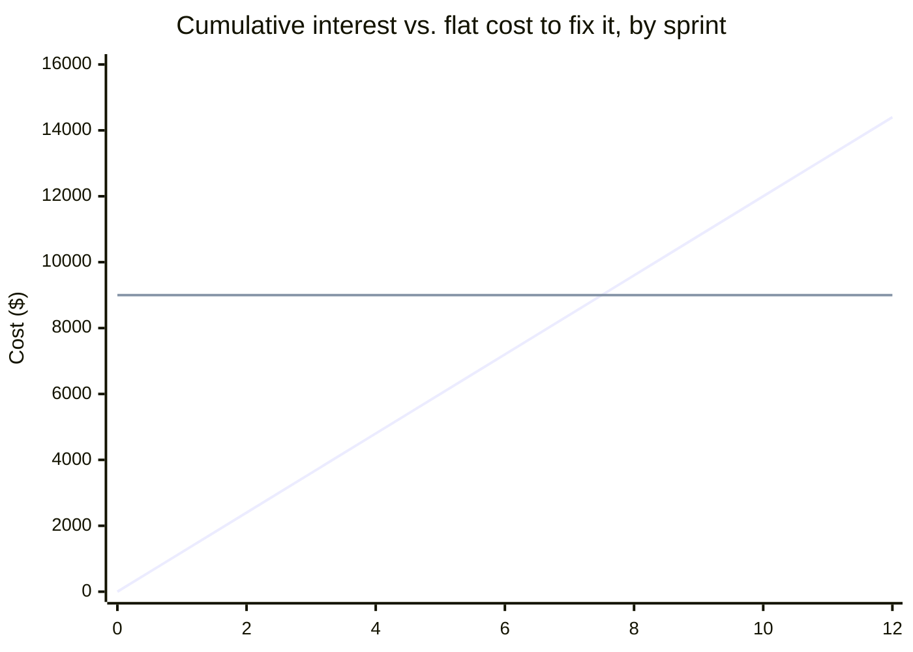
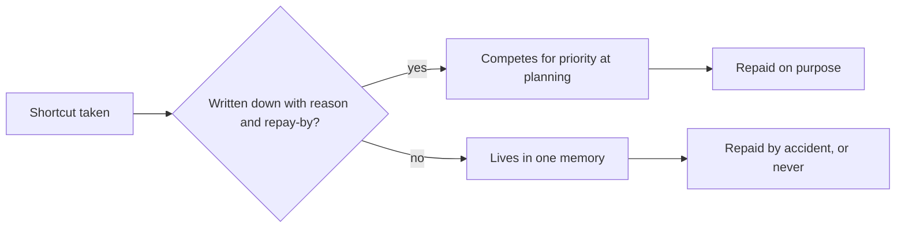

import LevelIntro from "../../../components/LevelIntro.astro";
import Checkpoint from "../../../components/Checkpoint.astro";
import PracticeCheck from "../../../components/PracticeCheck.astro";

export const unit = {
  track: "software-design",
  unitSlug: "technical-debt-deliberate-trade-off",
};

L1 named the metaphor: debt is a loan with a principal and an interest cost,
not a synonym for bad code. L2 turns "is this debt acceptable?" from a gut
feeling into a classification plus a piece of arithmetic.

<LevelIntro
  items={[
    "The deliberate/prudent quadrant",
    "Interest vs. principal and the break-even sprint",
    "Why debt must be visible to be repaid",
  ]}
/>

## Two identical pieces of code: what makes one acceptable?

Nadia chose a single-customer shortcut on purpose, knowing more customers
were coming. A new hire who has never heard of tenant isolation could write
the exact same code by accident. **Identical code, so what separates the
acceptable one from the unacceptable one?**

Not the code. Two questions about the _decision_ do: was it chosen knowingly
(deliberate or inadvertent), and was it a reasoned bet (prudent) or careless
(reckless)?

| Kind                     | What it sounds like                      | Nadia's shortcut when...                            |
| ------------------------ | ---------------------------------------- | --------------------------------------------------- |
| Deliberate and prudent   | "We know, and we have a plan"            | written down, with a repayment sprint picked        |
| Deliberate and reckless  | "We don't have time for the right way"   | taken knowingly with no plan and no intent to repay |
| Inadvertent and prudent  | "Now we know how we should have done it" | the team learned something it could not have known  |
| Inadvertent and reckless | "What is tenant isolation?"              | nobody realised a cost was being incurred           |

Only the first row is the trade-off this unit defends. The same code moves
into the second row the moment nobody intends to pay it back.

<Checkpoint question="Nadia takes the same shortcut for the same deadline, but tells no one and leaves no note. Six months later a new engineer assumes single-tenant is simply how the data model works. Did the code change, and which row is it in now?">

The code is identical. What changed is the missing plan and missing
visibility. A trade-off chosen on purpose but never surfaced is
indistinguishable, to everyone who comes later, from one nobody ever weighed:
no one can tell "temporary" from "this is how it works" without something
written down. So the row is a property of the decision-making around the
code, which is why visibility is part of the definition rather than a nicety.

</Checkpoint>

<PracticeCheck
  track={unit.track}
  unitSlug={unit.unitSlug}
  topicId="debt-quadrant"
/>

## How do you decide how much is too much?

**Knowing a shortcut is deliberate and prudent still does not say whether it
is sized right. What gets compared?** The same two numbers as any loan:

- **Principal** — the cost of the proper version whenever it is paid. For
  Nadia: about 15 engineer-days, $9,000 at an assumed $600/day loaded cost.
- **Interest per sprint** — the extra cost of not having done it, paid every
  sprint it stays: per-customer workaround scripts, bugs from features that
  assumed one customer. Assumed here: $1,200 per two-week sprint.

The model assumes both numbers are flat. Cumulative interest grows by $1,200
a sprint, so it catches the principal at $9,000 / $1,200 = 7.5 sprints, which
in whole sprints means the 8th.

The two lines cross between sprints 6 and 8. Before the crossing the
shortcut is cheaper to carry than to fix; after it, every sprint of waiting
costs more than the fix would have. The demo below lets you move the
numbers. Real teams only have estimates, so the exact crossing matters less
than having named both numbers at all.

<Checkpoint question="A teammate says 'the principal is $9,000 and this month's interest is only $1,200, so there is no urgency.' Is comparing today's interest to today's principal the whole picture?">

No. That comparison is true on day one of every loan ever taken and says
nothing about when the numbers meet. Interest accumulates each sprint while
the principal stays about the same (or grows, as more code is built on the
shortcut). With $1,200 a sprint, the lines cross around sprint 7.5, well
before the roughly 13 sprints in two quarters. The comparison that matters is
projected interest by the planned repayment date, not interest today.

</Checkpoint>

<PracticeCheck
  track={unit.track}
  unitSlug={unit.unitSlug}
  topicId="interest-principal"
/>

## Why does debt have to be visible?

A loan you forget still accrues interest; it just stops being managed. A
shortcut that lives only in one engineer's memory has nothing forcing anyone
to revisit it, so it is repaid only by accident, if someone happens to touch
that code for another reason.

A shared log is what separates the first row of the table from the second in
practice, not just in principle. L3 works through the full numbers and what
that log looks like.
