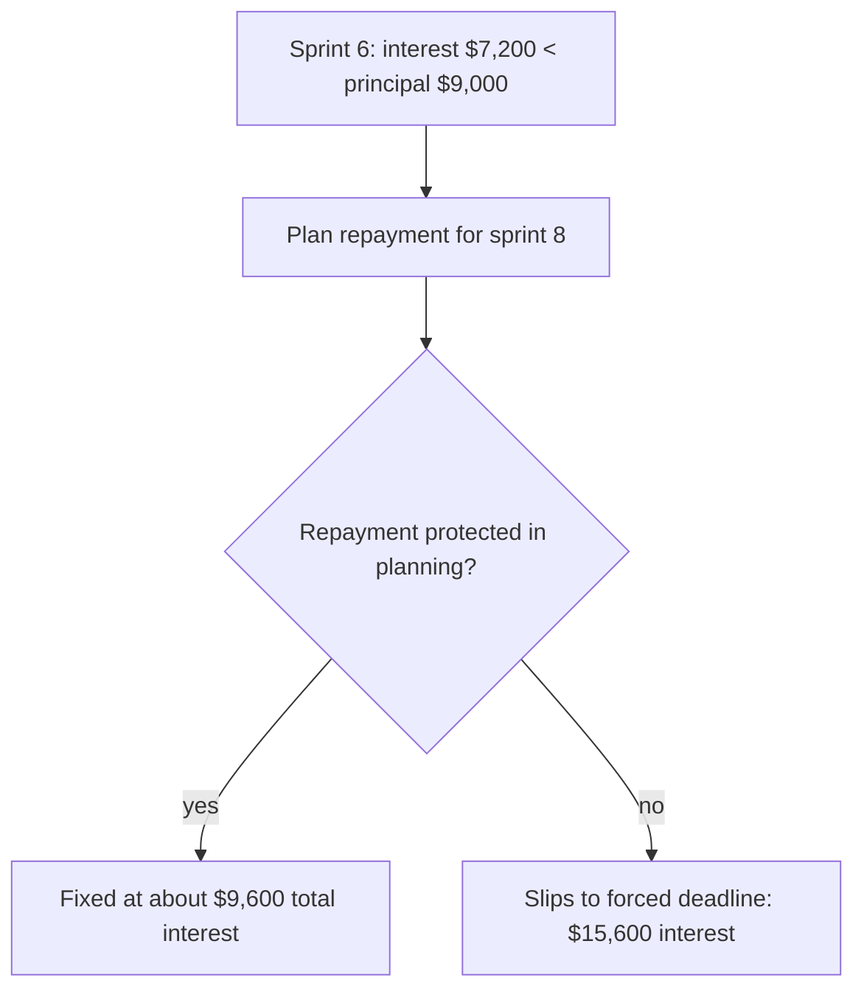

import Scenario from "../../../components/Scenario.astro";
import LevelIntro from "../../../components/LevelIntro.astro";
import Checkpoint from "../../../components/Checkpoint.astro";
import PracticeCheck from "../../../components/PracticeCheck.astro";

export const unit = {
  track: "software-design",
  unitSlug: "technical-debt-deliberate-trade-off",
};

L2 gave the quadrant and the two numbers that matter. This level runs
Nadia's decision end to end with every figure computed, shows what a debt log
looks like, and covers where the reasoning breaks down in practice. All dollar
amounts are assumptions made up for the example, not measurements.

<Scenario label="Six sprints in: has the shortcut started costing more than the fix?">
  <Fragment slot="facts">
    

      

        🏗️ <strong>Principal</strong> — 15 days x $600 = $9,000
      

      

        🔁 <strong>Interest</strong> — $1,200 per 2-week sprint
      

      

        
Interest paid at sprint 6$7,200 of $9,000

        

      

      

        📌 <strong>Forced deadline</strong> — about sprint 13
      

    

  </Fragment>

The team is six sprints in. Interest paid so far is 6 x $1,200 = $7,200, which
is 80% of the $9,000 it would cost to fix properly. Four more features have
quietly assumed one customer. The manager asks: "Do we repay now, or wait for
the real deadline at sprint 13?"

</Scenario>

<LevelIntro
  items={[
    "Break-even worked end to end",
    "A debt log that survives people leaving",
    "Where the reasoning fails in practice",
  ]}
/>

## What does the break-even say about Nadia's choice?

**When is waiting cheaper than fixing, and when does that flip?** Interest
is flat at $1,200 a sprint and principal at $9,000:

| Sprint | Interest paid | vs. $9,000 principal                 |
| ------ | ------------- | ------------------------------------ |
| 4      | $4,800        | cheaper to carry                     |
| 6      | $7,200        | cheaper to carry                     |
| 8      | $9,600        | carrying now costs more than the fix |
| 13     | $15,600       | 1.73 times the fix                   |

Break-even is 9,000 / 1,200 = 7.5 sprints, so the first whole sprint where
interest exceeds principal is the 8th. If the team waits for the forced
deadline at sprint 13, the accumulated carrying cost is $15,600 against a
$9,000 fix. The forced deadline and the economically sensible repayment date
are two different numbers, and only one of them is worth planning around.

This is a simplified model: it ignores the two days the shortcut itself
cost, any value from shipping earlier, and the interest rate rising as
features pile on. Treat it as a tool for making the comparison explicit.

<Checkpoint question="Nadia's manager proposes waiting until sprint 13, 'since that is the contractual deadline and there is no reason to do it early.' Using the numbers, what is wrong with the plan?">

Sprint 13 is when multi-tenancy becomes mandatory, not when it is cheapest to
do. By then roughly $15,600 of interest has accumulated against a fix that
costs $9,000 whenever it happens, and the interest line crossed the
principal at sprint 7.5. The forced deadline is a constraint; the break-even
is the economic signal. Planning around only the first means knowingly
paying the carrying cost for five more sprints.

</Checkpoint>

<PracticeCheck
  track={unit.track}
  unitSlug={unit.unitSlug}
  topicId="break-even-calc"
/>

## What does a debt log look like?

The arithmetic helps only if it lives somewhere other than Nadia's head:

| ID       | Description                          | Taken on | Reason                         | Principal | Interest/sprint | Repay by | Owner | Status |
| -------- | ------------------------------------ | -------- | ------------------------------ | --------- | --------------- | -------- | ----- | ------ |
| DEBT-001 | Single-tenant data model, no scoping | Sprint 1 | First customer's 3-week launch | $9,000    | $1,200          | Sprint 8 | Nadia | Open   |

A row in a shared, reviewed log survives Nadia changing teams, puts a number
in front of planning so "Sprint 8: retrofit tenant scoping" competes for
priority, and tells a later reader why the code looks the way it does.

<Checkpoint question="At sprint 6 the log still says 'Open, repay by sprint 8', but four new features assume one customer. Has the log done its job?">

Half of it. Nobody can claim they did not know about the shortcut, which is
the visibility half. But a log read once at launch and never again does not
protect sprint 8 in planning, and the real principal has probably grown past
$9,000 because more code now depends on the assumption. A log is necessary
for the shortcut to count as deliberate and prudent; it still has to be read
and acted on at planning time, and its principal re-estimated.

</Checkpoint>

<PracticeCheck
  track={unit.track}
  unitSlug={unit.unitSlug}
  topicId="debt-visibility"
/>

## Where does this reasoning break down in practice?

- **Real but invisible debt.** A good decision with the plan only in
  someone's head looks, from outside, like debt nobody decided on.
- **No planning buy-in.** If the repayment sprint is not protected in
  planning, it loses every prioritisation fight to whatever is on fire,
  because nobody outside the team agreed it was owed.
- **Poor quality called debt.** If the shortcut bought nothing (no deadline
  met, no experiment de-risked), it is not a loan. The tell: a real debt has
  a benefit you can name. If you cannot name one, fix it instead of logging it.
- **Principal that grows.** The model holds principal flat at $9,000, but
  each feature built on the shortcut widens the eventual retrofit. A log that
  tracks interest and never re-estimates principal understates the urgency.

What would change if Lumeo's very next customer contractually required its
data never be stored alongside anyone else's from day one? Does the shortcut
still count as prudent, or does that one fact move it to another row? And
what would change if interest were rising each sprint rather than flat? This
chapter worked one numeric case, not the whole territory. What is meant to
generalise is the procedure: name the principal, name the interest, name the
repayment point, write it down. The dollar figures are not.
