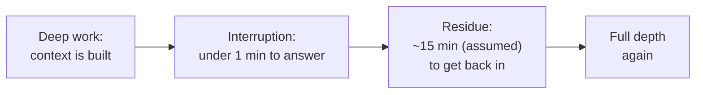

import Scenario from "../../../components/Scenario.astro";
import LevelIntro from "../../../components/LevelIntro.astro";
import PracticeCheck from "../../../components/PracticeCheck.astro";

export const unit = {
  track: "sustainable-performance",
  unitSlug: "attention-management",
};

<Scenario label="Busy all day, little to show for it">
  <Fragment slot="facts">
    

      

        120 of 480 min
        time spent at full depth on the hard essay (modeled)
      

      

        

      

    

    

      
🕗 8 hours (480 min) at the table, working the whole time

      
💬 A quick question about every 20 min, so 24 in the day

      
🔁 Assumed: about 15 min to get fully back into the essay each time

    

  </Fragment>

Sam sets aside a whole Saturday, 8 hours, to finish a hard essay at the shared
kitchen table. Housemates are around, and about every 20 minutes someone asks
something quick: where the scissors are, whether Sam has a minute, what time
dinner is. Sam answers every time, kindly, and each answer takes under a
minute. At 5pm Sam is exhausted, and the essay has barely moved.

**Sam worked all day and was never rude, lazy, or distracted on purpose. Where
did the time go?**

</Scenario>

The answer is not in the minutes the questions took. The numbers on this unit
(15 minutes to refocus, a question every 20 minutes) are assumptions chosen to
make the mechanism visible, not measurements of any real person. Under those
assumptions, only about a quarter of the day was spent at full depth.

<LevelIntro
  items={[
    "Deep work versus shallow work",
    "Attention residue and the refocus tax",
    "Why busy and productive are different",
  ]}
/>

## Are all hours of work the same kind of hour?

**Sam answered questions and wrote the essay, and both felt like working. Why
should they be counted differently?**

- **Deep work** is effortful, focused work on a demanding task with no
  switching. Writing the hard essay is deep work.
- **Shallow work** is low-focus, logistical work: answering a quick question,
  replying to a message, scheduling. It is necessary, and it does not need
  sustained concentration.
- Helping a housemate is not a waste. The problem is not that shallow work
  exists; it is where it lands in the day.

| Kind of work | Example from Sam's day             | Cost of being cut off partway |
| ------------ | ---------------------------------- | ----------------------------- |
| Deep         | Building the argument of the essay | High: the thread is lost      |
| Shallow      | Saying where the scissors are      | Almost nothing                |
| Shallow      | Replying to a message about dinner | Almost nothing                |

<PracticeCheck
  track={unit.track}
  unitSlug={unit.unitSlug}
  topicId="deep-vs-shallow"
/>

## Why does a thirty-second question cost far more than thirty seconds?

**If each question takes under a minute, how can 24 of them swallow most of the
day?** Because the question's own length is only the visible part.

- **Attention residue** is the part of your attention that stays stuck on the
  thing you just left, even after you have turned back to your task.
- **Task switching cost** is the time and effort to rebuild the mental context
  before work is back to its earlier depth and speed.
- The residue and the switching cost never appear as a line item. That is why
  the day feels busy but the essay looks untouched.

<PracticeCheck
  track={unit.track}
  unitSlug={unit.unitSlug}
  topicId="residue-cost"
/>

## What does this unit cover?

L2 works out why the size of the refocus tax compared with the time between
interruptions decides how much depth survives, and what it implies for
organizing a day. L3 walks Sam's fragmented Saturday and a protected-block
Saturday side by side, with the same hours and the same questions to answer.
