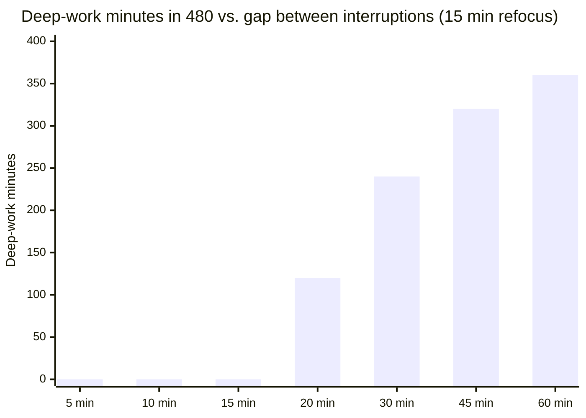

import LevelIntro from "../../../components/LevelIntro.astro";
import Checkpoint from "../../../components/Checkpoint.astro";
import PracticeCheck from "../../../components/PracticeCheck.astro";

export const unit = {
  track: "sustainable-performance",
  unitSlug: "attention-management",
};

L1 showed Sam answering a quick question about every 20 minutes and ending an
8-hour day with about two hours at full depth. L2 explains why that number is
so low and what actually decides it. Every figure below uses the same two
assumptions as L1: a question about every 20 minutes, and about 15 minutes to
get fully back into the task. They are teaching assumptions, not measurements.

<LevelIntro
  items={[
    "The two parts of an interruption's cost",
    "Refocus time versus the gap between interruptions",
    "Protecting blocks instead of reacting all day",
  ]}
/>

## What does one interruption really cost?

**A question takes 30 seconds to answer. Why is "30 seconds" the wrong price?**
Because the cost has two parts, and only one of them is visible.

| Part of the cost  | What it is                                   | How visible it is       |
| ----------------- | -------------------------------------------- | ----------------------- |
| Direct handling   | The seconds spent reading and answering      | Obvious, easy to count  |
| Refocus (residue) | Time to rebuild the context you were holding | Invisible, never logged |

Part of Sam's attention stays on the question (did I answer it right?) while
the rest tries to rebuild the paragraph that was half formed. That rebuilding is
real work, and it happens before Sam is back at the earlier depth. The
psychology of attention residue is a real line of research, but the specific
15 minutes here is this unit's assumption, so the mechanism is the lesson, not
the number.

<Checkpoint question="Someone says 'I spent only 12 minutes answering questions all day, so they barely affected my writing.' What is wrong with counting that way?">

The 12 minutes counts only direct handling. It leaves out the refocus time after
each answer, which is the larger part of the cost. A person can be honest about
the 12 minutes and still be wrong about where the day went, because the number
that explains a mostly empty day is the rebuilding that followed each answer.

</Checkpoint>

<PracticeCheck
  track={unit.track}
  unitSlug={unit.unitSlug}
  topicId="true-cost"
/>

## Does it matter how often interruptions come?

**If refocusing takes 15 minutes, is it the same whether questions come every 5
minutes or every 45?** No, and the difference is large. What decides the day is
the gap between interruptions compared with the refocus time.

- If the gap is shorter than the refocus time, Sam is always mid-rebuild and
  never reaches full depth at all.
- If the gap is longer, only the first 15 minutes after each question are lost,
  and the rest of the gap is real depth.

The demo on this unit lets you drag both numbers. With a 15-minute refocus time
and an 8-hour day, deep-work minutes follow this shape:

Each bar is the unit's formula, (gap minus 15) divided by gap, times 480. The
curve is flat at zero until the gap passes the refocus time, then climbs fast.
So a small change in how often people interrupt, around 20 minutes, moves the
total a lot, while the same change at 60 minutes barely matters.

<Checkpoint question="With a 15-minute refocus time, why does cutting interruptions from every 10 minutes to every 15 minutes change nothing, while cutting from every 20 to every 30 changes a lot?">

At gaps of 10 and 15 minutes, the gap is no longer than the refocus time, so
Sam never gets back to depth in either case: both give zero deep-work minutes.
At 20 minutes the gap finally exceeds the refocus time, and going from 20 to 30
doubles the depth from 120 to 240 minutes. The gain starts only once the gap
clears the refocus time.

</Checkpoint>

<PracticeCheck
  track={unit.track}
  unitSlug={unit.unitSlug}
  topicId="frequency"
/>

## Is the fix to ignore everyone?

**Sam cannot stop answering housemates forever. What changes if the answers
still happen?** The fix is about when, not how much.

| Day pattern         | When shallow work happens               | What happens to the essay          |
| ------------------- | --------------------------------------- | ---------------------------------- |
| Reactive            | Whenever it arrives, all day            | Never past the rebuilding phase    |
| Protected + batched | In set windows between deep-work blocks | Blocks stay free of switching cost |

A protected block is a stretch put on the calendar in advance, with
notifications off and a note to housemates, followed by a window for catching
up. The total shallow work does not shrink. What shrinks is the number of times
depth is broken. The same logic applies to any source: a person at the desk, a
phone buzz, or checking messages "just in case".

<PracticeCheck track={unit.track} unitSlug={unit.unitSlug} topicId="batching" />
