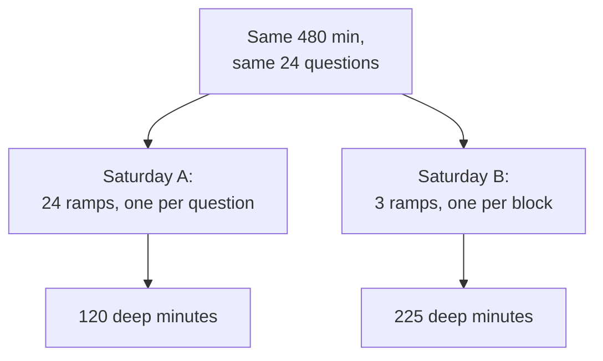

import Scenario from "../../../components/Scenario.astro";
import LevelIntro from "../../../components/LevelIntro.astro";
import Checkpoint from "../../../components/Checkpoint.astro";
import PracticeCheck from "../../../components/PracticeCheck.astro";

export const unit = {
  track: "sustainable-performance",
  unitSlug: "attention-management",
};

<Scenario label="Saturday A and Saturday B, same hours, same questions">
  <Fragment slot="facts">
    

      

        
🔀 Saturday A: reactive<strong>120 min deep</strong>

        

          

        

      

      

        
🛡️ Saturday B: protected<strong>225 min deep</strong>

        

          

        

      

      
Bars are share of 480 min. Assumed: 15 min refocus, a question every 20 min on A.

    

  </Fragment>

Sam has the same hard essay and the same housemates on two different Saturdays.
On Saturday A, Sam answers each question the moment it arrives. On Saturday B,
Sam blocks out stretches ahead of time and answers questions in set windows.
Both Saturdays are 8 hours (480 minutes) long, and both contain the same
24 quick questions.

**Before reading on, predict: with identical hours and identical questions,
what exactly has to differ for Saturday B to produce much more essay?**

</Scenario>

<LevelIntro
  items={[
    "Two Saturdays compared line by line",
    "Where the deep minutes actually come from",
    "What changes if the blocks or the task change",
  ]}
/>

## Which assumptions does the arithmetic rest on?

Every number here comes from three stated assumptions, none measured:

- A question arrives about every 20 minutes, so 24 in 480 minutes.
- Each question takes about 30 seconds to answer directly.
- After any break in the task, it takes about 15 minutes to get back to full
  depth. This applies at the start of a protected block too.

## What happened on Saturday A?

Each 20-minute gap holds 15 minutes of rebuilding and then 5 minutes at depth,
before the next question resets the climb.

| Quantity                | Working                           | Result  |
| ----------------------- | --------------------------------- | ------- |
| Questions in the day    | 480 / 20                          | 24      |
| Direct handling time    | 24 x 0.5 min                      | 12 min  |
| Deep minutes per gap    | 20 - 15                           | 5 min   |
| Deep minutes in the day | 24 x 5                            | 120 min |
| Rebuilding and handling | 24 x 15 (handling sits inside it) | 360 min |

Sam could truthfully say "answering questions took 12 minutes". The rest of the
360 minutes outside depth is rebuilding after each answer; this simple model
counts the 12 minutes of handling as part of that window. The demo on this unit
reproduces the 120 at its default settings.

<Checkpoint question="Saturday A shows 12 minutes of direct handling and 120 minutes of depth in an 8-hour day. Where did the other time go?">

Most of it went to rebuilding. Each question was followed by about 15 minutes of
getting back into the essay, and 24 of those is 360 minutes. The day was busy
the whole time, but that busy time bought partial refocusing, not finished
paragraphs. The 12 minutes of direct handling is a small part of the missing
time.

</Checkpoint>

## What did Saturday B change?

The same 24 questions still get answered. They move into two batched windows.

| Block | Length  | What happens                                       | Deep minutes |
| ----- | ------- | -------------------------------------------------- | ------------ |
| 1     | 90 min  | Essay, notifications off, housemates told          | 75           |
| 2     | 30 min  | Batched window: answer the questions that piled up | 0            |
| 3     | 90 min  | Essay                                              | 75           |
| 4     | 60 min  | Lunch, chores, a second batched window             | 0            |
| 5     | 90 min  | Essay                                              | 75           |
| 6     | 120 min | Everything else                                    | 0            |

Each protected block still pays the 15-minute ramp once, at its start, so it
yields 75 deep minutes, not 90. Three blocks give 225 minutes. The questions
cost the same 12 minutes of direct handling as on Saturday A, so the shallow
work did not shrink.

The whole difference is the number of ramps paid: 24 on A, 3 on B. Verified
arithmetic: 3 x (90 - 15) = 225, against 24 x (20 - 15) = 120.

<Checkpoint question="A skeptic says 'Saturday B just does less shallow work.' Does the table support that?">

No. Both Saturdays contain the same 24 questions and the same 12 minutes of
direct handling. What changed is when the questions are answered, which removed
21 of the 24 ramps. The extra 105 deep minutes (225 minus 120) come from paying
fewer refocus taxes, not from doing less.

</Checkpoint>

<PracticeCheck
  track={unit.track}
  unitSlug={unit.unitSlug}
  topicId="day-comparison"
/>

## Where does this reasoning go wrong?

| Failure mode                                        | What it gets wrong                                           |
| --------------------------------------------------- | ------------------------------------------------------------ |
| Counting only the seconds spent answering           | The refocus tax is the larger cost                           |
| Trying to delete all shallow work                   | It is often necessary; scheduling it is the fix              |
| Protecting a block only "if it happens to be quiet" | Unplanned protection fails the first time something comes up |
| Assuming a shorter interruption is a cheaper one    | The refocus cost does not shrink with the interruption       |
| Judging a day by how busy it felt                   | Busy and deep are different measurements                     |
| Treating 15 minutes as a law of nature              | It is an assumption; people and tasks vary                   |

<PracticeCheck
  track={unit.track}
  unitSlug={unit.unitSlug}
  topicId="failure-modes"
/>

## Extend it: this is a case, not the whole territory

Saturday A and B are one worked case, not the full map. Try these before
trusting the conclusion:

- **What if the blocks were 45 minutes instead of 90?** Each block still pays the
  15-minute ramp, so it yields 30 deep minutes. Three blocks give 90, which is
  40 percent of 225, less than half. Even six blocks of 45 (270 minutes in
  total, the same time as three 90s) give only 180. Is a shorter block ever
  worth it, and what would make it so?
- **What if the task were not an essay but a simple form to fill in?** Would the
  ramp still be 15 minutes? What would change in the arithmetic?
- **What if a housemate's question were truly urgent?** What rule would you set
  in advance for what may break a block?
