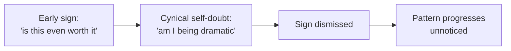

import Scenario from "../../../components/Scenario.astro";
import LevelIntro from "../../../components/LevelIntro.astro";
import PracticeCheck from "../../../components/PracticeCheck.astro";

export const unit = {
  track: "sustainable-performance",
  unitSlug: "early-warning-signs",
};

<Scenario label="The moment">
  <Fragment slot="facts">
    
Three months into exam season

    

      
🔥 Exhaustion: present

      
😏 Cynicism: just showed up

      
📉 Sense that effort works: not yet checked

    

    
The internal reply

    

      
🤔 "Am I just being dramatic?"

      
🤷 "Everyone is tired right now."

    

  </Fragment>

For three months you have been studying for a big set of exams. Last night a
friend said "the study group is meeting again, you in?" and you heard
yourself answer, "sure, because THIS session will finally fix everything." It
came out sarcastic, and you felt a flicker of guilt for being negative. Then
you shrugged it off: everybody is stretched thin right now, so it is not
worth mentioning to anyone.

**Was that sarcasm a real warning sign, or nothing worth flagging? Notice
that the question you just asked yourself, "am I being dramatic?", is itself
part of the answer.**

</Scenario>

<LevelIntro
  items={[
    "Tired versus burned out",
    "The three burnout components",
    "Why cynicism hides its own signs",
  ]}
/>

## Is being tired the same thing as being burned out?

**If a long weekend of sleep would fix it, which one is it?** The answer
separates two states that feel alike from the inside.

- **Tired** is solved by rest. A weekend, a few good nights, and the capacity
  comes back along with your usual attitude to the work.
- **Burned out** is not mainly about low energy. It is a change in your
  relationship to the work: detachment, cynicism, and a sense that effort no
  longer produces anything, even when you are well rested.

| Quick test | Does genuine rest resolve it?                            |
| ---------- | -------------------------------------------------------- |
| Tired      | Yes. A real break restores the prior relationship        |
| Burned out | No. Cynicism and the sense of futile effort largely stay |

<PracticeCheck
  track={unit.track}
  unitSlug={unit.unitSlug}
  topicId="rest-test"
/>

## What are the three components?

**If exhaustion is only one part, what are the other two?** Burnout research
converges on three, and burnout needs more than the first.

- **Exhaustion:** the depleted-energy part, and the only one that overlaps
  with ordinary tiredness.
- **Cynicism (depersonalization):** growing detachment from, or a negative
  attitude toward, the work, the people, or the purpose.
- **Reduced efficacy:** a growing sense that your effort accomplishes
  nothing.

Exhaustion alone points to overwork or poor sleep. Cynicism and reduced
efficacy alongside it are what make it burnout.

<PracticeCheck
  track={unit.track}
  unitSlug={unit.unitSlug}
  topicId="three-components"
/>

## Why is it so easy to miss in yourself?

**Why did the scene above end with a shrug?** Because cynicism is not only a
feeling about the work. It also colors how seriously you take your own early
warning signs.

- Early signs are behavioral and specific: sarcastic talk about the work,
  a widening gap between effort and any sense of accomplishment, pulling
  away from people, and routine things needing more effort than before.
- A mindset that is already skeptical dismisses those signs as "not real" or
  "not serious enough," which lets the pattern grow.
- This unit is about **recognition**. Fixing a workload or a staffing
  problem comes after, and is often the true root cause, but nobody fixes
  what they have not noticed.
- It also links to `sustainable-performance/myth-linear-output`: burnout is
  a plausible mechanism for why more hours can eventually yield less output.

<PracticeCheck
  track={unit.track}
  unitSlug={unit.unitSlug}
  topicId="hidden-signs"
/>
