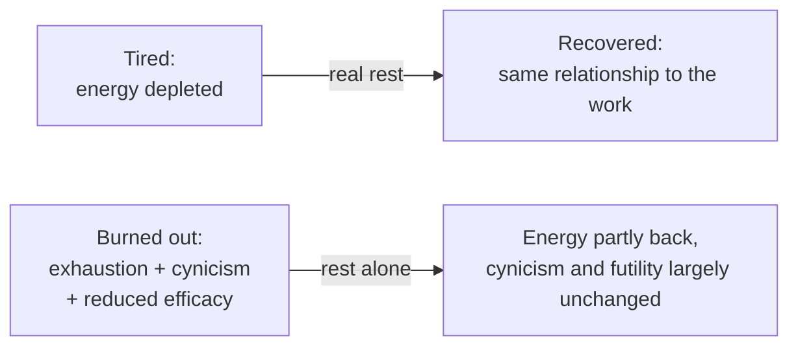
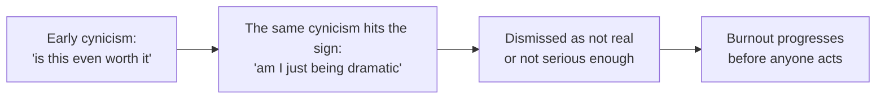

import LevelIntro from "../../../components/LevelIntro.astro";
import Checkpoint from "../../../components/Checkpoint.astro";
import PracticeCheck from "../../../components/PracticeCheck.astro";

export const unit = {
  track: "sustainable-performance",
  unitSlug: "early-warning-signs",
};

L1 separated tired from burned out and named the three components. This
level builds the model underneath: what early and late signs look like for
each component, why a general gut check is the wrong instrument, and how
burnout connects to the output curve from the previous unit.

<LevelIntro
  items={[
    "Early versus late signs of each component",
    "Why a gut check is a compromised instrument",
    "Burnout as a mechanism behind falling output",
  ]}
/>

## What do the early signs look like, compared with the late ones?

If you wait for the late signs, will you have noticed anything in time?
**Before reading on: which column of the table is the one worth checking
deliberately?**

| Component                    | Early sign                                                 | Late sign                                                        |
| ---------------------------- | ---------------------------------------------------------- | ---------------------------------------------------------------- |
| Exhaustion                   | More effort than before for routine tasks                  | Depleted even after adequate sleep, persistently                 |
| Cynicism / depersonalization | Occasional sarcastic detachment ("sure, THIS will matter") | A default assumption that effort is pointless before even trying |
| Reduced efficacy             | A vague sense that recent work has not amounted to much    | A settled belief that your work does not and will not matter     |

All three develop gradually. The early column is where recognition does the
most good, and it is exactly the column that is easiest to wave away.
Exhaustion alone is also consistent with ordinary overwork, so a single
early sign means "watch this," not "confirmed."

<Checkpoint question="A colleague returns from two full weeks off, physically rested, yet just as sarcastic about process changes and just as convinced their work does not matter. Does that rule out burnout?">

No. It points toward burnout rather than away from it. Rest resolves the
energy component because that part really was about energy. The cynicism and
the sense of futility did not move because they were never about energy in
the first place, and that pattern of partial recovery is what separates
burnout from being tired.

</Checkpoint>

<PracticeCheck
  track={unit.track}
  unitSlug={unit.unitSlug}
  topicId="early-late-signs"
/>

## Why can't I just ask myself "would I know?"

If cynicism colors how you read your own signs, can you trust the reader?
**Before reading on: what exactly would be doing the checking?**

The gut check is the instrument burnout changes. Asking it "am I burning
out?" asks a possibly compromised instrument to evaluate itself. A named,
specific list does not have that blind spot, because it does not depend on
cynicism reporting honestly on itself. That is why the table above matters:
it turns a vague feeling into something you can check line by line.

<Checkpoint question="Why is 'would I know if I were burning out?' an unreliable question, given what cynicism does?">

Because the faculty being asked is one of the things burnout alters.
Cynicism does not just color attitudes toward work, it colors how seriously
a person takes their own warning signs. A specific checklist avoids that
loop, since checking "do I have a sarcastic default?" is an observation, not
a feeling about whether the feeling counts.

</Checkpoint>

The interactive demo on this unit lets you drag how strongly self-doubt
dismisses each sign and how specifically the combination gets named. It is a
teaching model with assumed coefficients, not a measurement: with no
dismissal the modeled delay is 1 month, and with full dismissal and no
naming it is 7.9 months. The shape is the point, not the exact values.

<PracticeCheck
  track={unit.track}
  unitSlug={unit.unitSlug}
  topicId="self-check-instrument"
/>

## How does burnout connect to the output curve?

If burnout drags down work quality, does it explain the downward bend you
saw in `sustainable-performance/myth-linear-output`? **Before reading on:
which of the three components would you expect to act on errors, and which on
motivation?**

| Component        | What it degrades                             | Effect on output              |
| ---------------- | -------------------------------------------- | ----------------------------- |
| Exhaustion       | Focus                                        | More errors made directly     |
| Cynicism         | Care put into catching and preventing errors | Errors slip through           |
| Reduced efficacy | Motivation to course-correct                 | Visible problems stay unfixed |

Three separate contributors push the same downward-bending shape, over
months rather than within a single week. Burnout is a plausible mechanism
behind the curve, not a proven single cause.

<PracticeCheck
  track={unit.track}
  unitSlug={unit.unitSlug}
  topicId="negative-returns-link"
/>
