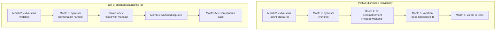
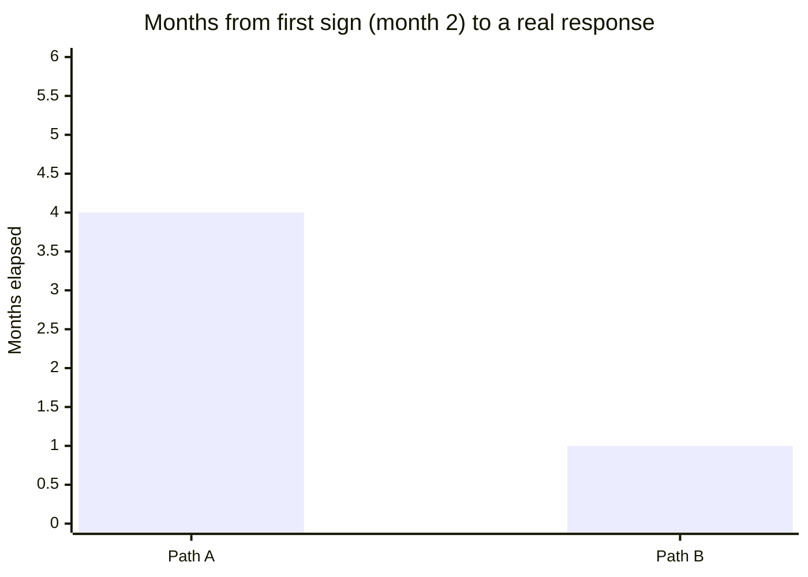

import Scenario from "../../../components/Scenario.astro";
import LevelIntro from "../../../components/LevelIntro.astro";
import Checkpoint from "../../../components/Checkpoint.astro";
import PracticeCheck from "../../../components/PracticeCheck.astro";

export const unit = {
  track: "sustainable-performance",
  unitSlug: "early-warning-signs",
};

<Scenario label="The scenario">
  <Fragment slot="facts">
    

      
🔥 Month 2: exhaustion sign, both paths

      
😏 Month 3: cynicism sign, both paths

      
📉 Month 4: flat sense of accomplishment, both paths

    

    
Where the paths split

    

      
🅰️ Path A: signs dismissed one at a time

      
🅱️ Path B: combination named to a manager, month 3

      
⏱️ Result: 4 months versus 1 month to a real response

    

  </Fragment>

An engineer has spent six months on a high-pressure project: consistently
longer hours, a string of production incidents, and slowly mounting
frustration with a process they used to tolerate. Two versions of this
engineer live through identical signs at identical times. **What decides
whether the story ends in month 6 or month 4?**

</Scenario>

<LevelIntro
  items={[
    "Two paths from the same early signs",
    "What made the early response possible",
    "Failure modes when applying this",
  ]}
/>

## Path A: each sign dismissed as "just being tired"

- **Month 2:** routine tasks need real effort. Chalked up to a demanding
  sprint: "push through to the next milestone."
- **Month 3:** a sarcastic retro comment ("sure, another process improvement,
  that'll fix everything"). Laughed off as normal venting.
- **Month 4:** a successful launch brings none of the satisfaction it would
  have six months earlier. Noticed briefly, then "I'm just tired, I need a
  weekend."
- **Month 5:** a genuine, fully disconnected week off. Physically rested, but
  the cynicism and flat sense of accomplishment are almost unchanged. The
  conclusion is that the vacation "didn't work," without connecting it to
  the fact that rest resolves exhaustion, not the other two components.
- **Month 6:** a small, routine review comment triggers an out-of-character
  frustration response in a meeting. For the first time colleagues see it,
  four months after the first sign.

## Path B: signs checked against the list, and named early

- **Month 2:** the same effort sign, this time checked against exhaustion,
  cynicism and efficacy. Only exhaustion is present, which is plausibly
  ordinary overwork, so it is flagged as "watch this," not "confirmed."
- **Month 3:** the same sarcastic comment, this time connected to the
  cynicism component. Two of three components are now present.
- **Month 3, same week:** raised with the manager: "I've noticed I'm both
  more exhausted than usual and genuinely more cynical about whether process
  changes matter. That combination is a burnout signal, not just a rough
  sprint, and I want to flag it before it gets worse." "I'm burned out"
  alone invites "everyone's tired, push through"; the specific combination
  is harder to wave off.
- **Month 4:** workload actually changes: a lower-priority feature is
  deprioritized and a second engineer shares the on-call load. Not a vacation,
  because Path A already showed rest alone would not fix cynicism.
- **Months 5 to 6:** the three components ease, because the driver (load, not
  lack of rest) was addressed.

<Checkpoint question="Path B named 'exhaustion AND increasingly cynical, and that combination' instead of just 'I'm burned out.' Why does the specific phrasing matter?">

A vague claim sounds interchangeable with ordinary tiredness, so it invites
an equally vague reply such as "everyone's tired, push through." Naming the
combination shows the person checked their state against real criteria, and
it hands the manager something that "everyone's tired" does not answer. That
precision is also why Path B could act at month 3 with only two of three
components present, instead of waiting for the pattern to become undeniable.

</Checkpoint>

Path A: four months from the first sign (month 2) to the point it became
visible to the team (month 6), and even then it was only noticed, not yet
addressed. Path B: one month from the first sign (month 2) to a specific
conversation (month 3), with a fix by month 4.

<PracticeCheck
  track={unit.track}
  unitSlug={unit.unitSlug}
  topicId="naming-combination"
/>

## What separated the paths, and where does this go wrong?

Both engineers had identical signs at identical times. Path A's dismissal was
not a personal failing. It is the predictable effect of the self-referential
trap from L2. Path B's difference was checking against a list and naming the
**combination**.

| Failure                                   | What it looks like                                                | The fix                                                                          |
| ----------------------------------------- | ----------------------------------------------------------------- | -------------------------------------------------------------------------------- |
| One sign treated as proof                 | Month 2's exhaustion-only signal read as "this proves burnout"    | Flag a single sign as "watch this"; exhaustion alone also fits ordinary overwork |
| Waiting for a scheduled check-in          | Sitting on a two-component signal until the next quarterly review | Raise it the same week the pattern is clear, as Path B did                       |
| Rest as the default fix                   | A vacation prescribed without checking which components exist     | Rest for exhaustion; a real workload change for cynicism and reduced efficacy    |
| Recognition treated as the whole solution | Naming the signs, then stopping                                   | Recognition makes a response possible; it does not replace the response          |

<Checkpoint question="Path A took a real week off and it 'didn't work.' What did that outcome actually tell them, if they had read it correctly?">

That the energy component recovered while cynicism and futility did not, which
is the signature that separates burnout from tiredness. Read correctly, the
failed vacation is evidence to act on, not proof that nothing can help. It also
says the fix must target the driver (the load), since rest already
showed it addresses only one of the three components.

</Checkpoint>

<PracticeCheck
  track={unit.track}
  unitSlug={unit.unitSlug}
  topicId="fix-and-timing"
/>

## Beyond this example

This engineer's six months is one case, not the whole territory. Questions to
test whether the model transfers:

- What changes if the person noticing is a manager watching a direct report
  show the same pattern from outside? Which signs are still visible, and
  which (like internal "am I being dramatic" self-doubt) are not?
- What if Path B's manager had answered "everyone's tired, this is a rough
  quarter"? Does naming the combination still help, or does the fix now
  require going around or above that manager?
- Where would you place yourself on this timeline right now: at month 2's
  single dismissible sign, or already at a combination worth naming out loud?
