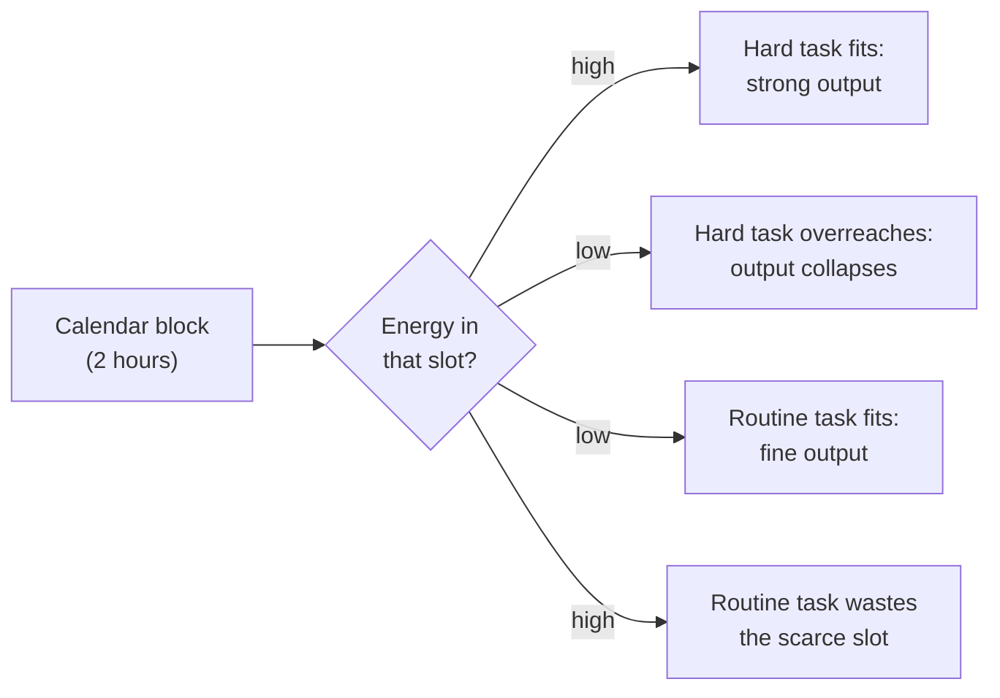

import Scenario from "../../../components/Scenario.astro";
import LevelIntro from "../../../components/LevelIntro.astro";
import PracticeCheck from "../../../components/PracticeCheck.astro";

export const unit = {
  track: "sustainable-performance",
  unitSlug: "energy-management-across-day-week",
};

<Scenario label="Same two hours, two very different results">
  <Fragment slot="facts">
    

      

        

          🌅 <strong>9 AM</strong> block
          focus 8 of 10 (illustrative)
        

        

          

        

      

      

        

          😴 <strong>2 PM</strong> block
          focus 3 of 10 (illustrative)
        

        

          

        

      

      
⏱️ Length of both blocks: 2 hours. Identical.

    

  </Fragment>

Sam is a student who protects two hours a day for studying. On Tuesday the block
starts at 9 AM and Sam finishes a hard problem set, with time to spare. On
Thursday the block starts at 2 PM, right after lunch, and Sam reads the same
paragraph five times without absorbing a word. **The calendar entry is
identical both days. What changed?**

Not the time. The two hours were the same length. What changed was how much
sharp focus Sam had to spend inside them. A calendar block guarantees that a
slot exists; it says nothing about what Sam can do once inside it.

</Scenario>

<LevelIntro
  items={[
    "Why an hour is not a fixed unit of capacity",
    "The daily and weekly shape of energy",
    "Task-energy mismatch as the real failure",
  ]}
/>

## If the hours were identical, why are the results so different?

Two ways of looking at the same Tuesday and Thursday:

| View              | What it counts           | What it predicts for Sam                   |
| ----------------- | ------------------------ | ------------------------------------------ |
| Time management   | Hours available          | Tuesday and Thursday should match: 2h = 2h |
| Energy management | Focus available per hour | Tuesday should beat Thursday: 8 beats 3    |

Only the second view explains what Sam actually saw. Time management treats every
hour as interchangeable. Energy management treats hours as **qualitatively
different**: the same clock hour can be a high-focus hour or a low-focus hour,
depending on where it falls in a person's daily and weekly pattern.

## The shape of the problem

- Mental energy is not flat across a day. For most people it rises, dips, and
  partly recovers in a fairly predictable shape (often tied to circadian and
  ultradian rhythms), and the overall level also drifts across a week: fresher
  early, more depleted late, recovering after rest.
- The practical failure is rarely "not enough time". It is **task-energy
  mismatch**: putting the task that most needs sharp focus into a slot where
  focus is naturally lowest, and burning a high-focus slot on something that
  barely needed it.

<PracticeCheck
  track={unit.track}
  unitSlug={unit.unitSlug}
  topicId="energy-vs-time"
/>

## Key terms

- **Energy state**: a person's current capacity for focus, decision-making, and
  creative effort, as distinct from how many hours they have free.
- **Circadian dip**: a predictable low point in alertness that most people
  notice in the early-to-mid afternoon.
- **Task-energy matching**: scheduling high-demand cognitive work (writing,
  problem-solving, hard decisions) into naturally high-energy windows, and
  low-demand work (routine replies, filing, tidying) into naturally low-energy
  windows.
- **Weekly energy trend**: the slower rise and fall of overall capacity across a
  week, layered on top of the faster daily rhythm.

## What this unit covers

L2 works out the shape of a daily curve, how to match task difficulty to it, and
how the weekly trend shifts the whole curve. L3 scores two schedules for the same
five tasks, one energy-blind and one energy-matched, and shows what the
difference is worth.

The numbers on every curve in this unit (8 for a morning peak, 3 for the
afternoon dip) are illustrative, chosen to show the shape. They are not measured
averages, and your own curve may differ.
