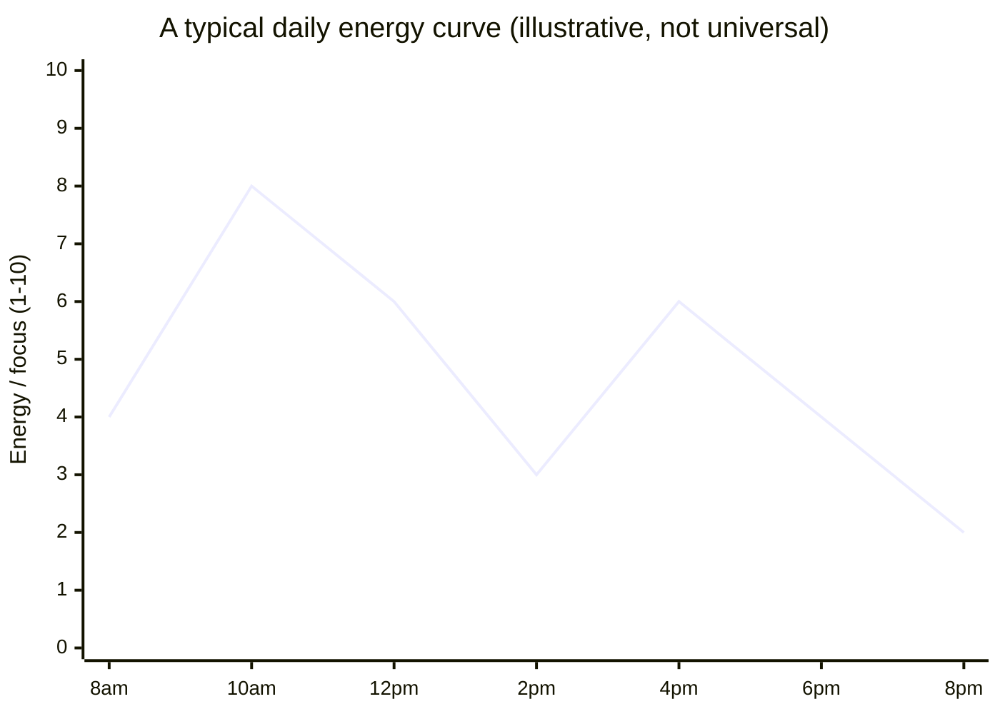
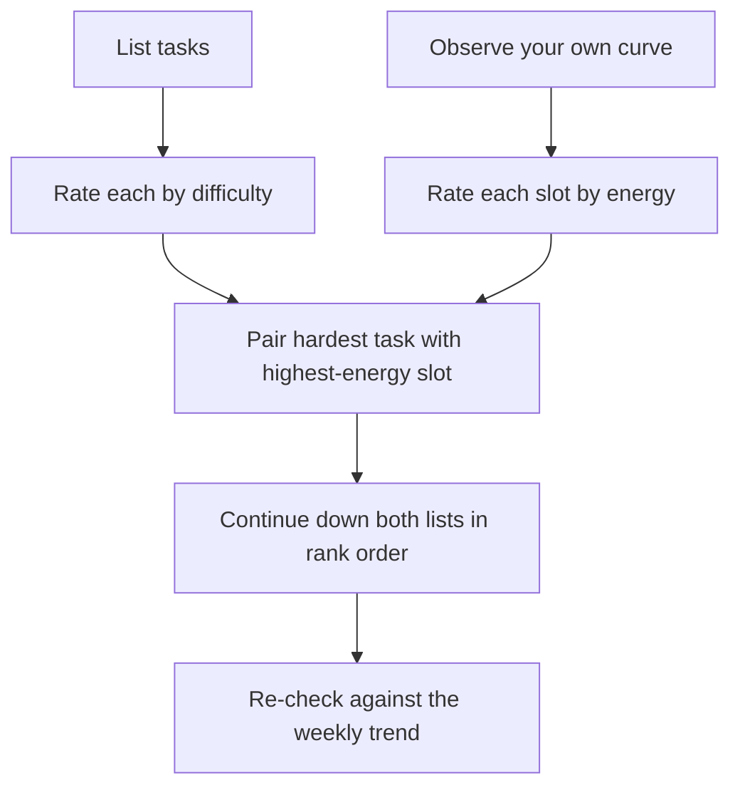
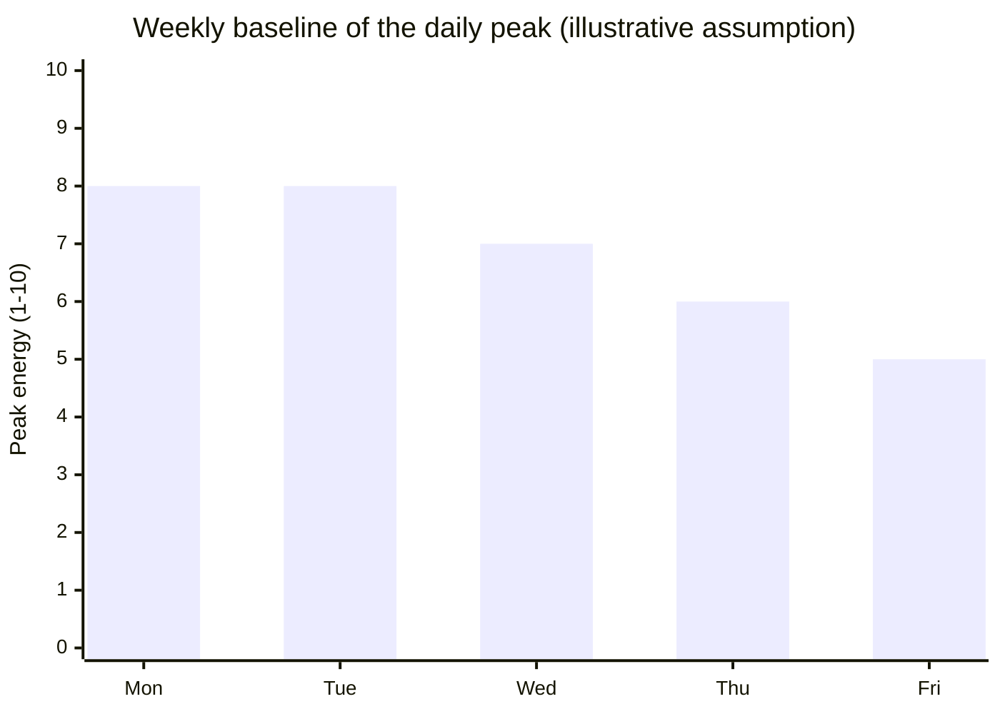

import LevelIntro from "../../../components/LevelIntro.astro";
import Checkpoint from "../../../components/Checkpoint.astro";
import PracticeCheck from "../../../components/PracticeCheck.astro";

export const unit = {
  track: "sustainable-performance",
  unitSlug: "energy-management-across-day-week",
};

L1 showed Sam getting a hard problem set done at 9 AM and nothing useful out of
the same two hours at 2 PM. L2 works out what the daily and weekly shape of
energy looks like, and how to place tasks on it instead of just naming the idea.

<LevelIntro
  items={[
    "The typical daily energy curve",
    "Matching task difficulty to energy state",
    "The weekly trend underneath the daily one",
  ]}
/>

## What actually varies across a day?

**If Sam's two-hour blocks are identical in length, what is the variable that
makes one productive and the other wasted?** Sam's underlying energy at the
time. Alertness for most people follows a recognizable shape across a day, not a
flat line:

Two features matter. The **morning peak** (around 10am: awake long enough to be
alert, before fatigue builds) and the **early-afternoon dip** (2pm, a common low
point that shows up even when lunch was light). The late-afternoon partial
recovery is real but, in this illustrative curve, smaller than the morning peak.

The shape is not universal. Some people peak later, some earlier. What nearly
everyone shares is _having_ a shape, and that is what makes energy a lever
separate from time.

**Does that mean you can borrow the curve above?** No. A borrowed curve is a
guess about someone else's body. The reliable method is to observe your own for a
week or two: note when work felt easy, when it felt like pushing a cart uphill,
and when you reread the same line repeatedly. Scheduling by a borrowed curve
reproduces the mismatch the curve was meant to solve.

<PracticeCheck
  track={unit.track}
  unitSlug={unit.unitSlug}
  topicId="daily-curve"
/>

## If the curve is fixed, what can you actually adjust?

Not the curve. The lever is **which task lands in which part of it**:

| Energy state                  | Good for                                                                  | Bad for                                                            |
| ----------------------------- | ------------------------------------------------------------------------- | ------------------------------------------------------------------ |
| High (peak)                   | Hard problems, first drafts, high-stakes decisions, learning new material | Routine work: this is the scarcest resource, do not spend it there |
| Medium (recovering/declining) | Editing, structured meetings, planning, moderately complex replies        | Starting something genuinely new and hard                          |
| Low (dip)                     | Routine replies, filing, scheduling, tasks with a checklist in hand       | Anything needing a first decision or sustained novel thinking      |

Sam's Thursday did not fail because of too few hours. It failed because a
high-demand task (the hard problem set) met a low-energy slot, while earlier in
the week a low-demand task could easily have taken that slot. Swapping which task
occupies which slot, with zero change in total hours, changes the outcome.

<Checkpoint question="Sam has a high-energy 10am slot and a low-energy 2pm slot. Sam is tempted to spend 10am tidying notes ('to feel organized') and save the hard problem set for 2pm. What is wrong with that plan, using the table above?">

It puts the mismatch in twice. The 10am slot is the scarce, high-energy window
that the table says routine work should never take, so tidying notes squanders
capacity that a hard task could have used. Then the problem set lands at 2pm,
right in the dip, where the table says a first decision or sustained novel
thinking is the worst fit. The tidying would have gone nearly as well at 2pm; the
problem set needed 10am and did not get it. Feeling organized is not the same as
having used the two slots well.

</Checkpoint>

<PracticeCheck
  track={unit.track}
  unitSlug={unit.unitSlug}
  topicId="task-matching"
/>

## Does the curve look the same on Friday as on Monday?

Usually not. Under the daily up-and-down, most people carry a slower weekly
trend: fresher and more resilient early in the week, more depleted toward the
end, recovering with rest before it restarts.

This matters beyond a single day: the 10am slot that hits 8 on Monday might only
reach 5 by Friday (these five numbers are an assumed example). A schedule that
assumes every Monday-equivalent hour behaves the same all week keeps putting hard
work into a slot that has quietly weakened, and the mismatch compounds instead of
resetting each morning.

<Checkpoint question="A schedule was built once, on Monday, by matching each task to that day's curve. Is it still well matched on Thursday, and why or why not?">

Not necessarily. The daily shape (morning peak, afternoon dip) still recurs, but
the weekly trend means the peak itself has probably dropped: the chart shows 8 on
Monday sliding to 6 by Thursday. A task sized for an 8 on Monday can now sit in
what is really a 6, the same overreach mismatch described for the daily curve,
only introduced by the week instead of the day. Matching has to be re-checked
against the week's trend, not assumed to hold from one day's measurement.

</Checkpoint>

<PracticeCheck
  track={unit.track}
  unitSlug={unit.unitSlug}
  topicId="weekly-trend"
/>

## Failure modes at this level

| Failure mode                               | Why it fails                                                                                                                   |
| ------------------------------------------ | ------------------------------------------------------------------------------------------------------------------------------ |
| Assuming your curve matches someone else's | The shape is a common pattern, not a law; genuine late-peakers exist, and a borrowed curve reintroduces the mismatch           |
| Treating the dip as a willpower failure    | Forcing hard work through a natural low usually costs more (recovery time, errors) than moving a low-demand task into the slot |
| Optimizing only the daily curve            | A schedule that looks matched on Monday can still fail by Thursday if the weekly decline is ignored                            |
