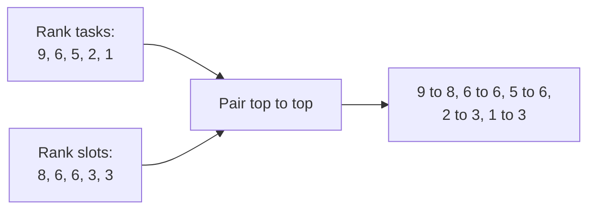

import Scenario from "../../../components/Scenario.astro";
import LevelIntro from "../../../components/LevelIntro.astro";
import Checkpoint from "../../../components/Checkpoint.astro";
import PracticeCheck from "../../../components/PracticeCheck.astro";

export const unit = {
  track: "sustainable-performance",
  unitSlug: "energy-management-across-day-week",
};

<Scenario label="One workday, five tasks, five slots">
  <Fragment slot="facts">
    

      
Task difficulty (1-10)

      
Draft the hard proposal

9

      
Plan next sprint

6

      
Review teammate's PR

5

      
Reply to routine emails

2

      
File expense report

1

      
Slot energy (1-10)

      
🌅 9am: 8, 11am: 6, 1pm: 3, 2pm: 3, 4pm: 6

    

  </Fragment>

Maya has five tasks and five slots, and she is about to drop them in as they
come to mind. **The same five tasks, in the same five slots, can produce very
different results depending only on which task goes where. How much is the
ordering actually worth, and can you put a number on it?**

This level answers with a deliberately simple scoring rule, applied to two
schedules for the same day.

</Scenario>

<LevelIntro
  items={[
    "Scoring a schedule with an effectiveness rule",
    "Comparing an energy-blind schedule to an energy-matched one",
    "Where the matching principle breaks down",
  ]}
/>

All numbers below (task difficulties, slot energies, the scoring weights) are
assumed for illustration. They are a teaching model, not measurements of any real
person.

## How do you score a task placed in a slot?

Both kinds of mismatch lose points, at different rates:

1. If the slot's energy is at or above the task's difficulty, the task fits but
   wastes spare capacity: effectiveness is the energy minus half the surplus.
2. If the slot's energy is below the task's difficulty, the task overreaches:
   effectiveness is the energy minus one and a half times the shortfall, and it
   never goes below zero.

Why the different weights? A task given more energy than it needed still gets
done, and the spare capacity is only lost value. A task given less than it needed
may produce nothing usable at all.

| Case               | Energy | Difficulty | Calculation        | Effectiveness |
| ------------------ | ------ | ---------- | ------------------ | ------------- |
| Overreach (mild)   | 8      | 9          | 8 - 1 x 1.5        | 6.5           |
| Overreach (severe) | 3      | 6          | 3 - 3 x 1.5 = -1.5 | 0 (floored)   |
| Surplus (small)    | 6      | 5          | 6 - 1 x 0.5        | 5.5           |
| Surplus (large)    | 6      | 1          | 6 - 5 x 0.5        | 3.5           |
| Perfect fit        | 6      | 6          | 6 - 0              | 6.0           |

The interactive demo on this unit lets you drag slot energy and task difficulty
and watch exactly this rule. Its default is the severe overreach row.

<PracticeCheck
  track={unit.track}
  unitSlug={unit.unitSlug}
  topicId="effectiveness-score"
/>

## Schedule A: time-blocked, energy-blind

Maya works through the list in the order it occurred to her, putting each task in
the next open slot:

| Slot (energy) | Task (difficulty)           | Effectiveness |
| ------------- | --------------------------- | ------------- |
| 9am (8)       | Draft the hard proposal (9) | 6.5           |
| 11am (6)      | Review teammate's PR (5)    | 5.5           |
| 1pm (3)       | Reply to routine emails (2) | 2.5           |
| 2pm (3)       | Plan next sprint (6)        | **0**         |
| 4pm (6)       | File expense report (1)     | 3.5           |
| **Total**     |                             | **18.0**      |

**Before reading on: where is the worst mismatch, and why is its score exactly 0
rather than just low?** It is sprint planning at 2pm: a difficulty-6 task in an
energy-3 slot. The shortfall of 3 times the overreach weight of 1.5 is 4.5, more
than the slot's own 3, so the score floors at zero. That is not "did it badly";
it is "produced nothing usable", which matches trying to plan something
consequential in a genuine trough.

<Checkpoint question="In Schedule A, filing the expense report (difficulty 1) landed in the 4pm slot (energy 6) and scored 3.5. Is that the same kind of mismatch as the sprint-planning failure, and does it call for the same urgency?">

No, it is the opposite direction. Sprint planning was overreach: too little
energy for the task, penalized at 1.5 times the gap, so it collapsed to zero. The
expense report at 4pm is surplus: too much energy for a task that barely needed
it, penalized at only 0.5 times the gap, so it still scores 3.5. Overreach
produces unusable output and is the one to fix first; surplus only leaves value on
the table. That asymmetry is why the rule weights the two directions differently.

</Checkpoint>

## Schedule B: energy-matched

Same five tasks, same five slots. Only the assignment changes: rank the tasks by
difficulty, rank the slots by energy, and pair them top to top.

The two slots tied at 6 (11am and 4pm) and the two tied at 3 (1pm and 2pm) are
interchangeable: either order scores the same.

| Slot (energy) | Task (difficulty)           | Effectiveness |
| ------------- | --------------------------- | ------------- |
| 9am (8)       | Draft the hard proposal (9) | 6.5           |
| 11am (6)      | Plan next sprint (6)        | 6.0           |
| 4pm (6)       | Review teammate's PR (5)    | 5.5           |
| 1pm (3)       | Reply to routine emails (2) | 2.5           |
| 2pm (3)       | File expense report (1)     | 2.0           |
| **Total**     |                             | **22.5**      |

```mermaid
xychart-beta
    title "Effectiveness per task: Schedule A (first bar) vs Schedule B (second bar)"
    x-axis ["Proposal", "Sprint plan", "PR review", "Emails", "Expense report"]
    y-axis "Effectiveness" 0 --> 10
    bar [6.5, 0, 5.5, 2.5, 3.5]
    bar [6.5, 6, 5.5, 2.5, 2]
```

Total hours are identical in both. **Total effectiveness goes from 18.0 to 22.5, a
25% improvement (22.5 / 18.0 = 1.25), from changing which task lands in which
slot.**

Where does the gain come from? Not from every task. Three of the five scores do
not change: the proposal was already in the best slot, and the PR review and the
emails land in slots of the same energy as before. The whole gain is two moves:
sprint planning rises from 0 to 6.0 (+6.0), and the expense report drops from 3.5
to 2.0 (-1.5). Net: +6.0 - 1.5 = +4.5. A small loss on a low-stakes task bought a
large gain on the task that would have collapsed.

<PracticeCheck
  track={unit.track}
  unitSlug={unit.unitSlug}
  topicId="schedule-comparison"
/>

## What does this example prove, and what does it not?

**Would the same 25% hold for different tasks, or for a person whose curve peaks
in the evening?** Not necessarily. The size of the gap depends on how badly
mismatched the original schedule happened to be, and a schedule that is already
close to matched has little room to improve. What generalizes is the mechanism,
not the 25%: any schedule that ignores energy has some mismatched pairs, and
re-pairing them recovers effectiveness at no cost in total hours.

<Checkpoint question="A colleague's curve peaks in the evening, not the morning. Does the rank-tasks, rank-slots, pair-top-to-top procedure still apply to them?">

Yes, unchanged. What changes is the input, not the method. The procedure never
assumed a morning peak; it only assumed that difficulty and energy can each be
ranked. What would be wrong is feeding it Maya's table (9am high, 2pm low) for
someone whose real curve is different, which would reintroduce a mismatch with
the wrong person's numbers. Once they observe their own curve, the same ranking
and pairing recover the same kind of gain.

</Checkpoint>

## Failure modes

| Failure mode                                      | What it gets wrong                                                                                                                                                                        |
| ------------------------------------------------- | ----------------------------------------------------------------------------------------------------------------------------------------------------------------------------------------- |
| Matching by urgency instead of difficulty         | An urgent-but-easy task (the expense report, due at 5pm) does not need a high-energy slot because it is due soon; urgency decides _when in the day_, difficulty decides _how much energy_ |
| Assuming the schedule only needs fixing once      | The weekly trend from L2 shifts a slot's real energy across the week; a Monday match can silently become a Thursday mismatch                                                              |
| Overcorrecting into rigid energy-only scheduling  | A fixed client call or hard deadline cannot always move to the ideal slot; matching is a default to lean toward, not a rule that overrides every other constraint                         |
| Treating one bad day as proof the approach failed | One day's curve can deviate (poor sleep, an early meeting); matching against yesterday's assumed curve instead of today's state reintroduces the mismatch                                 |

## This is one case, not the whole territory

The example above has five tasks, five slots, and one scoring rule. Real days
have meetings that cannot move, tasks that take two slots, and energy that
depends on sleep. Treat the worked numbers as a case to reason from, not a
template to copy.

**Try extending it yourself.** If Maya's 4pm energy were 8 instead of 6 (a
genuine second peak), which task moves, and does the gap between the two
schedules get larger or smaller? Then change something else: what happens to the
gap if every task were difficulty 5?

<Checkpoint question="With 4pm energy at 8 (slots 8, 6, 3, 3, 8), which task moves in Schedule B, and what happens to the gap between the schedules?">

The sprint plan (difficulty 6) moves to a slot of energy 8 (4pm or 9am, the tied
top slots), scoring 7.0 instead of 6.0, while the proposal stays at 8 and the PR
review takes the 6. Schedule B totals 6.5 + 7.0 + 5.5 + 2.5 + 2.0 = 23.5.
Schedule A (same task order) improves too, since the expense report at 4pm now
scores 4.5: 6.5 + 5.5 + 2.5 + 0 + 4.5 = 19.0. The absolute gap stays 4.5, but the
relative gain shrinks slightly (23.5 / 19.0 is about 1.24), because both totals rose and the baseline is now larger.

</Checkpoint>
