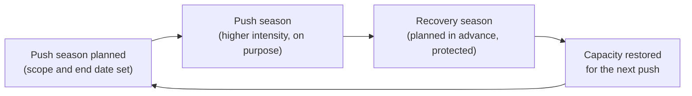
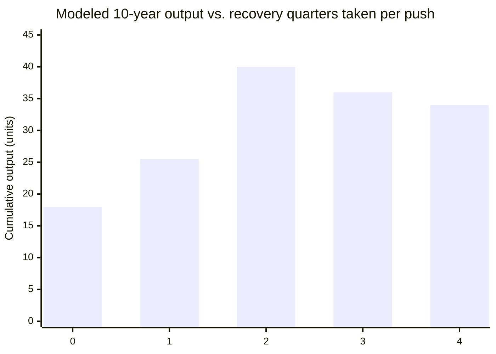

import LevelIntro from "../../../components/LevelIntro.astro";
import Checkpoint from "../../../components/Checkpoint.astro";
import PracticeCheck from "../../../components/PracticeCheck.astro";

export const unit = {
  track: "sustainable-performance",
  unitSlug: "long-horizon-sustainability",
};

L1 showed the trap: every quarter can look like a win while the run of them
fails as a decade. L2 works out how the pace has to be built to avoid that, and
why more hours are not the substitute they look like.

<LevelIntro
  items={[
    "Why strong quarters can sum to a weak decade",
    "What makes a seasons model work",
    "What lasting output depends on besides hours",
  ]}
/>

## Why can strong quarters sum to a weak decade?

**If each quarter, judged alone, really was strong, where does the damage come
from?** From what each "run hot" decision quietly borrows from the next
quarter. The result shows up now; the cost lands later, so it never appears in
the quarter that caused it.

| Viewed one quarter at a time                     | Viewed across a decade                                        |
| ------------------------------------------------ | ------------------------------------------------------------- |
| "This launch matters, I will push hard."         | The fourth push in a row with no quarter set aside to recover |
| "I can skip the vacation, the project needs me." | Many skipped recovery windows, each invisible, adding up      |
| "I stayed sharp enough to ship this well."       | Judgment slowly eroding each cycle, visible only in hindsight |

A push taken on purpose is often the right call. The mistake is treating every
quarter as one.

## What does a seasons model actually require?

**If the fix is "alternate push and rest," isn't that just common sense?** The
difference is that recovery is **planned before the push starts**, sized to the
push, and protected once it arrives. "I will rest when things calm down" means
resting only if nothing else comes up, which for a demanding role is close to
never.

The demo on this unit models 40 quarters (ten years). Each push is two quarters
at 150% output, a recovery quarter runs at 50%, and a push needs two recovery
quarters to fully pay off. Unpaid debt compounds into low-output crash
quarters. These are modeled assumptions, not measurements. What the model
produces:

Two things stand out. Taking no recovery is far the worst (18 versus 40). And
taking _more_ than the push needs (3 or 4 quarters) gives up a little output
rather than gaining any, so the answer is "sized to the push," not "as much
rest as possible."

<Checkpoint question="Something urgent comes up and the planned recovery quarter gets skipped 'just this once.' What happens to the debt from the push?">

It does not cancel. It rolls forward and stacks onto whatever the next push
borrows, the same way a skipped loan payment is still owed next month. A
seasons model that lets anything more urgent override recovery is not really a
seasons model; it is a permanent push with a hopeful label.

</Checkpoint>

A recovery season is not "doing nothing." It usually means lower-stakes work:
less on-call, fewer concurrent projects, and more of the reflection and
teaching that a push crowds out.

<PracticeCheck
  track={unit.track}
  unitSlug={unit.unitSlug}
  topicId="seasons-model"
/>

## What does lasting output depend on besides hours?

**Doesn't more output over more years just mean working more hours for longer?**
Not for the part of experienced work that matters most: judgment about which
problems are worth solving, mentoring that raises other people's output, and
trust built by being predictable. All three need spare capacity to reflect,
teach and notice early warnings. Someone permanently redlined has _less_ of
that, even while logging the most hours.

| What raw hours buy                  | What decade-scale output actually needs                              |
| ----------------------------------- | -------------------------------------------------------------------- |
| More tickets closed this sprint     | Judgment about which problems are worth solving at all               |
| More individual output this quarter | Other people's output rising because of mentoring, which needs slack |
| Being always available              | Being consistently trusted, built over years by being predictable    |

<Checkpoint question="A manager says, 'She is the hardest worker on the team, so she will advance fastest.' What would you want to know before agreeing?">

Hardest-working, measured in hours, is not the same axis as lasting output. The
useful questions are whether that intensity has any planned recovery attached,
and whether the hours are turning into judgment, mentoring and trust or only
into more individual output this quarter. Someone running hot can look like the
obvious next step for a year or two and still be the person most likely to burn
out before getting there.

</Checkpoint>

<PracticeCheck
  track={unit.track}
  unitSlug={unit.unitSlug}
  topicId="capacity-not-hours"
/>

## Failure modes at this level

| Failure mode                                           | Why it fails                                                          |
| ------------------------------------------------------ | --------------------------------------------------------------------- |
| Treating every quarter as the most important one       | Nothing is ever the lighter season, so the model collapses to a push  |
| Making recovery conditional on nothing being urgent    | Something is always urgent, so recovery effectively never happens     |
| Measuring readiness by hours instead of what they make | Hours and judgment look identical for a year or two before they split |
