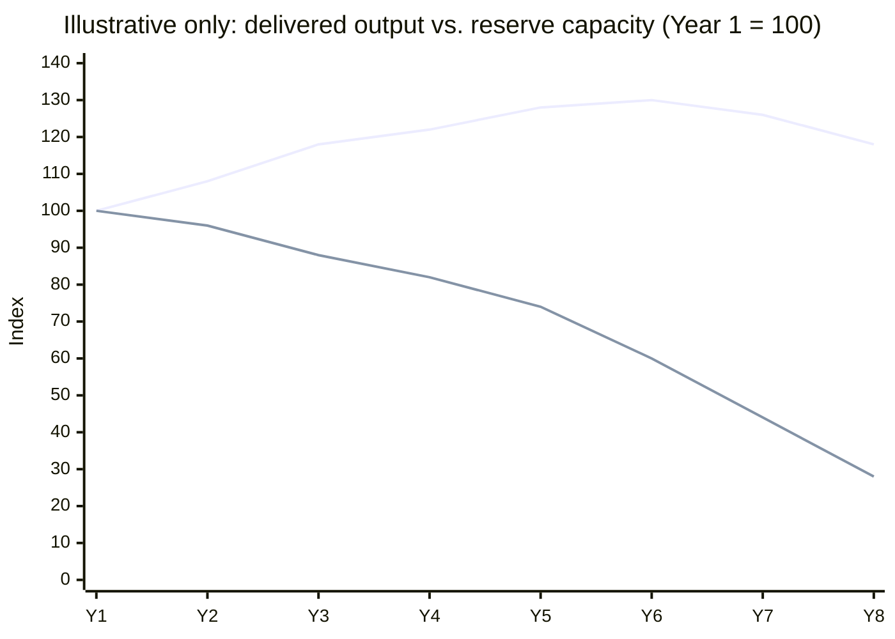

import Scenario from "../../../components/Scenario.astro";
import LevelIntro from "../../../components/LevelIntro.astro";
import Checkpoint from "../../../components/Checkpoint.astro";
import PracticeCheck from "../../../components/PracticeCheck.astro";

export const unit = {
  track: "sustainable-performance",
  unitSlug: "long-horizon-sustainability",
};

<Scenario label="The scenario">
  <Fragment slot="facts">
    

      
🗓️ <strong>Years 1 to 5</strong> — a promotion about every 18 months (assumed for this case), never a lighter year

      
⏱️ <strong>Years 6 to 8</strong> — about 55 hours a week (assumed), the biggest project of her career

      
🏆 <strong>Month 10 of year 8</strong> — the promotion process opens

      
😶 <strong>The reaction</strong> — no relief, dread, two missed 1:1s

    

    
The model's read on her pattern

    

      
📉 About 1 recovery quarter per push: 25.5 modeled units

      
📈 2 recovery quarters per push: 40 modeled units

    

  </Fragment>

Priya has worked as an engineer at a payments company for eight years. Her
reviews were strong every cycle, every launch she touched shipped on time, and
she was promoted regularly. The week the biggest promotion of her career opens,
she feels nothing, then dread, and then misses two consecutive 1:1s with her own
reports because she genuinely cannot face them. **Nothing in her record shows a
problem. What was building underneath, and what does she change once she sees
it?**

</Scenario>

L2 established what the seasons model requires and why hours are not a
substitute. L3 walks one decade through it, including the point where it
nearly broke.

<LevelIntro
  items={[
    "Why output lags the real warning signal",
    "The inflection point and what forced it",
    "Structural changes versus plain rest",
  ]}
/>

## Years 1 to 5: the run that looked entirely fine

Every year had a defensible reason behind it. This table is the case as written
for this unit, with assumed details:

| Year | What happened                                              | How it looked at the time     |
| ---- | ---------------------------------------------------------- | ----------------------------- |
| 1-2  | Ramped fast, became the go-to for the checkout service     | Promising, promoted early     |
| 3    | Owned a re-platforming project solo, about 50h/week        | High performer                |
| 4    | Promoted; immediately took on the on-call rotation lead    | Rewarded for reliability      |
| 5    | Took a second critical launch mid-year on top of the first | "Someone who always delivers" |

**Was any single year a mistake?** Not obviously. The pattern only appears in
aggregate: five years, and none was ever planned as a lighter one. The recovery
season was perpetually deferred to "after this next thing."

## Years 6 to 8: the debt compounds, quietly

She kept the pace through the biggest migration of her career, about 55 hours a
week. Her patience in code review got shorter, she stopped flagging risks she
would have caught a year earlier, and she began canceling her own 1:1s first
when a sprint got tight. None of this appears in a review, because reviews
measure delivered output, not the reserve behind it.

The chart below is **illustrative, with invented index values** (Year 1 = 100)
meant to show a shape, not a measurement:

**Why does output stay high for years after reserve starts falling?** Output is
partly funded by accumulated skill and reputation, which do not vanish when
reserve does. She could ship well on fumes for a while, drawing down rather
than replenishing. That gap is the recovery debt from L2 made visible, and it is
why the crash looked sudden from outside after building for years.

<Checkpoint question="If a manager judged whether Priya's pace was sustainable only by delivered output, what would they conclude, and why would that be wrong?">

They would conclude it was working, since output was still rising for years.
That is wrong because the output was being funded by a shrinking reserve, and
the two lines measure different things. Output is a lagging signal; the warning
was in reserve capacity, which no review measured.

</Checkpoint>

<PracticeCheck
  track={unit.track}
  unitSlug={unit.unitSlug}
  topicId="lagging-signal"
/>

## Year 8, month 10: the inflection point

The migration shipped in month 9, on time and well reviewed. A week later the
promotion process opened, and she felt nothing, then dread, and could not
concentrate for more than a few minutes. **Why was this the inflection point
rather than another stretch she would push through?** Two reasons: it was the
first time exhaustion did not lift after the triggering project ended, and the
first time the cost was visible to other people. Her reports noticing missed
1:1s made it concrete instead of private.

## What she changed, and why rest alone would not have done it

Her manager noticed the missed 1:1s and asked directly. What followed was not a
vacation and a return to the same pace, but a restructuring of the next
several years:

1. She named the pattern out loud as a multi-year one, asking for at least one
   planned recovery season over the next four quarters, rather than saying she
   was tired this month. A bad-week framing would have produced a bad-week fix.
2. She stepped away from the on-call lead role for two quarters and handed it to
   an engineer she had been meaning to develop, so her recovery doubled as
   someone else's growth.
3. When the next "critical" launch was offered a month later, she declined it
   by naming what she was already carrying and handing the prioritization call
   back to her manager (the framing from `sustainable-boundary-setting`).
4. She put protected, recurring time on the calendar for mentoring and design
   review she had quietly dropped, treating it as fixed like a shipping date.
5. The promotion came four months later than the original plan.

**Did the delay mean recovery cost her the promotion?** No. It delayed it, and
the version of her that was promoted had already shown what the recovery made
room for: she had grown another engineer into the on-call role and protected
review time for the team. Against the alternative (same pace, original
timeline, the years 6 to 8 trend continuing), the delay was small.

<Checkpoint question="Her manager had instead said, 'Take a long weekend and you will be back to normal.' Why would that have missed the real problem?">

A long weekend treats acute fatigue, and the problem was three years with no
planned recovery. It is a bad-week fix applied to a multi-year pattern. None of
the five changes (naming the pattern, stepping back from on-call lead,
declining the launch, protecting mentoring time, accepting a later promotion)
would have happened from a long weekend, so the same allocation of work would
have recreated the same debt within a quarter or two.

</Checkpoint>

<PracticeCheck
  track={unit.track}
  unitSlug={unit.unitSlug}
  topicId="structural-response"
/>

## What generalizes, and what is specific to Priya

This is one case, not the whole territory. What generalizes: a run of
individually defensible hot quarters can compound because the cost is invisible
from inside any single one, and recovering needs a change in how future work is
allocated, not just time off. The same pattern appears in research, medicine,
sales and any role where "the next push" is always available to justify
skipping recovery. What is specific to her: the five-year runway, the
migration, the four-month delay, and the supportive manager. Someone else's
decade has different triggers and a different runway.

**Try extending it yourself.** Suppose the inflection had come at year 4 instead
of year 8, right after her first promotion, with a manager who treated the
missed 1:1s as a performance problem rather than a capacity signal. Using the
seasons model from L2, what would she need to do differently? And does having
far less tenure and trust at year 4 change what declining a launch would cost
her, or only make it harder to do?

## Failure modes across the decade

| Failure mode                                                 | What it gets wrong                                                             |
| ------------------------------------------------------------ | ------------------------------------------------------------------------------ |
| Judging pace by delivered output instead of reserve capacity | Output can rise for years while the reserve runs down; it is a lagging signal  |
| "I will rest when things calm down" as the recovery plan     | Something else is always urgent, so the plan effectively never runs            |
| Answering a near-burnout point with rest alone               | Rest treats the symptom; the pattern needs a change in how work is allocated   |
| Treating recovery as purely a personal cost                  | Hers doubled as another engineer's growth; good designs are often not zero-sum |
