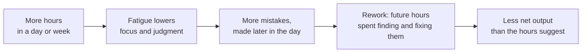

import Scenario from "../../../components/Scenario.astro";
import LevelIntro from "../../../components/LevelIntro.astro";
import PracticeCheck from "../../../components/PracticeCheck.astro";

export const unit = {
  track: "sustainable-performance",
  unitSlug: "myth-linear-output",
};

<Scenario label="The problem">
  <Fragment slot="facts">
    

      

        3h → 9h a day
        Sam's plan, three times the study time
      

      

        

      

      

        

      

    

    

      
📚 Usual: 3 hours a day, 30 practice problems solved correctly (assumed numbers)

      
🧮 Sam's math: 9 hours should mean 90 problems

      
❓ Unknown: what the ninth hour actually produces

    

  </Fragment>

Sam has an exam in a week. On a normal day Sam studies for 3 hours and
solves about 30 practice problems correctly. These numbers are made up to
keep the arithmetic easy. Sam decides to study 9 hours a day instead and
reasons: "three times the hours, so three times the problems, 90 a day."

**By the evening of the first 9-hour day, will Sam have 90 correct
problems, fewer than 90 but more than 30, or could Sam end up with fewer
correct problems than after a normal 3-hour day?**

</Scenario>

The same reasoning shows up at work every time a deadline tightens: "we need
more done, so we work more hours." Sam's guess is the model almost everyone
reaches for first, and this unit is about where it quietly stops being true.

<LevelIntro
  items={[
    "The straight-line assumption",
    "Diminishing and negative returns",
    "Why this is a throughput argument",
  ]}
/>

## What is the straight-line assumption?

**Sam multiplied hours by a fixed rate. Is that how output really grows?**
It is how output grows for a little while, which is why the model survives.

- **Linear model:** output = hours × a constant rate. Double the hours, double
  the output. Every hour is assumed to be as good as the first.
- **Observed pattern:** the line bends. Early hours track the straight line,
  then each extra hour adds less, and eventually it can subtract.
- The model is not stupid, it is a good local approximation. It fails when it
  is stretched far beyond the range where it was true.

| What you'd expect (linear)                | What actually happens                                             |
| ----------------------------------------- | ----------------------------------------------------------------- |
| More hours means proportionally more      | More hours means more output, then less per hour, then less total |
| Effort and result move together forever   | The relationship bends, and can reverse                           |
| "Behind schedule" is fixed by "work more" | Past a point, "work more" makes "behind schedule" worse           |

<PracticeCheck
  track={unit.track}
  unitSlug={unit.unitSlug}
  topicId="linear-assumption"
/>

## What are diminishing and negative returns?

**If the line bends, how far can it bend before more hours do harm?** There
are two different bends, and they call for different decisions.

- **Diminishing returns:** each extra hour adds less than the one before it.
  The total still goes up, just more slowly.
- **Negative returns:** an extra hour makes the total go down, because the
  mistakes it causes cost more than it produces.
- The turning point between them is the peak of the curve. Left of it, more
  hours still buys something. Right of it, fewer hours is the better lever.

<PracticeCheck
  track={unit.track}
  unitSlug={unit.unitSlug}
  topicId="returns-regions"
/>

## Why would a tired hour cost more than it makes?

**Sam's ninth hour produces a few problems, and some of them are wrong. Who
pays for the wrong ones?** Nobody pays in that hour.

- A mistake costs hours later, on a different day than the one that caused it.
  That delay is why the effect is easy to miss while it is happening.
- **Net output** is what is left after mistakes are fixed: finished, correct,
  usable work. It is the number that matters, not hours logged.

<PracticeCheck
  track={unit.track}
  unitSlug={unit.unitSlug}
  topicId="rework-delay"
/>

## Is this a wellness argument?

**A manager says "I do not care about anyone's comfort, I care about what
ships." Does the argument still apply?** Yes, and that is the point.

- This is a **throughput** argument. If the goal is the most sustained
  output over a real horizon, a quarter or a year, then pushing past the
  peak is a measurably worse strategy, not a kinder-but-slower one.
- It does not say "never work long hours" or name a universal number of
  hours. It says the relationship bends, and treating overtime as free
  capacity is a modeling error.
- So "we need this sooner" and "add hours" stop being the same lever past
  a point. Scope, sequencing, and staffing remain.

<PracticeCheck
  track={unit.track}
  unitSlug={unit.unitSlug}
  topicId="throughput-framing"
/>
