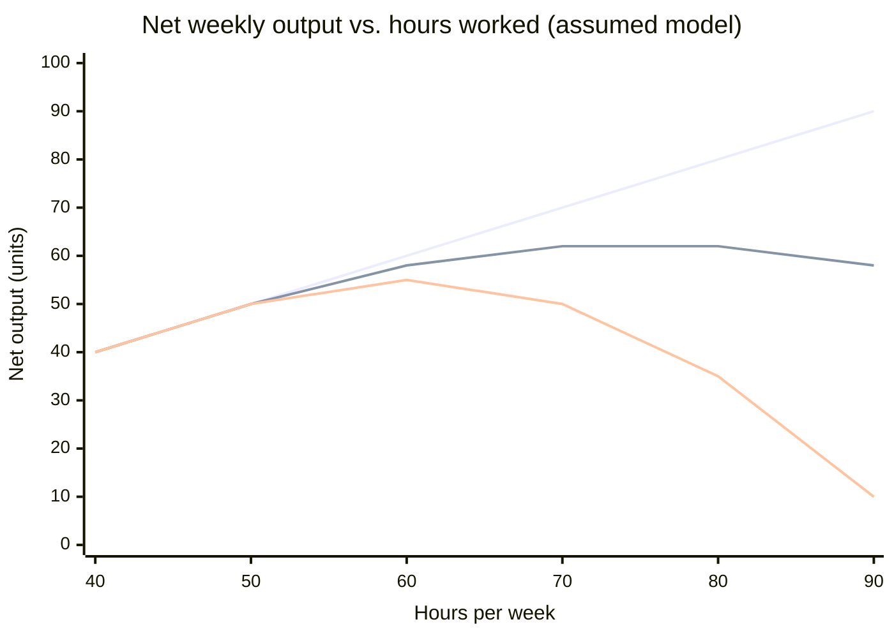

import LevelIntro from "../../../components/LevelIntro.astro";
import Checkpoint from "../../../components/Checkpoint.astro";
import PracticeCheck from "../../../components/PracticeCheck.astro";

export const unit = {
  track: "sustainable-performance",
  unitSlug: "myth-linear-output",
};

L1 named the shape: a straight-line assumption that holds for a while, then
bends, and can turn downward. L2 puts a concrete curve under that shape,
works out where the two kinds of bend sit, and asks what moves the turning
point.

<LevelIntro
  items={[
    "One explicit output curve, built from a formula",
    "Where diminishing turns into negative returns",
    "What moves the turning point",
  ]}
/>

## What does the bend look like when you write it down?

**Saying "the line bends" is easy. Can we pin the bend to numbers so that
the three regions are visible?** The interactive demo below this page uses a
simple assumed model, and every number in this level comes from it. Net
weekly output is the hours worked, minus a penalty that grows with the
square of the hours past 50:

`net output = hours − (k / 100) × (hours − 50)²` for hours above 50, where `k` is
the fatigue sensitivity: how error-prone the work is. This formula is an
illustrative assumption, not a measurement. It is built so the shape is
clear and the arithmetic is checkable.

Below 50 hours all three lines agree. Above it, the linear line keeps
climbing while the other two flatten and fall. The gap between the linear
line and the others is the cost of treating the straight-line model as true
past the range where it holds.

<Checkpoint question="At 90 hours the linear prediction is 90 units. In the k = 2 model the real figure is 58. Where did the 32 missing units go?">

They were never produced in the first place, they were spent. The penalty
term stands for mistakes that have to be found and fixed, so those hours
produce nothing new. Hours worked is still 90, but a growing share of them
goes into repairing earlier output. The straight-line model has no term for
that spending, so it reports the full 90 as though every hour made new work.

</Checkpoint>

<PracticeCheck
  track={unit.track}
  unitSlug={unit.unitSlug}
  topicId="linear-assumption"
/>

## How does the cost of a tired hour arrive?

**If the penalty is real, why does nobody notice it on the day it is created?**
Because it is billed to a later day.

A fatigued hour makes mistakes. The mistakes are only discovered when
something breaks or a check fails, and then someone spends hours fixing them.
Those hours come out of a future day's budget. A model that tracks only hours
worked against direct output cannot see this: the day that caused the cost
looks fine, and the day that pays it looks mysteriously slow.

<Checkpoint question="Tuesday's output looks normal after a very long, tiring Monday. Does that show Monday's late hours were fine?">

No. Tuesday's numbers only describe Tuesday's hours. The repair work that
Monday's mistakes create has not been billed yet, and it will arrive on
whichever day someone finds the problem. A clean-looking next day tells you
nothing about a cost already incurred but not yet paid.

</Checkpoint>

<PracticeCheck
  track={unit.track}
  unitSlug={unit.unitSlug}
  topicId="rework-delay"
/>

## Where does diminishing turn into negative?

**Both regions past 50 hours give a worse exchange rate. Is the difference
between them academic?** It decides whether more hours is a bad deal or the
wrong direction entirely.

In the assumed model, each extra hour above 50 adds `1 − 2 × (k / 100) × (hours − 50)`
units. That is 1 at 50 hours and falls steadily. When it reaches 0 the total has peaked,
and below 0 an extra hour subtracts. The peak sits at `50 + 50 / k` hours.

| Region (k = 2)      | Hours    | Added by one more hour                     | What it implies                     |
| ------------------- | -------- | ------------------------------------------ | ----------------------------------- |
| Linear              | up to 50 | about 1 unit                               | More hours is a fair lever          |
| Diminishing returns | 50–75    | 1 unit falling to 0 (0.6 at 60, 0.2 at 70) | Still helps, at a worsening rate    |
| Negative returns    | above 75 | below 0 (−0.2 at 80)                       | Fewer hours is now the better lever |

The line that matters for a decision is the one between the last two rows. To
the left, "push harder" is a bad deal. To the right, it is a lever pointed
the wrong way.

<Checkpoint question="A team at 60 hours a week (k = 2) is told to go to 70 to catch up, and later to 85. Is the second push the same kind of decision as the first?">

No. Going from 60 to 70 stays inside diminishing returns: the total goes from
58 to 62, a small gain at a poor rate. Going to 85 crosses the peak at 75, so the
total falls from 62 back down to roughly 60 (85 − 0.02 × 35² = 60.5). The first push
is a worse deal that still pays. The second spends effort to produce less than
the plan it replaced, even though the pressure to do it feels the same.

</Checkpoint>

<PracticeCheck
  track={unit.track}
  unitSlug={unit.unitSlug}
  topicId="returns-regions"
/>

## What moves the turning point?

**If the peak is at 75 hours for one team, is that a safe number for
everyone?** No. The chart already shows it: with `k = 5` the peak is at
`50 + 50 / 5 = 60` hours, fifteen hours earlier.

| Factor                                 | Effect on the bend                                               |
| -------------------------------------- | ---------------------------------------------------------------- |
| Error-prone, high-stakes work (high k) | Bends earlier, because each mistake is expensive to find and fix |
| Routine, low-stakes work (low k)       | Bends later, because mistakes are cheap and rare                 |
| One short push before a fixed date     | Little time for fatigue to compound                              |
| A heavy week repeated for months       | Rework from earlier weeks keeps piling on top of new fatigue     |

So there is no single correct number of hours. What does transfer is the
shape, and the habit of asking where this team's work sits on it.

<PracticeCheck
  track={unit.track}
  unitSlug={unit.unitSlug}
  topicId="curve-shape"
/>
