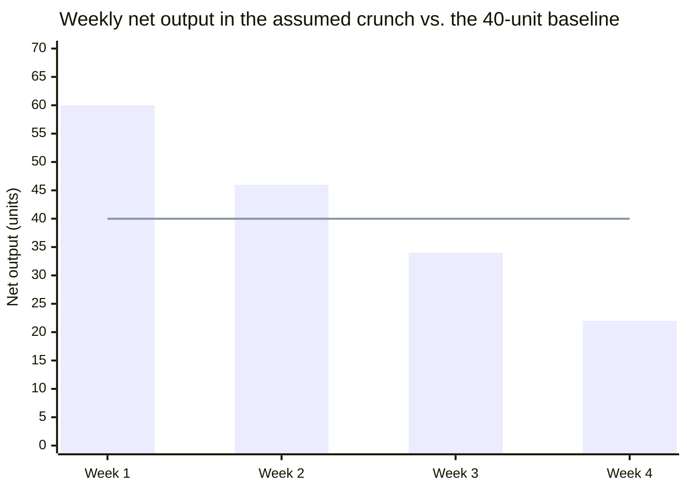

import Scenario from "../../../components/Scenario.astro";
import LevelIntro from "../../../components/LevelIntro.astro";
import Checkpoint from "../../../components/Checkpoint.astro";
import PracticeCheck from "../../../components/PracticeCheck.astro";

export const unit = {
  track: "sustainable-performance",
  unitSlug: "myth-linear-output",
};

<Scenario label="A worked crunch scenario">
  <Fragment slot="facts">
    

      
🗓️ Normal pace: 40h/week, 40 units of net output

      
📈 Plan: 65h/week for 4 weeks (+62.5%)

      
🧮 Linear forecast: 65 × 4 = 260 units

      
⚠️ All weekly figures below are assumed, chosen for clean arithmetic

    

  </Fragment>

A team has a deadline four weeks out. Their normal week is 40 hours and
produces 40 units of finished, correct work. The plan is 65 hours a week for
four weeks, and the reasoning is the familiar one: 65 is 62.5% more than 40,
so expect about 62.5% more done, which is 260 units against the usual 160.

**Before reading the breakdown: will the four-week total come out ahead of
the 260 forecast, somewhat ahead of the usual 160, or behind 160?**

</Scenario>

L2 gave the curve a formula. L3 runs a full four-week case through it week by
week, then checks what real data says about whether the shape is more than a
modeling convenience.

<LevelIntro
  items={[
    "A four-week crunch, arithmetic included",
    "What historical factory data suggests",
    "Failure modes in how teams reason about it",
  ]}
/>

## What does the week-by-week arithmetic look like?

**How can a model show rework compounding without hiding the numbers?** By
making each assumption a single visible number. Here are the assumptions,
all invented for clarity:

1. Gross output is what the 65 hours produce before repairs: 60, 52, 44, then 36 units
   (fatigue lowers yield: about 92%, 80%, 68%, then 55% of the 65 hours).
2. Mistakes made in a week must be fixed the next week, one unit of repair per
   mistake: 6, 10, 14, then 18 units (the last lands in week 5).
3. Net output for a week = gross − repair carried in from the week before.

| Week | Gross | Repair carried in | Net output | Against the 40 baseline |
| ---- | ----- | ----------------- | ---------- | ----------------------- |
| 1    | 60    | 0                 | 60         | +20                     |
| 2    | 52    | 6                 | 46         | +6                      |
| 3    | 44    | 10                | 34         | −6                      |
| 4    | 36    | 14                | 22         | −18                     |

The four-week total is 60 + 46 + 34 + 22 = 162 units, against 160 for four
ordinary weeks. That is a 2-unit gain for 100 extra hours (25 per week × 4).
It is also an incomplete number: the 18 units of repair from week 4 are
still owed in week 5, so counted honestly the crunch leaves 162 − 18 = 144
units of settled work, 16 below the baseline. The linear forecast of 260
overshoots the 162 by 98 units, about 60%, because it has no repair term at
all.

<Checkpoint question="Hours logged were about 65 in each of the four weeks. A manager reads that log and concludes the team held a strong, steady effort. What does the log hide?">

It measures activity, not result. The hours column is flat, so by that
measure week 4 looks like week 1. Net output fell every week, from 60 to 22,
and by week 3 it was already under what a normal week produces. Each week a
larger share of the same 65 hours went into fixing earlier mistakes, and no
column in the hours log records that. Judging the crunch by hours logged is
exactly what lets it look sustainable until the total arrives.

</Checkpoint>

<PracticeCheck
  track={unit.track}
  unitSlug={unit.unitSlug}
  topicId="net-output"
/>

## Does real data show the same shape?

**Everything above is an assumed model. Is there evidence the shape exists
outside a spreadsheet?** One frequently cited source is the economist John
Pencavel's analysis of detailed output records from British munitions
factories in the First World War. As reported, weekly output rose with hours
at a slowing rate, and very long weeks produced little or no more than
somewhat shorter ones, with output per hour falling as weeks got longer. The
exact figures are worth looking up directly instead of trusting a summary.

This is factory work, which is about as far from "burnout from creative
work" as it gets. If the shape shows up even in comparatively repetitive
manual output, that is some reason to think fatigue overtaking added time is a
general property of sustained effort and not a quirk of knowledge work.

<Checkpoint question="Someone objects that wartime factory records say nothing about modern knowledge work. Is the objection right?">

Partly. The exact hour count where the curve bends almost certainly differs
between repetitive factory work and error-prone knowledge work, and L2 already
showed the bend moving with how costly mistakes are. So the specific numbers
should not be imported. But the objection overreaches when it calls the data
irrelevant: repetitive work is the harder case for this shape to appear in,
so seeing it there supports the claim that the shape is real. The records are
evidence for the shape, never a ready-made hour count for any other job.

</Checkpoint>

<PracticeCheck
  track={unit.track}
  unitSlug={unit.unitSlug}
  topicId="curve-shape"
/>

## What failure modes show up in practice?

**Knowing the curve, how do teams still get this wrong?**

| Failure                                               | What it looks like                                                  | The fix                                                           |
| ----------------------------------------------------- | ------------------------------------------------------------------- | ----------------------------------------------------------------- |
| Measuring raw hours or work started, never net output | Activity looks impressive while correct, usable output falls        | Track finished work that does not need redoing                    |
| Judging one all-nighter like a months-long pattern    | A single push before an immovable date treated as a chronic problem | Weigh duration and intensity, they sit on different curves        |
| Cutting hours with no plan for the deadline           | The crunch is canceled but nothing replaces it                      | Change scope, sequencing, or staffing, which are the other levers |
| Importing the factory study's numbers as a benchmark  | "Output peaks at X hours" quoted for any kind of work               | Use the data as evidence for the shape, then measure this team    |

<PracticeCheck
  track={unit.track}
  unitSlug={unit.unitSlug}
  topicId="throughput-framing"
/>

## Beyond this example

The four-week crunch above is one case, not the whole territory. Try
stretching it:

- What changes if the work is routine and low-stakes? Predict whether the
  repair column shrinks, and whether the 162 would move above or below 160.
- What if the deadline is three days away, not four weeks? Which of the
  numbers above would still apply, and which failure mode becomes the
  real risk?
- If you had to argue "do not add hours here" to someone under real deadline
  pressure, which one number from this unit would you lead with, and why that
  one?
