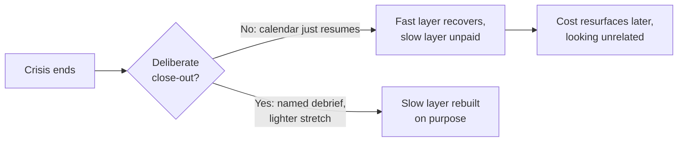

import Scenario from "../../../components/Scenario.astro";
import LevelIntro from "../../../components/LevelIntro.astro";
import PracticeCheck from "../../../components/PracticeCheck.astro";

export const unit = {
  track: "sustainable-performance",
  unitSlug: "recovery-practices-crunch",
};

<Scenario label="The problem">
  <Fragment slot="facts">
    

      
🏃 <strong>Sunday</strong>: a runner finishes a marathon (42.195 km)

      
😌 <strong>Wednesday</strong>: the legs feel normal again

      
📅 <strong>Next Monday</strong>: the old training plan resumes, full volume (assumed for this story)

      
❓ What did the feeling of "normal" actually measure?

    

  </Fragment>

A runner finishes a marathon on Sunday. By Wednesday the soreness is gone, the
legs feel normal, and the training plan on the fridge says Monday is a full
week again. Nothing hurts, so the plan stays as written.

**The soreness recovered. Did the runner?** The muscles that ached are only
one of the things the race spent. If nobody asks about the rest, where does
that unpaid cost go?

</Scenario>

Now swap the runner for a team. Three weeks of back-to-back incident response
end on a Friday, the system is stable, and Monday the calendar resumes with no
retro on the three weeks themselves. The team feels fine by Wednesday for the
same reason the runner does: the part that recovers fast is the part you can
feel.

<LevelIntro
  items={[
    "Feeling recovered versus being recovered",
    "Where unpaid cost resurfaces later",
    "What a deliberate close-out replaces",
  ]}
/>

## Why does "I feel fine" not settle it?

**If the legs feel normal on Wednesday, what is still owed?** The runner's
soreness is the fast layer. Underneath it sit slower things (tendons, sleep
debt, the base that training built) that do not announce themselves. The team
has the same two layers.

| Layer                   | Runner example                       | Team example                                       | Clock           |
| ----------------------- | ------------------------------------ | -------------------------------------------------- | --------------- |
| **Acute recovery**      | Soreness fades, sleep returns        | People sleep again, adrenaline comes down          | Days            |
| **Capacity rebuilding** | Tendons and base retrained gradually | Trust, belief that "urgent" means something, slack | Weeks to months |

- **Acute recovery** is the short reset after the crisis stops. Necessary, but
  visible, so it is easy to mistake for the whole job.
- **Capacity rebuilding** is the slower work of restoring what the period
  actually spent. It does not happen on its own just because the pressure lifted.
- A crisis ending marks the end of the event, not the end of its cost.

<PracticeCheck
  track={unit.track}
  unitSlug={unit.unitSlug}
  topicId="two-clocks"
/>

## Where does the unpaid cost go?

**If nobody closes out the period, does the cost simply vanish?** No. It comes
back later wearing a different costume. The runner who resumes full volume
early does not get hurt on Monday; a stress injury shows up weeks later and
gets blamed on "bad shoes." A team behaves the same way.

- **Carrying it forward** means unresolved cost from a brutal period resurfacing
  later as something that looks unrelated: quiet attrition, a team that goes
  silent in retros, a small alert that triggers a full scramble.
- The crunch itself is sometimes unavoidable. The failure this unit is about is
  the missing close-out afterwards.
- A **recovery practice** (a named debrief plus a scheduled lighter stretch) is
  the deliberate step between "the crisis ended" and "business as usual."

<PracticeCheck
  track={unit.track}
  unitSlug={unit.unitSlug}
  topicId="carrying-forward"
/>
