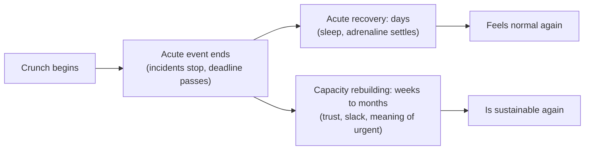
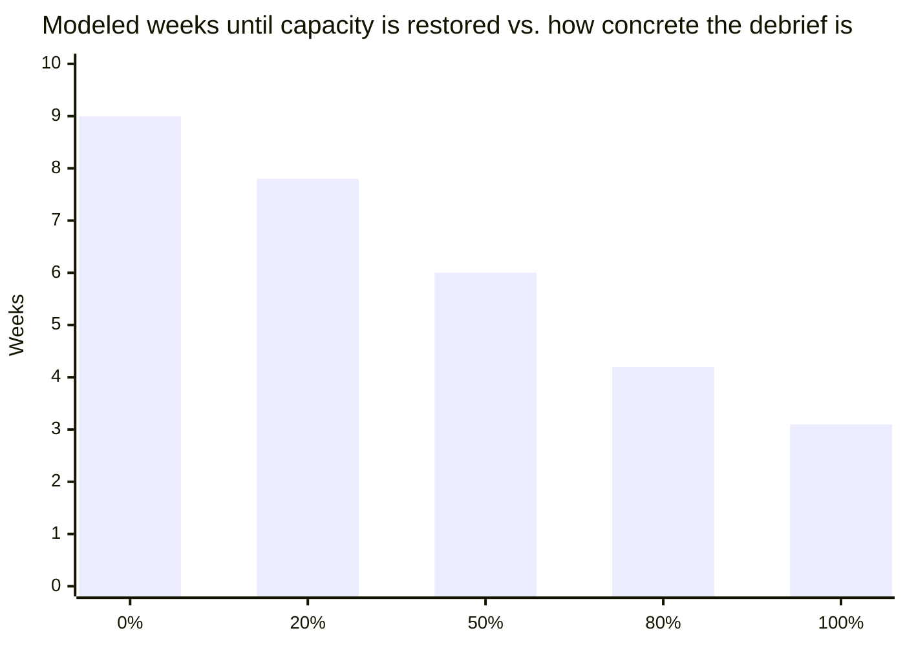

import LevelIntro from "../../../components/LevelIntro.astro";
import Checkpoint from "../../../components/Checkpoint.astro";
import PracticeCheck from "../../../components/PracticeCheck.astro";

export const unit = {
  track: "sustainable-performance",
  unitSlug: "recovery-practices-crunch",
};

L1 split recovery into a fast layer you can feel and a slow layer you cannot,
and showed unpaid cost resurfacing later in disguise. L2 works out what exactly
the slow layer consists of, and what a debrief has to ask that an ordinary
incident postmortem never does.

<LevelIntro
  items={[
    "The specific things a crunch spends",
    "Why each one needs its own repair",
    "A four-step debrief that closes the loop",
  ]}
/>

## What did the crunch actually spend?

**A manager says "the team seems fine, the incidents stopped a week ago." What
is that sentence measuring, and what is it not?** It measures the fast clock.
To see what it misses, "morale" is too vague to act on, so name the specific
things spent. Each has a different repair.

| What got spent                                | What repairs it                                                     |
| --------------------------------------------- | ------------------------------------------------------------------- |
| Sleep and adrenaline                          | Rest; resolves on its own within days                               |
| Trust between teammates after pressured calls | A direct conversation, then consistent follow-through               |
| Schedule slack borrowed to survive            | A genuinely lighter stretch with items removed, not just "go easy"  |
| Belief that "urgent" means something          | The next few requests handled at normal urgency, not another crunch |
| The fact that the period was hard             | Someone saying so out loud and specifically                         |

<Checkpoint question="A manager says, 'The team seems fine: the incidents stopped a week ago and everyone is back at their desks.' What is that likely measuring, and what might it be missing?">

It is likely measuring acute recovery: people are no longer sleep-deprived or in
active crisis, which does resolve fast. What it misses is capacity rebuilding,
which runs on a slower clock and is not visible the same way: whether people
still trust the next "urgent" ask, whether any real schedule slack is left, and
whether trust between teammates who made hard calls under pressure was repaired.
"Back at their desks" looks identical for a recovered team and for one carrying
cost, until something tests it.

</Checkpoint>

<PracticeCheck
  track={unit.track}
  unitSlug={unit.unitSlug}
  topicId="what-crunch-spends"
/>

## What does a debrief ask that a postmortem does not?

**The incident postmortems are already filed. Why is that not a recovery?**
Because a postmortem is about the system: what broke, why, what changes
technically. A crunch debrief is about the team's cost of getting through it.
Different questions, asked on purpose.

1. **Name it, out loud, as a group.** Specifically, not "things were busy" but
   "four major incidents in three weeks, someone paged almost every night." This
   is the step most often skipped, because it feels like dwelling.
2. **Ask what got spent.** Not "how is everyone" in the abstract. Did anyone
   make a call under pressure they are still uneasy about? Was something skipped
   that normally would not be?
3. **Make the rebuilding plan concrete and scheduled.** "We'll take it easier"
   is not a plan. A lighter sprint with named items removed and an end date is.
4. **Check back in more than once.** Trust and confidence rebuild over weeks; one
   meeting starts the process and does not finish it.

The unit's demo models why step 3 matters. Using its teaching formula for a
crunch of severity 70% (a modeled number, not a measurement of any real team):

<Checkpoint question="A manager runs one hour-long debrief after a brutal quarter, covers what broke technically, thanks everyone, and considers it closed. What is missing?">

The technical review and the thanks address the crisis and the effort. The
framework is about a different thing: what the period cost the team (trust,
slack, confidence in "urgent") and a scheduled plan to rebuild it. Closing with
"thanks, that's done" also misses step 4. Capacity rebuilds over weeks, so
treating one meeting as the whole recovery repeats the original mistake, just
one step later.

</Checkpoint>

<PracticeCheck
  track={unit.track}
  unitSlug={unit.unitSlug}
  topicId="debrief-framework"
/>

## Failure modes at this level

- **Treating acute recovery as the whole recovery.** A team that looks rested can
  still carry real cost.
- **Running the technical postmortem and skipping the human debrief.** Only one
  of the two gets asked by default.
- **Treating the debrief as a single event.** Naming the cost once starts
  repair; it does not complete it.
