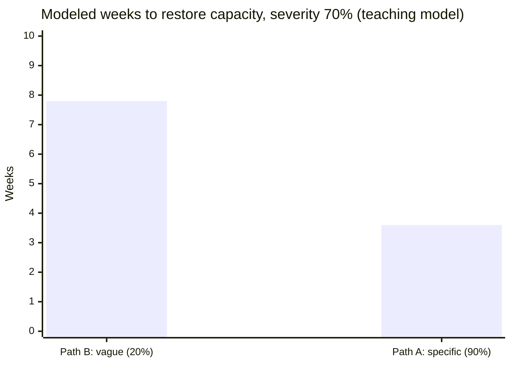

import Scenario from "../../../components/Scenario.astro";
import LevelIntro from "../../../components/LevelIntro.astro";
import Checkpoint from "../../../components/Checkpoint.astro";
import PracticeCheck from "../../../components/PracticeCheck.astro";

export const unit = {
  track: "sustainable-performance",
  unitSlug: "recovery-practices-crunch",
};

<Scenario label="The scenario">
  <Fragment slot="facts">
    

      
👩‍💼 <strong>Priya</strong> manages a six-person platform team

      
🔥 3 weeks, 4 major incidents, 2 of them overnight

      
🌙 <strong>Marcus</strong> and <strong>Dana</strong> carried most of the on-call load

      
🔁 Dana rolled back the payments service alone at 2am; Marcus still disagrees

    

  </Fragment>

Everything in L1 and L2 happens to one team. A cascading failure in a payments
dependency set off four major incidents over three weeks, two of them overnight.
Marcus and Dana knew the integration best, so they carried most of the pages.
The last incident closed on a Friday. L3 follows the same Monday twice: once
with a deliberate close-out, once with the calendar simply resuming.

**Before reading on, predict: which of the two versions looks fine at week 2,
and which one is actually fine at week 9?**

</Scenario>

<LevelIntro
  items={[
    "What this crunch spent, item by item",
    "Path A: five concrete, checkable moves",
    "Path B: four symptoms with no visible link to the cause",
  ]}
/>

## What did three weeks actually cost this team?

**Can Priya infer the cost by watching, or does she have to ask?** Some of it
she can see; some she cannot know unless someone tells her.

| What got spent           | Specific cost here (story details, not data)                                                  | Visible to Priya?          |
| ------------------------ | --------------------------------------------------------------------------------------------- | -------------------------- |
| Sleep                    | Marcus and Dana short on sleep for two of the three weeks                                     | Yes                        |
| Trust in "urgent"        | A PM labeled a non-incident request "urgent" mid-crunch; the team stopped believing the label | Only if she asks           |
| Schedule slack           | The next sprint's items were commitments made before the crunch began                         | Yes, on paper              |
| Trust between teammates  | Dana's solo rollback call, which Marcus privately still disagrees with                        | No, unless someone says so |
| Confidence in the system | Nobody fully trusts the payments dependency will not do this again                            | Partly                     |

<Checkpoint question="Which of these five costs would a standard technical postmortem on the four outages surface, and which would it miss?">

The postmortem would touch the rollback only as far as it affected the fix
timeline, not the disagreement Marcus still carries. It would not surface the
eroded trust in "urgent," the lost slack, or the team's lowered confidence as
people-and-process costs. None of those are a postmortem's job, so they only get
asked about if someone deliberately asks a different set of questions.

</Checkpoint>

## Path A: what does recovery done well look like?

**Monday morning. What does Priya do that is different from resuming the sprint?**
Each move is a sentence said, an item removed, or a date written down.

1. **She names the cost specifically.** "Four major incidents in three weeks, two
   overnight, and Marcus and Dana carried most of it. I want to say that plainly
   instead of 'great work, everyone.'"
2. **She asks the concrete question in a 1:1.** To Dana: "You made the rollback
   call alone at 2am. How do you feel about it now there is time to think?" Dana
   would make the same call again but wishes she had looped Marcus in for two
   minutes. The isolation, not the decision, is what still bothers her.
3. **She repairs the "urgent" label directly** with the PM, in front of the team:
   that request was not urgent, and mislabeling it during a crunch cost something.
4. **She makes the lighter stretch real.** Two committed items are removed
   publicly, stakeholders are told why, and normal pace resumes on a named date,
   three weeks out.
5. **She schedules a follow-up.** Two weeks later, a short check on whether the
   Marcus and Dana trust repaired and whether "urgent" is being used correctly.

**Why does this beat "being a supportive manager"?** Because every move is
checkable. A vague "let's take it easy" gives the team nothing to hold her to
and gives her nothing to verify against later. In the unit's demo, that is the
concreteness slider: at a crunch severity of 70% (assumed), a vague debrief at
20% concreteness models 7.8 weeks to restore capacity, a specific one at 90%
models 3.6.

<PracticeCheck
  track={unit.track}
  unitSlug={unit.unitSlug}
  topicId="path-a-specifics"
/>

## Path B: the same crunch, recovery skipped

**Same team, same Friday. What happens when Monday opens with "great work
everyone, glad that's behind us"?** Nobody asks Dana about the rollback.
Nothing is descoped. The PM never hears that the label mattered. Then:

| Week | What surfaces                                                      | Looks connected to the crunch? |
| ---- | ------------------------------------------------------------------ | ------------------------------ |
| 2    | Dana double-checks Marcus's payments PRs more than usual           | No, reads as thoroughness      |
| 4    | A minor alert (not an incident) triggers a full overnight scramble | No, reads as on-call culture   |
| 6    | The PM's next "urgent" request is quietly deprioritized            | No, reads as a dropped ball    |
| 9    | Marcus mentions he is "thinking about other opportunities"         | No, reads as career drift      |

Each event gets solved on its own terms: a note on review practice, clearer
escalation criteria, a retention talk about pay and growth. The root cause
(unrepaired trust, slack never restored, an "urgent" that means nothing) is
never named, so it is never addressed. (The weeks shown are story beats, not a
statistical pattern.)

<Checkpoint question="In Path B, week 4's overnight scramble over a minor alert looks like an on-call process problem. What is the more likely underlying cause?">

The more likely cause is lost confidence in the payments dependency and in the
team's own judgment under pressure. Last time something small looked small there,
it cascaded into four major incidents, so nobody trusts that a "minor" alert is
minor. Better escalation criteria might help marginally, but the real gap is
trust the team never got help rebuilding.

</Checkpoint>

<PracticeCheck
  track={unit.track}
  unitSlug={unit.unitSlug}
  topicId="path-b-root-cause"
/>

## Try extending it yourself

This is a case, not the whole territory. Three changes worth working through
before moving on:

- What if Priya herself made a high-pressure call she is unsure about? Can a
  manager run steps 1 to 5 while also being a subject of the recovery, or does
  part of it need a skip-level or a peer manager?
- What if the brutal period was a layoff aftermath, with survivor guilt and a
  much larger trust break between the team and leadership? Which of the five
  moves transfer as-is, and which must change?
- What if the team is spread across time zones and cannot meet on one Monday?
  What replaces the shared room in step 1?

## Failure modes, side by side

| Failure mode                                            | What it gets wrong                                                                |
| ------------------------------------------------------- | --------------------------------------------------------------------------------- |
| Assuming rested people means a recovered team           | Confuses the fast clock with the slow one; Path B's core mistake                  |
| Running only the technical postmortem                   | Answers what broke while leaving what it cost the people unasked                  |
| A vague, unscheduled "let's take it easier for a while" | Nothing to hold the manager to and nothing to verify                              |
| Treating one debrief as the entire recovery             | Trust and slack rebuild over weeks; one meeting only starts it                    |
| Leaving a peer's crunch-time behavior unaddressed       | The actual trust break stays intact even if the team's own dynamics get attention |
