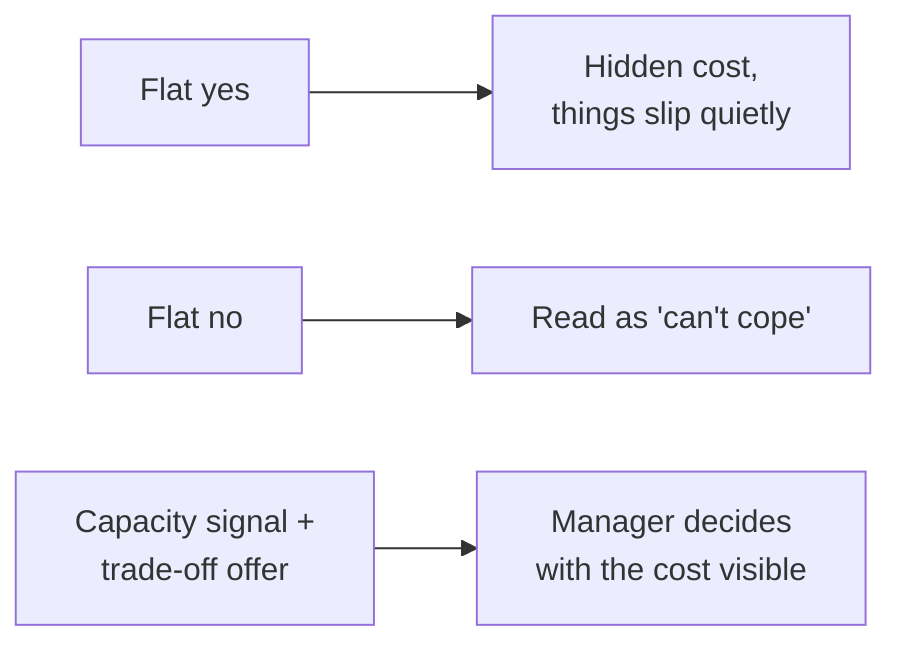

import Scenario from "../../../components/Scenario.astro";
import LevelIntro from "../../../components/LevelIntro.astro";
import PracticeCheck from "../../../components/PracticeCheck.astro";

export const unit = {
  track: "sustainable-performance",
  unitSlug: "sustainable-boundary-setting",
};

<Scenario label="The hallway ask">
  <Fragment slot="facts">
    

      
📋 Atlas rollout: deadline this quarter

      
📋 Billing fix: deadline this quarter

      
📋 Q3 reporting: deadline this quarter

      
❓ Meridian migration: the new "urgent" ask, made in a hallway

    

    

      

        3 of 3
        committed project slots already full
      

      

        

      

    

  </Fragment>

An engineer is already working on three projects, each with a real
deadline this quarter: the Atlas rollout, a billing fix and the Q3
reporting work. In a hallway conversation, their manager asks: "Can you
also pick up the Meridian migration? It's urgent."

The engineer honestly has no room for a fourth project without
something else slipping. But promotion season is close, and "can't
handle a full plate" is the last impression they want to leave.

**Is there a way to decline that is neither "yes, and burn out" nor "no,
and look like I can't do my job"?**

</Scenario>

A flat "no" gives the manager nothing to work with, so the manager
fills the gap with the most available explanation, and "this person
can't cope" is a common one. A silent "yes" avoids that, but hides the
real cost until something quietly breaks.

<LevelIntro
  items={[
    "Capacity versus capability",
    "Trade-off framing in one sentence",
    "What boundary-setting is for",
  ]}
/>

## Is the engineer saying "I can't" or "I have no room"?

**Those sound alike. Why does the difference decide how the "no" is
heard?**

- **Capacity** is about room: "given what I have already committed to, I
  cannot fit this in."
- **Capability** is about ability: "I do not have the skill to do this."
- A bare "no" does not say which one is meant, and listeners tend to
  default to the harsher reading.

| Claim      | Sounds like                | What would fix it                   |
| ---------- | -------------------------- | ----------------------------------- |
| Capacity   | "I have no room right now" | Re-prioritize, or wait              |
| Capability | "I can't do this at all"   | Training, help, or a different task |

The engineer in the Scenario has a capacity problem. Nothing about
Meridian is beyond them; three deadlines are already in the way.

<PracticeCheck
  track={unit.track}
  unitSlug={unit.unitSlug}
  topicId="capacity-vs-capability"
/>

## What does the engineer say instead of a flat no?

**If neither "yes" nor "no" works, what is left?** A third option:
state the commitments, then hand the choice back with its cost
attached.

- **Capacity signal:** a factual statement of current commitments, given
  as context, not as an excuse.
- **Trade-off framing:** "I can take this on, but something else has to
  move. Which one?" The manager sees the real price of the request.
- **Sustainable boundary-setting** means surfacing limits as they are
  reached, so workload decisions are made on purpose and not by silent
  overextension.

The goal is not avoiding new work. It is making sure new work arrives
with its trade-off acknowledged by someone with the authority to accept
it.

## What the rest of this unit covers

L2 explains why trade-off framing reads differently from a refusal, what
makes a capacity signal credible and how silent absorption goes wrong.
L3 plays the hallway conversation out in full, including what happens
when the manager pushes back.
