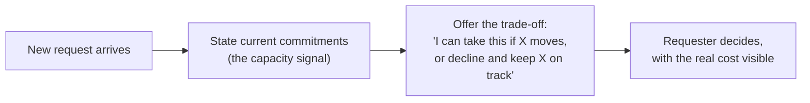

import LevelIntro from "../../../components/LevelIntro.astro";
import Checkpoint from "../../../components/Checkpoint.astro";
import PracticeCheck from "../../../components/PracticeCheck.astro";

export const unit = {
  track: "sustainable-performance",
  unitSlug: "sustainable-boundary-setting",
};

L1 named the risk in a flat "no": it is heard as a capability judgment
when it was meant as a capacity statement. L2 works out why trade-off
framing avoids that trap, what makes a capacity signal believable, and
what goes wrong when the trade-off stays hidden.

<LevelIntro
  items={[
    "Why trade-off framing changes the conversation",
    "What makes a capacity signal credible",
    "How silent absorption and unilateral choices fail",
  ]}
/>

## Why does the same refusal sound different with a reason attached?

**If the intent is identical, why does the wording change what the
listener concludes?** Because a bare "no" leaves the listener to supply
the reason, and the easiest reason to supply is a flaw in the speaker.

| What is said                                                | What it risks being heard as                         |
| ----------------------------------------------------------- | ---------------------------------------------------- |
| "No, I can't."                                              | Reluctance or overwhelm, with no reason to weigh     |
| "I'm already committed to X, Y and Z through this quarter." | Informed prioritization: a fact the listener can use |

Who should decide after the constraint is stated? Usually not the speaker
alone. The requester knows how urgent the new item is compared with what
is already committed; the speaker knows what is committed. Trade-off
framing puts each piece of information in front of the person who needs
both.

<Checkpoint question="A teammate asks a colleague to review their pull request 'today if possible.' The colleague replies, 'No, I can't.' How is that likely to be heard, and what is missing?">

It is likely to be heard as reluctance or an unexplained refusal, because
the teammate has nothing to weigh it against. They cannot tell whether
the colleague is swamped, thinks the request is unimportant or simply
does not want to. What is missing is the capacity context: naming what is
already committed, such as two reviews due before lunch, turns the same
refusal into a statement about load, which reads as prioritization and not
as a judgment about willingness.

</Checkpoint>

<PracticeCheck
  track={unit.track}
  unitSlug={unit.unitSlug}
  topicId="tradeoff-framing"
/>

## What makes a capacity signal credible instead of vague?

**Would "I'm pretty busy right now" work as well as naming the three
projects?** No. A vague claim is easy to dismiss because it gives the
listener nothing concrete to compare with the new request.

| Vague signal          | Credible signal                                        |
| --------------------- | ------------------------------------------------------ |
| "I'm swamped."        | "I'm finishing the Atlas rollout and the billing fix." |
| No deadline mentioned | "Both are due this quarter."                           |
| Nothing to compare    | The requester can weigh the new ask against named work |

Specific commitments and their deadlines turn the signal into something
the requester can reason about. It also shows that the speaker has
tracked their own load, which supports the claim that the limit is real.

<Checkpoint question="Two people decline the same request. One says 'I'm swamped right now.' The other says 'I'm finishing the Atlas rollout and the billing fix, both due Friday.' Which is more likely to change what the requester does next, and why?">

The second one, because it hands the requester something concrete to act
on. "I'm swamped" cannot be weighed against anything, so it gets
dismissed or answered with more pressure. Named commitments with a
deadline let the requester compare the new request's urgency against
Friday's work and decide what should move, which a vague claim cannot
support.

</Checkpoint>

<PracticeCheck
  track={unit.track}
  unitSlug={unit.unitSlug}
  topicId="credible-capacity-signal"
/>

## What goes wrong when the trade-off stays hidden?

**Absorbing the work quietly feels safe. Why is it not?** Because the
cost does not vanish; it moves somewhere nobody chose.

| Move                    | Who decides what slips        | What goes wrong                                               |
| ----------------------- | ----------------------------- | ------------------------------------------------------------- |
| Absorb silently         | Nobody, by default            | Longer hours or a quiet miss that surprises everyone later    |
| Refuse with no context  | The speaker, unexplained      | Heard as unwillingness; the requester cannot respond usefully |
| Decide alone what slips | The speaker, without consent  | Removes a call that is often the requester's to make          |
| Offer the trade-off     | The requester, with the facts | Slower in the moment, but the decision is deliberate          |

The first three feel easier in the moment and share one flaw: the person
with the authority to re-prioritize never sees the choice being made.

<PracticeCheck
  track={unit.track}
  unitSlug={unit.unitSlug}
  topicId="hidden-tradeoff-failures"
/>
