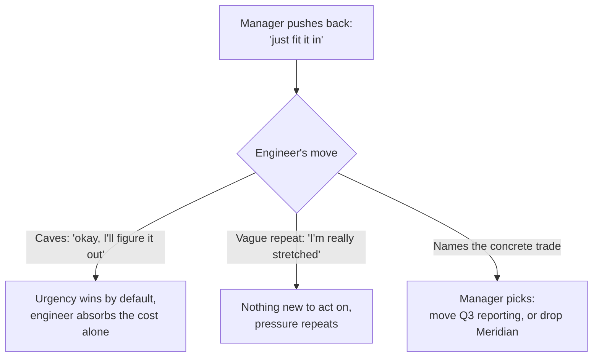

import Scenario from "../../../components/Scenario.astro";
import LevelIntro from "../../../components/LevelIntro.astro";
import Checkpoint from "../../../components/Checkpoint.astro";
import PracticeCheck from "../../../components/PracticeCheck.astro";

export const unit = {
  track: "sustainable-performance",
  unitSlug: "sustainable-boundary-setting",
};

<Scenario label="The second round">
  <Fragment slot="facts">
    

      
🗣️ Round 1: trade-off offered (something must move)

      
😤 Round 2: "Can you just find a way to fit it in?"

      
⚖️ The open question: repeat the trade, or cave?

    

  </Fragment>

The engineer has just offered the trade-off for Meridian. The manager
does not answer it. Instead: "I really need this one. Can you just find a
way to fit it in?"

**Does the boundary have to collapse here?**

</Scenario>

L2 established why trade-off framing works and what makes a capacity
signal credible. L3 plays out the first exchange in full, then the harder
second one, where the manager pushes back.

<LevelIntro
  items={[
    "The trade-off response, word by word",
    "Holding the boundary under pushback",
    "What this case does and does not generalize to",
  ]}
/>

## What does the first answer sound like in the actual moment?

**Right after the manager asks about Meridian, what does a
trade-off-framed reply contain?**

> Manager: "Can you also pick up the Meridian migration? It's urgent."
>
> Engineer: "I want to help make that happen. Right now I'm committed to
> the Atlas rollout, the billing fix and the Q3 reporting work, all with
> deadlines this quarter. I can take Meridian on, but something else would
> need to slip or be reassigned. Do you want to work out what moves, or
> would it make more sense for someone else to pick this up?"

The reply has four parts: willingness ("I want to help"), the capacity
signal (three named projects, all due this quarter), the trade-off ("I can,
but something else slips") and a question that returns the decision to the
manager.

Why does this not read as "can't handle the job"? A bare no leaves the
manager guessing. This reply gives a checkable reason and a real offer,
which looks like someone actively managing a workload. Managers are
rarely looking for infinite capacity; they are looking for people who make
trade-offs visible before something quietly breaks.

<Checkpoint question="The engineer names three specific projects instead of saying 'I'm at capacity.' Based on L2, why does that specificity matter here?">

A vague claim gives the manager nothing to weigh against Meridian's
urgency, so it is easy to dismiss or push past. Three named projects, each
with a real deadline, turn the signal into something the manager can
reason about: which of these, if any, is less urgent than Meridian. That
is what makes the trade-off offer real and not a soft way of saying no.

</Checkpoint>

## What does holding the boundary sound like when the manager pushes back?

**Pushback usually means the manager has not yet seen a specific
decision to make. How does the engineer supply one?**

> Manager: "I really need this one. Can you just find a way to fit it
> in?"
>
> Engineer: "I can make Meridian happen this week if the Q3 reporting
> work moves to next sprint. That's the trade I'd need. If Q3 reporting
> can't move, I don't think I can do Meridian justice without cutting
> corners on it or on what's already committed. Which one do you want me
> to prioritize?"

Why repeat the trade and not give in? Giving in would undo the point of
surfacing the trade-off: the word "urgent" would override the capacity
limit without anyone deciding that was right. Repeating the specific
trade keeps the conversation attached to a concrete decision the manager
can make in one sentence.

<Checkpoint question="After the pushback, suppose the engineer says only 'okay, I'll figure it out' and never names the Q3 reporting trade again. What did that response decide, and who decided it?">

It decided that Meridian gets done at the cost of something else slipping,
most likely quietly, with neither person consciously choosing what gives.
The urgency framing won by default, and the engineer alone absorbed the
consequence. This is the silent-absorption failure from L2 reappearing one
exchange later: holding the boundary means repeating the concrete trade,
not complying to avoid friction.

</Checkpoint>

| Pushback response                           | What it gets wrong                                             |
| ------------------------------------------- | -------------------------------------------------------------- |
| Caving without renegotiating                | The urgent framing wins by default, not by a real decision     |
| Repeating "I'm really busy"                 | Gives the manager nothing new to act on                        |
| Treating pushback as a personal attack      | Pushback is usually a request for specifics, not an accusation |
| Assuming the conversation happens only once | New trade-offs can start their own follow-up conversation      |

<PracticeCheck
  track={unit.track}
  unitSlug={unit.unitSlug}
  topicId="holding-under-pushback"
/>

## What does this case cover, and what does it not?

This is a case, not the whole territory. The core lesson is that a capacity
signal paired with a concrete trade-off offer communicates prioritization
and not inability, and that repeating the trade under pushback keeps the
decision honest. That carries to any situation with competing, legitimate
demands on limited time.

What is specific to the example: these three projects, the Q3 reporting
trade and a manager who responds to specifics. A different person's real
trade-offs will involve different work, different stakes and possibly a
different answer about what should move.

**Try extending it yourself.** If the manager's next reply were
"actually, just drop the billing fix, that can wait," a call the engineer
did not expect and privately disagrees with, what would holding the
boundary well look like? Has it already been upheld, or does another
trade-off conversation still need to happen? And what would change if the
requester were not a manager but a peer with no authority to reprioritize
anything?
