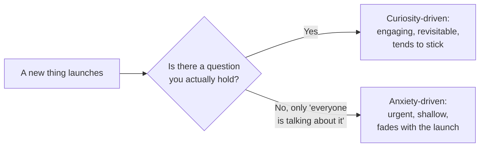

import Scenario from "../../../components/Scenario.astro";
import LevelIntro from "../../../components/LevelIntro.astro";
import PracticeCheck from "../../../components/PracticeCheck.astro";

export const unit = {
  track: "sustainable-performance",
  unitSlug: "sustainable-long-term-learning-pace",
};

<Scenario label="The problem: a shelf that fills faster than you can read">
  <Fragment slot="facts">
    

      

        ~35% covered
        5.2 of 15 new books per year (assumed numbers)
      

      

        

      

    

    

      
📚 15 notable new books a year in the genre

      
⏰ 3 hours a week to read = 156 hours a year

      
🧮 30 hours to really absorb one book, so about 5 a year

    

  </Fragment>

Imagine a reader who loves one genre. Every year it produces about 15 notable
new books. The reader has about 3 free hours a week and needs about 30 hours to
really absorb one book. (All three numbers are assumptions chosen to keep the
arithmetic visible.) Their shelf of "to read" books grows every month, and every
new release makes them feel a little further behind. They have started
reading in the evenings, on weekends, on holiday. The shelf keeps growing
anyway.

**If working harder at reading closed the gap, a year of extra evenings should
have closed it by now. Why hasn't it, and what is the reader actually supposed
to be aiming at?**

</Scenario>

Swap "books" for "frameworks, tools and AI capabilities" and this is the
everyday situation of a working engineer. The shelf is a folder of half-finished
courses, and the pull to "keep up" is the same. The rest of this unit works out
why the pull misleads and what to aim at instead.

<LevelIntro
  items={[
    "Why keeping up has no finish line",
    "Curiosity-driven vs. anxiety-driven learning",
    "Choosing what not to learn, on purpose",
  ]}
/>

## The shape of the problem

The gap between what exists and what you have learned is not a debt you can pay
off. It reopens at roughly the rate the field produces new things.

| What the reader tries to do         | What actually happens                          |
| ----------------------------------- | ---------------------------------------------- |
| Read every new release              | About a third gets covered, the rest piles up  |
| Read faster to catch up             | Depth drops, and the shelf still grows         |
| Read fewer books, chosen on purpose | Less covered, but each one is actually learned |

The sustainable move is not "learn faster". It is choosing which things to learn,
so the hours go to what compounds.

<PracticeCheck
  track={unit.track}
  unitSlug={unit.unitSlug}
  topicId="no-finish-line"
/>

## Key terms

- **Curiosity-driven learning**: pursued because a real question or a problem in
  front of you pulls you toward it. It tends to stick because a use is attached.
- **Anxiety-driven learning**: pursued mainly to escape the feeling of falling
  behind. The trigger is the existence of the new thing, not a question you hold.
- **Churn rate**: how fast the field produces new things that plausibly matter.
- **Sustainable absorption capacity**: how much you can learn to a useful depth
  per unit of time without cutting into rest, work quality or the rest of life.
- **Learning debt**: the permanent gap between what the field has produced and
  what any one person has learned. It is normal, not a personal failing.

Two readers can spend the same Saturday morning on the same new tool. What
separates them is not the behavior but what is driving it:

<PracticeCheck
  track={unit.track}
  unitSlug={unit.unitSlug}
  topicId="two-drivers"
/>

## What this unit covers

L2 builds the model: why churn will always outpace absorption, how to tell the two
drivers apart, and a three-question filter for what to learn and what to let pass.
L3 follows one engineer across three real technology waves, one handled with
anxiety and two with the filter, to show what the difference looks like year over year.
