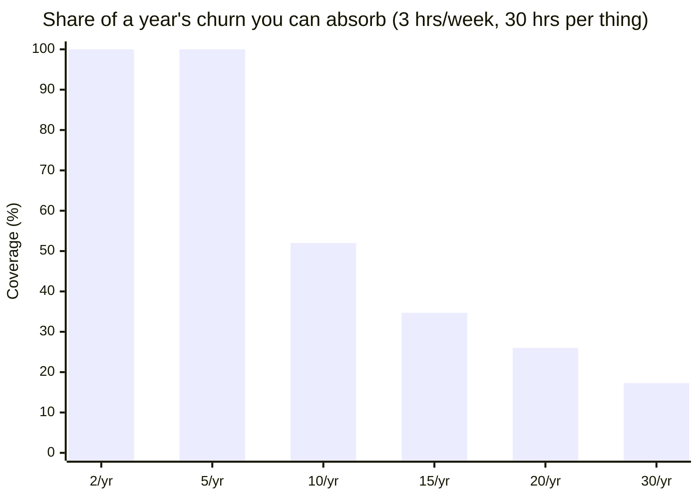
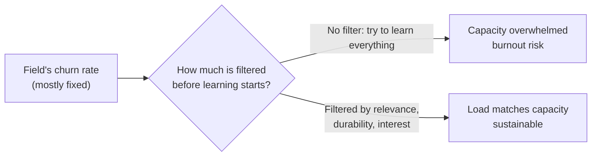

import LevelIntro from "../../../components/LevelIntro.astro";
import Checkpoint from "../../../components/Checkpoint.astro";
import PracticeCheck from "../../../components/PracticeCheck.astro";

export const unit = {
  track: "sustainable-performance",
  unitSlug: "sustainable-long-term-learning-pace",
};

L1 showed a reader whose shelf grows faster than they can read, and named the
trap: treating "caught up" as reachable. L2 moves that picture to technical
learning and works out the model underneath it: the ratio that makes the gap
permanent, the two drivers that make identical effort cost different amounts,
and a filter for deciding what is worth the hours.

<LevelIntro
  items={[
    "Churn rate against absorption capacity",
    "How to tell the two drivers apart",
    "A three-question filter for what to skip",
  ]}
/>

## If the field never pauses, what would "caught up" even look like?

**Before reading on: if you finished every tool released this year, would you be
done?** No. The field keeps producing at roughly the same rate whether or not
you absorbed last year's output, so "caught up" is not a finish line that moves.
It is not a finish line at all.

|                              | Treating "caught up" as reachable | Treating a permanent gap as normal                  |
| ---------------------------- | --------------------------------- | --------------------------------------------------- |
| What every new release means | Another sign you are behind       | Expected: the field outproduces any one person      |
| What success looks like      | Closing the gap (never happens)   | Learning what moves your work and goals, on purpose |
| Emotional cost over years    | Chronic and compounding           | Bounded, since no unreachable target is driving it  |

Accepting a permanent gap is not giving up on growth. It changes what growth is
measured against: not "have I learned everything new" (always no) but "have I
learned what moves my work and goals forward" (answerable).

## Why does the gap never close? A pacing model

**If churn is outside your control, what is left to manage?** The other side of
the ratio: how much of it you try to absorb. Using this unit's assumed numbers
(3 hours a week, 30 hours per new thing, 15 new things a year):

- 3 hours x 52 weeks = 156 hours a year.
- 156 / 30 = 5.2 things you can learn to a useful depth.
- 5.2 / 15 = about 35% of the year's churn.

The demo on this page lets you drag each number. Here is the one relationship
that matters, with hours and cost per thing held at those defaults and only the
churn rate changing:

The shape is the point: below about 5 new things a year you could cover everything,
and above that coverage drops faster than anything you control. You can add hours,
but each extra hour comes out of sleep, rest or the rest of life, which is exactly
how the burnout in L3 starts.

<Checkpoint question="You double your weekly learning time from 3 to 6 hours. Using the model above (30 hours per thing, 15 things a year), what share of the churn can you now cover, and what does that say about 'just work harder'?">

6 x 52 = 312 hours a year, 312 / 30 = 10.4 things, 10.4 / 15 is about 69%. Doubling
the time roughly doubles coverage but still leaves nearly a third uncovered, and
the extra 3 hours a week had to come from somewhere. Effort moves the number, but
it cannot close the gap, which is why the lever that matters is what you choose
to cover, not only how much time you spend.

</Checkpoint>

<PracticeCheck
  track={unit.track}
  unitSlug={unit.unitSlug}
  topicId="absorption-math"
/>

## Two engineers study the same new tool. Are they doing the same thing?

Not necessarily. The same outward behavior can be driven by two different things,
and the driver changes both what sticks and what it costs:

| Signal                   | Curiosity-driven                               | Anxiety-driven                                       |
| ------------------------ | ---------------------------------------------- | ---------------------------------------------------- |
| What triggers it         | A real question you are facing                 | The existence of the new thing: a launch, a headline |
| How it feels             | Engaging, sometimes effortful but not draining | Urgent, low-grade dread if not started soon          |
| What happens if you stop | You return later, no cost                      | Feels like falling further behind                    |
| What tends to stick      | Retained, tied to a real use                   | Shallow, often gone once the anxiety passes          |

**Is anxiety-driven learning always wasted?** Not automatically. It can teach
something real. The problem is that it competes for the same limited hours as
curiosity-driven learning without the same odds of sticking.

<Checkpoint question="An engineer spends every free evening for two weeks on a new framework the week it launches, then never opens it again. Which driver does this most resemble, and what is the strongest evidence?">

It most resembles anxiety-driven learning. Launch-week timing alone is weak
evidence, since curiosity can also start right after something ships. The stronger
evidence is what happened afterward: nothing stuck and the framework was never
touched again once the urgency passed. Curiosity-driven learning tends to be
revisited because a real question is attached to it.

</Checkpoint>

## Given a new launch, what decides whether it is worth the hours?

Three questions, asked before starting rather than three hours into a tutorial:

- **Relevance**: does it connect to a problem in your current work or a goal you
  actually hold, or is it interesting only because it is new?
- **Durability**: is it likely to still matter in two years, or to be replaced
  before it compounds?
- **Genuine interest**: apart from the first two, is a real question pulling you,
  or is the pull entirely "everyone is talking about it"?

A yes to any one is often reason enough. A no to all three is a strong sign the pull
is anxiety. Skipping then is not falling behind; it is the filter doing its job.

**Does filtering mean sometimes missing something that mattered?** Yes, occasionally.
But the unfiltered alternative does not avoid that risk. It trades "occasionally
miss something" for "reliably run out of sustainable hours". And a "no" is a verdict
on the current moment: if your work changes, the same tool can pass the filter later.

<Checkpoint question="A new client-side state library launches. It is unrelated to the current stack, its category has already churned through three competing approaches in two years, and the engineer feels no curiosity beyond 'it is trending'. What does the filter say?">

Skip it, at least for now. It fails relevance (no connection to current work), fails
durability (three approaches in two years makes a long-term bet weak) and fails
genuine interest (the pull is only trending status). Zero yes answers is the signal
the filter is built to catch: the buzz is generating the pull, not anything about
the tool.

</Checkpoint>

<PracticeCheck
  track={unit.track}
  unitSlug={unit.unitSlug}
  topicId="learning-filter"
/>

## Failure modes at this level

- **Treating "caught up" as a real goal.** It is unreachable, so chasing it
  guarantees a permanent sense of falling short.
- **Letting a launch decide what gets learned.** Reacting to whatever is newest
  hands your pacing to the field's churn rate.
- **Reading every "no" as permanent.** The filter is applied to the current moment.
