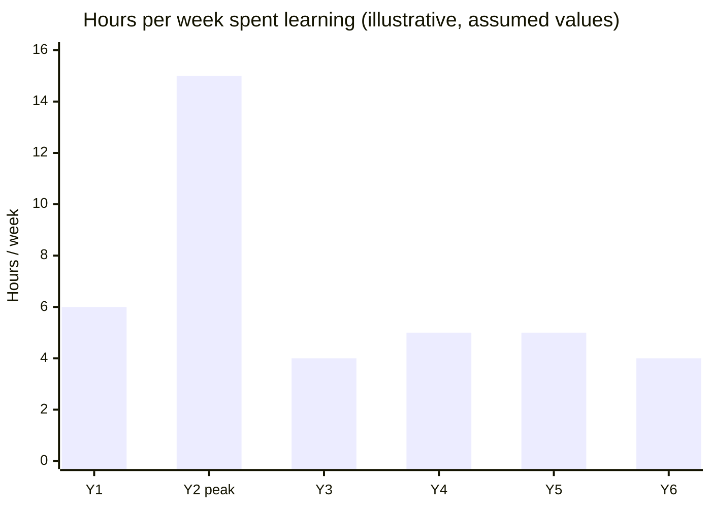

import Scenario from "../../../components/Scenario.astro";
import LevelIntro from "../../../components/LevelIntro.astro";
import Checkpoint from "../../../components/Checkpoint.astro";
import PracticeCheck from "../../../components/PracticeCheck.astro";

export const unit = {
  track: "sustainable-performance",
  unitSlug: "sustainable-long-term-learning-pace",
};

<Scenario label="One engineer, three waves: mobile-first, cloud-native, and AI">
  <Fragment slot="facts">
    

      
🌊 <strong>3 waves</strong>: mobile-first (years 1-2), cloud-native (year 4), AI (years 5-6)

      
🔥 <strong>Year 2 peak</strong>: about 15 hrs/week of learning (assumed), nights and both weekend days

      
⚖️ <strong>After the filter</strong>: about 4-5 hrs/week (assumed), kept up for years

    

  </Fragment>

An engineer nearly burns out chasing every mobile-first tool in year 2. They then
handle two more major technology waves, cloud-native and AI, with no second close
call and roughly the same free time. The field's churn did not slow down in
between. **Before reading on, predict: what has to change between year 2 and year 4
to make that possible?**

</Scenario>

<LevelIntro
  items={[
    "The wave that nearly caused burnout",
    "Applying the filter to the next two waves",
    "What generalizes to any future wave",
  ]}
/>

## The numbers this walkthrough uses

These are the same assumed figures as L1, L2 and this unit's demo, not measurements:

- About **15 significant new things per year**.
- About **3 hours a week** of sustainable learning time in an ordinary week.
- About **30 hours** to become genuinely competent (not just aware) in one new thing.

That gives about 5.2 things a year, or roughly 35% of the churn. The mechanism is
what matters, not the exact values: churn outpaces absorption by default, and the
gap is managed on purpose or it manages you through burnout or stagnation.

## Years 1-2: the mobile-first wave, handled by anxiety

Nothing like the filter exists yet, so every launch feels like something to learn
now or fall behind for good.

| Month | What happens                                                                                     |
| ----- | ------------------------------------------------------------------------------------------------ |
| 1-3   | A first mobile framework launches; the engineer works through it nights and weekends             |
| 4-7   | A competing framework gains traction; the engineer starts over, worried the first pick was wrong |
| 8-14  | Two build tools and a third state approach arrive; the engineer tries to stay current on all     |
| 15-18 | Learning time peaks around 15 hrs a week; sleep and relationships start to slip                  |

Fifteen hours a week is 780 hours a year, which on paper is more than enough for
15 things at 30 hours each. It still produced no depth, because the hours were
split across starts and restarts, each one abandoned when something newer arrived.
Volume of hours did not decide the outcome; where the hours went did. A manager
notices declining code-review quality and asks if something is wrong.

<Checkpoint question="At month 18 the engineer has studied about 15 hours a week for over a year and can point to almost nothing they would call real competence. Using the curiosity-versus-anxiety distinction, what was driving the learning, and what would curiosity have looked like at the same hours?">

Anxiety was driving it. The trigger was each launch, not a question the engineer was
trying to answer, which is the pattern L2's table predicts: high effort, shallow
retention. With curiosity as the driver, the same 15 hours would have produced fewer
things attempted and real depth in the ones pursued, because a real question holds
attention through to competence. Hours alone do not reveal the driver; what stuck
does.

</Checkpoint>

The manager's question is the turning point. Year 3 becomes a reset, not as "learn
less" but as adopting the three questions before starting anything.

## Year 4: the cloud-native wave, handled with the filter

Kubernetes, three competing service-mesh tools and a trend of "serverless-first"
frameworks all arrive in one year. The engineer's team already deploys containers,
and each new thing now passes the filter before any hours are committed.

| New thing                     | Relevant now?                        | Durable?                            | Genuine interest?           | Verdict      |
| ----------------------------- | ------------------------------------ | ----------------------------------- | --------------------------- | ------------ |
| Kubernetes                    | Yes, the team's deploys use it       | Yes, dominant for several years     | Some, how scheduling works  | Learn deeply |
| Service mesh tool A           | No, no multi-service traffic problem | Unclear, three rivals, none has won | No                          | Skip         |
| Service mesh tools B and C    | Same as A                            | Same as A                           | No                          | Skip         |
| Trending serverless framework | No, a different deployment model     | Unclear, the category has churned   | Mild, only "it is trending" | Skip         |

About 5 hours a week (assumed) went mostly into Kubernetes, well past the 30-hour
competence line. By year's end the team routes its trickier deployment questions to
this engineer, something that never happened after the year-2 sprint.

<PracticeCheck
  track={unit.track}
  unitSlug={unit.unitSlug}
  topicId="filter-before-hours"
/>

## Years 5-6: the AI wave, the hardest call yet

The AI wave is different in kind: not one tool among rivals but a shift that
plausibly touches most of the job, so "is it relevant?" stops giving a clean no.

**Does the filter still work when almost everything looks relevant?** Yes, but the
judgment gets harder. Relevance is close to a universal yes, so durability and genuine
interest carry more of the decision. The engineer goes deep on the capability that
already touches daily work (using an AI coding assistant well, including its failure
modes), stays aware but not deep on the fast-moving research layer, and explicitly
decides that chasing every model release is not worth hours yet.

<Checkpoint question="In the AI wave, relevance stops discriminating because almost everything qualifies. Based on how the engineer split the decision, which of the other two questions does more of the filtering, and why?">

Durability does more of the work. Daily-use tooling is durable because it is already
load-bearing in the job, while the pace of model releases makes any single one a weak
bet for deep hours regardless of how interesting it is. When one question stops
discriminating, the model does not collapse; the remaining questions carry more of
the decision.

</Checkpoint>

## Comparing the three waves

|                                 | Mobile-first (Y1-2)                | Cloud-native (Y4)           | AI wave (Y5-6)                                  |
| ------------------------------- | ---------------------------------- | --------------------------- | ----------------------------------------------- |
| Filter applied before starting? | No                                 | Yes                         | Yes                                             |
| Peak weekly hours (assumed)     | About 15                           | About 5                     | About 5                                         |
| Things attempted                | Nearly everything that launched    | Only what passed the filter | Deep on daily-use tooling, aware-only elsewhere |
| Competence gained               | Little, spread thin                | Real, in Kubernetes         | Real, in the daily-use capability               |
| Cost                            | Near-burnout, flagged by a manager | Sustainable                 | Sustainable despite harder calls                |

<PracticeCheck
  track={unit.track}
  unitSlug={unit.unitSlug}
  topicId="hard-calls"
/>

## Extend it: this is a case, not the whole territory

The three waves here each unfolded over a year or two, and the engineer's team
happened to use one of the candidate tools already. **What changes if a future wave
compresses to a few months? Do the same three questions stay answerable that fast,
or does a faster wave need something added, such as a rule for when to decide? And
what changes if the engineer's team uses none of the candidates, so relevance is
nearly always no?** Reason these through instead of assuming the filter scales to
any speed or context unchanged: a filter that takes longer to apply than the wave
takes to pass can reproduce year 2's pressure even with the filter in hand.

## Failure modes

| Failure mode                                              | What it gets wrong                                                                            |
| --------------------------------------------------------- | --------------------------------------------------------------------------------------------- |
| Treating every new thing as equally urgent (year 2)       | Spreads fixed hours across too much, giving wide shallow exposure instead of competence       |
| Applying the filter only after hours are already invested | Its value is in deciding before starting; afterward it only breeds guilt about time spent     |
| Assuming "relevant" alone is enough once a wave is big    | When relevance stops discriminating, durability and interest must do real work                |
| Mistaking a sustained low-anxiety pace for complacency    | Learning less than everything is the design; steady focused hours beat a scattered sprint     |
| Never revisiting a past "skip"                            | A no is a verdict on the current moment; changed work can make a skipped thing relevant later |
