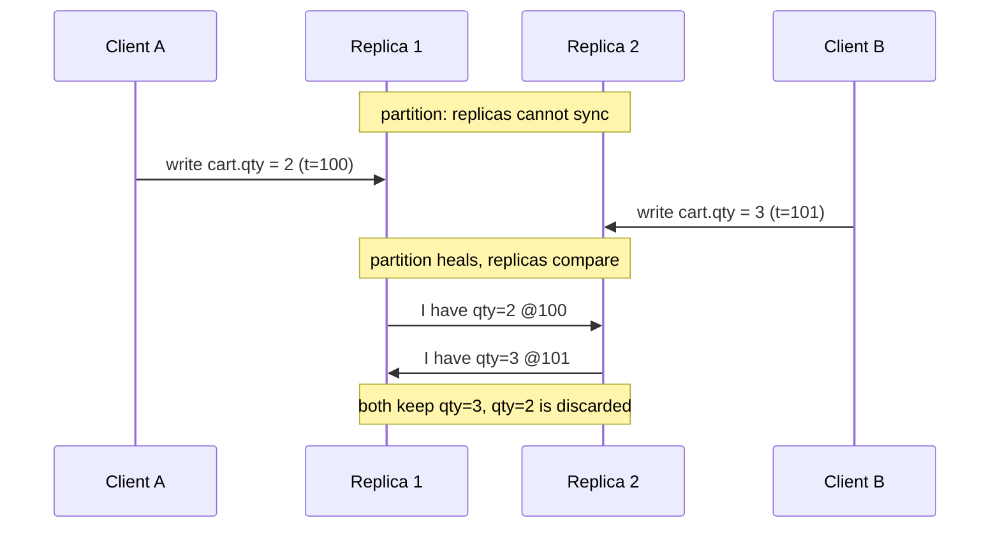
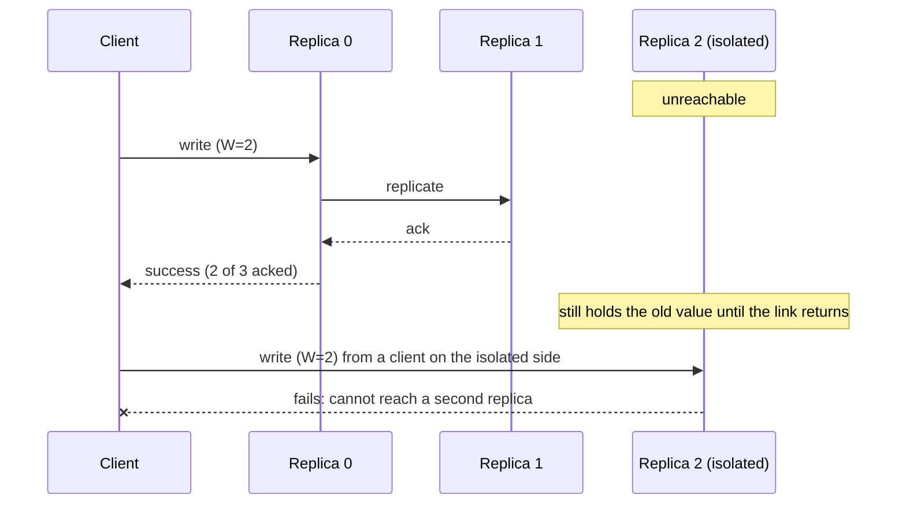
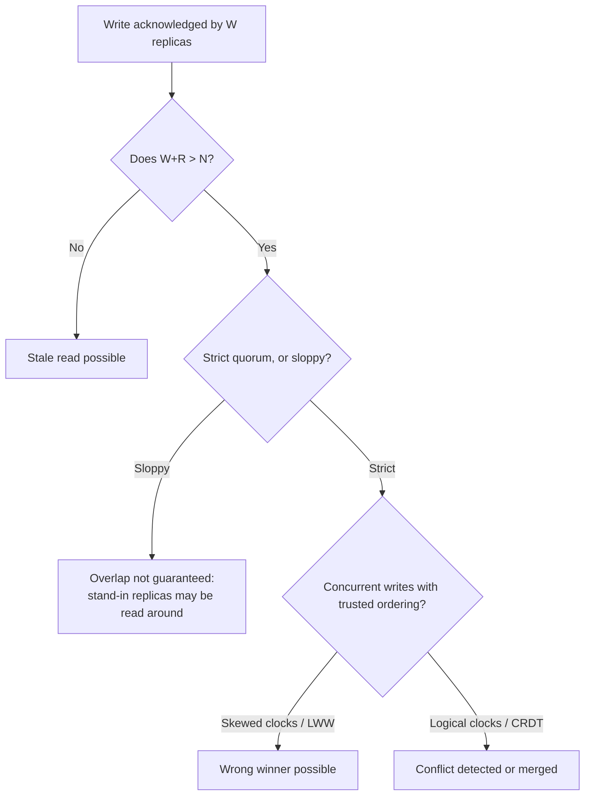

import Scenario from "../../../components/Scenario.astro";
import LevelIntro from "../../../components/LevelIntro.astro";
import Checkpoint from "../../../components/Checkpoint.astro";
import PracticeCheck from "../../../components/PracticeCheck.astro";

export const unit = {
  track: "systems",
  unitSlug: "cap-theorem",
};

<Scenario label="The problem">
  <Fragment slot="facts">
    

      
🧑‍💻 <strong>Client A</strong> writes <code>cart.qty = 2</code> at t=100

      
🧑‍💻 <strong>Client B</strong> writes <code>cart.qty = 3</code> at t=101, to a different replica

      
🔀 Both writes reach only <strong>part</strong> of the cluster before a partition hits

    

    

      When the partition heals, two replicas disagree about <code>cart.qty</code> — and neither is "corrupted." They just each recorded a real write that really happened.
    

  </Fragment>

L2 gave the quorum formula as a guarantee about **overlap**: a read
is guaranteed to see the newest acknowledged write. It said nothing
about what happens when two writes race each other and land on
different replicas before either fully propagates. That is a real gap
the formula alone does not close, and this level walks through it:
what the cluster does with two honest, conflicting writes, how the
same partition produces opposite behavior depending on one setting,
and which failure modes survive even a correct quorum.

**Before reading on: does raising W (say, to N, so every write must
reach every replica) make this race impossible, or does it just make
it slower to trigger?**

</Scenario>

<LevelIntro
  items={[
    "Concurrent writes and last-write-wins",
    "One partition, three write quorums, three outcomes",
    "Failure modes a correct quorum still leaves open",
  ]}
/>

## Two writes, one key, no coordination

**When two clients write the same key to different replicas and
neither write has propagated, what does a later read actually see?**
It depends on what the replicas do when they compare notes. The most
common default is **last-write-wins** (LWW): every write carries a
timestamp, and the higher timestamp survives.

Each replica accepted a real write, so neither is "corrupted." LWW
simply has to pick one. A's write is not damaged; it is overwritten
and never returned by any future read.

<Checkpoint question="In the Scenario, once last-write-wins resolves the race, is Client A's write 'lost' because it was corrupted, or in some weaker sense?">

In a weaker, specific sense: A's write was valid when it happened,
and the system chose to discard it purely because its timestamp was
smaller. Nothing was corrupted. The real cost is that LWW has no
idea which write the business wanted to win. "qty=3" might have been
a deliberate correction of "qty=2", or the two edits might have been
independent and both deserved to survive. This is why some stores use
vector clocks or CRDTs: they can detect that two writes were
concurrent and keep both as siblings or merge them with domain logic,
instead of quietly dropping one.

</Checkpoint>

<PracticeCheck
  track={unit.track}
  unitSlug={unit.unitSlug}
  topicId="concurrent-writes-lww"
/>

## Worked example: one partition, three write quorums

Take N=3 replicas. A partition isolates replica 2 from replicas 0 and

1. A write arrives on the majority side (0 and 1). What happens
   depends only on how many acknowledgements the write demands.

| Write quorum     | Can the majority side (0, 1) succeed? | Can the isolated replica 2 succeed? | Behavior during the partition                          |
| ---------------- | ------------------------------------- | ----------------------------------- | ------------------------------------------------------ |
| `W=3` (all)      | No, it can only reach 2 replicas      | No                                  | CP: refuses everywhere, stays consistent               |
| `W=2` (majority) | Yes, 2 acks reachable                 | No, it can only reach itself        | CP-leaning: only the majority side serves writes       |
| `W=1`            | Yes                                   | Yes                                 | AP: both sides accept writes and will conflict on heal |

The same cluster, the same partition, and the behavior flips from
"refuse" to "serve one side" to "serve both sides and reconcile later"
purely by changing one number. This is the concrete form of L1's
abstract claim that the CP/AP choice is made during a partition, and
that quorum systems let you make it per request.

<Checkpoint question="With N=3 and W=2, a read with R=2 runs on the majority side during the partition. Is it guaranteed to see the latest acknowledged write? What about a read with R=1 sent to the isolated replica 2?">

The R=2 read is guaranteed: W+R = 4 > 3, so its two replicas must
overlap the two that acknowledged the write. The R=1 read on replica 2
is not: W+R = 3 is not greater than 3, and replica 2 is exactly the
one the write could not reach, so it can return the old value. The
formula's guarantee is conditional on both numbers, and a single
cheap read path can quietly opt out of it.

</Checkpoint>

<PracticeCheck
  track={unit.track}
  unitSlug={unit.unitSlug}
  topicId="cp-ap-per-request"
/>

## This example is a case, not the whole territory

The shopping-cart race and the three-replica partition are one slice
of the space. **What changes if the key is a like counter instead of
a cart quantity? What if the two clients write in the same
millisecond? What if the partition splits 2-2 in a four-replica
cluster, with no majority at all?** For a counter where losing one
increment briefly is harmless, LWW (or an increment-based CRDT) is a
fine default. For a cart quantity someone specifically intended,
silently discarding a concurrent write is the actual bug. And a 2-2
split is the case where a majority quorum becomes unreachable on
both sides at once, so a CP system refuses writes everywhere. Work
through each of these before trusting any single rule of thumb.

## Failure modes a correct quorum still leaves open

| Failure mode       | What goes wrong                                                                                                                      | Typical mitigation                                                                            |
| ------------------ | ------------------------------------------------------------------------------------------------------------------------------------ | --------------------------------------------------------------------------------------------- |
| **Clock skew**     | LWW trusts timestamps, but two replicas' wall clocks can disagree by enough to make the wrong write look newer                       | Logical clocks (Lamport, vector clocks) or bounded-uncertainty clocks like Spanner's TrueTime |
| **Sloppy quorums** | During a partition, a write "succeeds" against temporary stand-in replicas, so the overlap guarantee no longer holds even if W+R > N | Hinted handoff to forward data home later, accepting weaker read guarantees meanwhile         |
| **No read repair** | A read that notices a stale replica does not fix it, so staleness lingers until the next write                                       | Read repair: write the winning value back to the stale replica                                |

<Checkpoint question="A cluster uses strict quorums with W+R > N and LWW, but one replica's clock runs 5 seconds fast. Which guarantee has broken: the overlap guarantee, or the conflict-resolution rule?">

The conflict-resolution rule. The overlap still works: every read
still touches a replica holding the latest acknowledged write. But
LWW compares timestamps, and a write stamped by the fast clock looks
newer than a genuinely later write stamped by a correct clock, so
the read confidently returns the wrong winner. Quorums solve
"which replicas must I ask"; they do not solve "which of these
values is the right one."

</Checkpoint>

<PracticeCheck
  track={unit.track}
  unitSlug={unit.unitSlug}
  topicId="lww-limits"
/>
