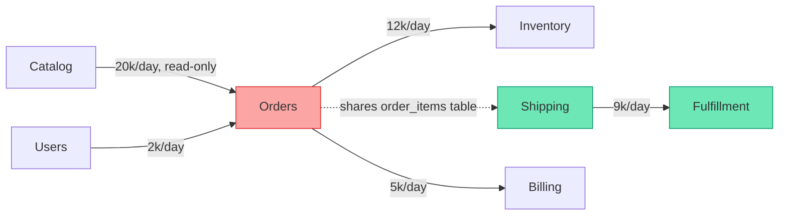
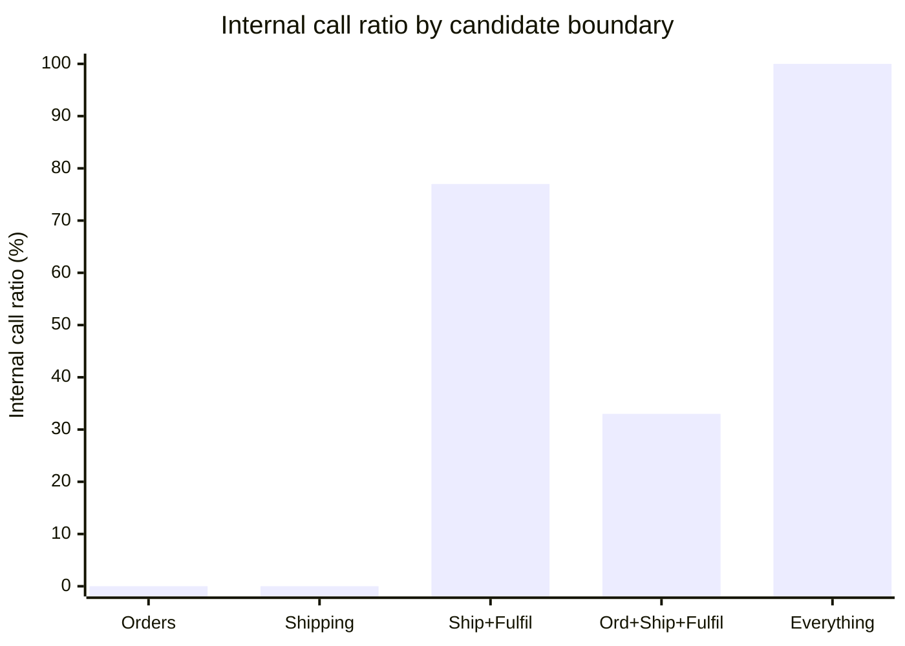
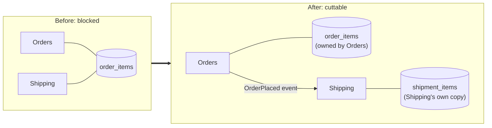

import Scenario from "../../../components/Scenario.astro";
import LevelIntro from "../../../components/LevelIntro.astro";
import Checkpoint from "../../../components/Checkpoint.astro";
import PracticeCheck from "../../../components/PracticeCheck.astro";

export const unit = {
  track: "systems",
  unitSlug: "domain-boundaries",
};

<Scenario label="The problem">
  <Fragment slot="facts">
    

      
📦 <strong>Candidate A</strong> — Orders alone: shares <code>order_items</code> with Shipping, 3,000 calls/day from Shipping

      
📦 <strong>Candidate B</strong> — Shipping + Fulfillment together: 15,000 internal calls/day, only 1 shared table (<code>order_items</code>) crossing the line

      
❓ Same modules, two different lines drawn around them — only one holds up

    

    

      A "candidate boundary" isn't one module — it's whatever set of modules you're proposing to extract together. The set matters as much as the modules in it.
    

  </Fragment>

L1 named the two numbers that matter — coupling out, cohesion in —
and the signals that reveal them (shared tables, call frequency,
co-change, vocabulary). This level turns that into an actual method:
draw a call graph of the monolith's modules, score candidate
boundaries against it, and read off which one is safe to extract
first.

**Given the two candidates above — same six modules to choose from, two different proposed groupings — which one would you bet on, and what single number would you check first to decide?**

</Scenario>

<LevelIntro
  items={[
    "Modeling the monolith as a call graph with weighted edges",
    "Scoring a candidate boundary: internal call ratio and external shared tables",
    "Reading the graph to find the boundary that's already there",
  ]}
/>

## Modeling the monolith as a graph

Before scoring anything, the monolith needs a shape. Every module
becomes a node; every call from one module into another becomes a
directed edge, weighted by how often it happens; every table two
modules both touch becomes a marked "shared data" edge, separate from
the call edges because it's a stronger and different kind of coupling
(a call can be replaced by an API; two modules silently sharing a
table can't be, without one of them moving first).

The dotted line is the one that matters most: a shared-table edge,
drawn deliberately different from the solid call edges, because it's
the one no service boundary can paper over without a real migration.

<Checkpoint question="In the graph above, Catalog calls Orders 20,000 times a day — the highest call count of any edge. Does that make Catalog+Orders the best candidate boundary to extract together?">

Not by itself. Call _frequency_ alone measures traffic, not the kind
of coupling that breaks a split. Catalog's calls into Orders are
read-only price lookups with no shared table and no shared writes —
exactly the kind of dependency an API (or even a cache) absorbs
cleanly. Orders and Shipping have a much lower call count but a
**shared table**, which is the coupling that actually resists being
split. High traffic on a clean interface is fine; low traffic through
a shared table is the red flag. The graph needs both signals read
together, not call count alone.

</Checkpoint>

<PracticeCheck
  track={unit.track}
  unitSlug={unit.unitSlug}
  topicId="call-graph-model"
/>

## Scoring a candidate boundary

A candidate boundary is a _group_ of modules you're proposing to
extract as one service. Two numbers score it:

- **Internal call ratio** — of all call volume touching any module in
  the group, the share that stays inside the group:
  `internal / (internal + external)`. High means self-contained; low
  means every request drags the rest of the graph along.
- **External shared tables** — tables a module inside the group shares
  with a module _outside_ it. This must be zero for a clean split; any
  other count is a distributed transaction waiting to happen.

Scored against the graph above:

| Candidate group             | Internal call ratio | Tables shared across the line           | Reading                               |
| --------------------------- | ------------------- | --------------------------------------- | ------------------------------------- |
| Orders alone                | 0%                  | `order_items`, `inventory_reservations` | Blocked twice over                    |
| Shipping alone              | 0%                  | `order_items`                           | Blocked, and chatty                   |
| Shipping + Fulfillment      | 77%                 | `order_items`                           | Close — one table to resolve          |
| Orders + Shipping + Fulfil. | 33%                 | `inventory_reservations`                | Worse ratio, still blocked            |
| Every module                | 100%                | none                                    | Clean only because it is the monolith |

The last row is the trap: a bundle that swallows enough of the
monolith always scores well on ratio, because "internal" grows to
include whatever used to be external. Shipping + Fulfillment wins
because it is the _smallest_ group with a high ratio and only one
blocker left.

<Checkpoint question="A team proposes bundling every module into one 'service' because it scores 100% internal call ratio and zero shared tables. Is that the best boundary on the chart?">

No. It scores perfectly because it is the monolith with a new name:
all the original coupling is still inside it, and none of the
benefits of a split (independent deploys, independent scaling, one
team owning one thing) are bought. The useful boundary is the
smallest group that gets external shared tables to zero, not the
largest group that gets the ratio to 100%.

</Checkpoint>

<PracticeCheck
  track={unit.track}
  unitSlug={unit.unitSlug}
  topicId="scoring-boundary"
/>

## Resolving the shared table, then cutting

**Shipping + Fulfillment scored 77% but is blocked by one table. What
does "resolving" it actually look like?**

Each side keeps exactly the fields it needs in a table only it
writes, and changes travel as events or API calls instead of shared
writes. Only then is the line safe to cut. The full method:

| Step | Do                                                                    | Stop condition                                        |
| ---- | --------------------------------------------------------------------- | ----------------------------------------------------- |
| 1    | Build the weighted call graph, mark shared tables                     | Every module and edge accounted for                   |
| 2    | Propose a group (start from the pain, but not only from it)           | A named candidate                                     |
| 3    | Score ratio and external shared tables                                | Both numbers on the page                              |
| 4    | Tables non-zero: split the data first, or grow the group to absorb it | External shared tables = 0                            |
| 5    | Hand the clean group to the strangler-fig cutover                     | Where to cut is settled; how is `strangler-fig`'s job |

<Checkpoint question="A group scores 0 external shared tables but only a 20% internal call ratio. Is it safe to extract?">

Data-wise yes, performance-wise it is risky. No shared tables means
no distributed transactions, but 80% of the traffic touching the
group crosses the new network line, so every request becomes several
slow, failure-prone hops. The two numbers catch different failures:
shared tables break correctness, a low ratio breaks latency and
availability. A good boundary needs both.

</Checkpoint>

<PracticeCheck
  track={unit.track}
  unitSlug={unit.unitSlug}
  topicId="fixing-shared-data"
/>
