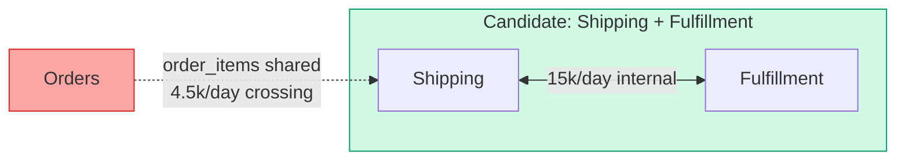
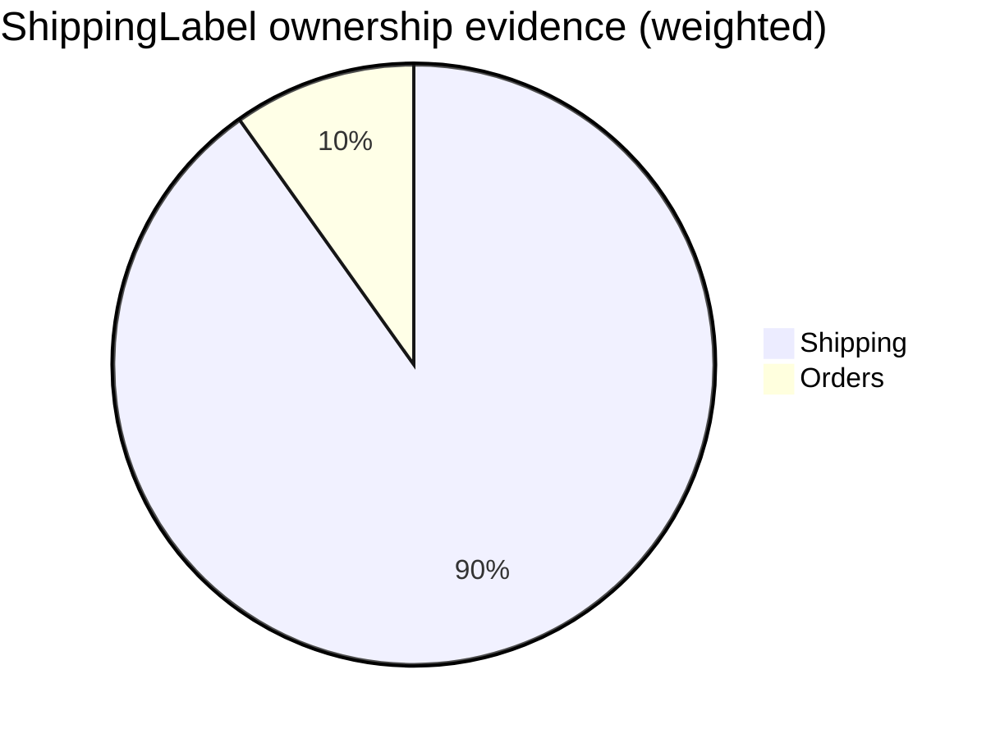

import Scenario from "../../../components/Scenario.astro";
import LevelIntro from "../../../components/LevelIntro.astro";
import Checkpoint from "../../../components/Checkpoint.astro";
import PracticeCheck from "../../../components/PracticeCheck.astro";

export const unit = {
  track: "systems",
  unitSlug: "domain-boundaries",
};

<Scenario label="The problem">
  <Fragment slot="facts">
    

      
📋 Review asks: <strong>"Why Shipping+Fulfillment first, not Orders?"</strong>

      
📊 "It feels right" is not an answer a staff review accepts

      
🧮 The answer has to be a number computed from the actual call graph

    

    

      A design review that can't be re-derived from data by someone who wasn't in the room isn't a decision — it's a guess with confidence attached.
    

  </Fragment>

L2 gave the method on one small graph. This level walks the numbers
end to end the way a review would demand them, then handles the two
messy cases the clean method skips: a class that seems to belong to
two contexts at once, and a boundary that is clean by the numbers but
cuts across your teams. No tooling is needed to follow it — the point
is the reasoning, and every number can be re-derived by hand.

**Before reading on: if you had to defend "Shipping+Fulfillment first" in a review with one sentence and one number, what would the sentence be — and could you say it without saying "it feels right"?**

</Scenario>

<LevelIntro
  items={[
    "Re-deriving the scores from the raw edge list",
    "Writing the one-sentence, one-number defense",
    "Placing an ambiguous class, and when the numbers are not enough",
  ]}
/>

## Re-deriving the scores from the edge list

Everything starts from the raw edges. Nothing here is hidden: the
review can recompute any score from this table.

| From → To              | Calls/day | Shared table             |
| ---------------------- | --------- | ------------------------ |
| Catalog → Orders       | 20,000    | none                     |
| Orders → Inventory     | 12,000    | `inventory_reservations` |
| Orders → Shipping      | 3,000     | `order_items`            |
| Shipping → Orders      | 1,500     | `order_items`            |
| Orders → Billing       | 5,000     | none                     |
| Shipping → Fulfillment | 9,000     | none                     |
| Fulfillment → Shipping | 6,000     | none                     |
| Users → Orders         | 2,000     | none                     |

For the group \{Shipping, Fulfillment\}: four edges touch it
(3,000 + 1,500 + 9,000 + 6,000 = 19,500 calls). Two have both ends
inside (9,000 + 6,000 = 15,000). Ratio: 15,000 / 19,500 = **77%**.
Of the two edges that cross, both carry `order_items`, so the
external shared table count is **1**.

For \{Orders\}: every edge touching it crosses (43,500 calls, none
internal): ratio **0%**, and two tables (`order_items`,
`inventory_reservations`) cross.

<PracticeCheck
  track={unit.track}
  unitSlug={unit.unitSlug}
  topicId="score-derivation"
/>

## The one sentence and one number

The review question was "why Shipping + Fulfillment first, not
Orders?" The defense: "Orders alone keeps none of its call volume
inside and shares two tables across the line it would cut along.
Shipping plus Fulfillment keeps 77% of its volume internal and shares
one table, `order_items`, inherited from its calls with Orders. It is
far closer to extractable, but closer is not clean: Shipping first
gets its own copy of the order-item fields it needs, synced by event,
and only then do we cut."

That sentence names the number, the blocker and the prerequisite
work. It can be re-derived by someone who was not in the room, which
is what makes it a decision instead of a guess.

<Checkpoint question="Suppose a third module, Reporting, also reads `order_items`, but is not in the candidate group. The edge list only records pairs of modules that call each other, and Reporting never calls Shipping. Does the \{Shipping, Fulfillment\} score of '1 external shared table' still hold?">

Not necessarily. Reading edges pair by pair only sees a table when the
two ends of an edge both use it. Reporting touches `order_items`
without any edge to Shipping, so the pairwise view hides it. The
reliable method is table-centric: list every module that touches each
table, then check whether that set straddles the proposed line. Here
the answer for `order_items` is the same (it straddles), but the
count of _who_ must be migrated off it grows by one. Always do the
table-centric pass before promising a boundary is clean.

</Checkpoint>

<PracticeCheck
  track={unit.track}
  unitSlug={unit.unitSlug}
  topicId="defending-split"
/>

## Classifying an ambiguous class

**A `ShippingLabel` class grew a method that writes `order_items`
directly. Which context owns it?**

Neither "both" nor a coin flip. Weigh two signals, and weight the
structural one more heavily:

| Signal                      | Evidence for `ShippingLabel`                   | Points to                   | Weight                |
| --------------------------- | ---------------------------------------------- | --------------------------- | --------------------- |
| Data it touches (ownership) | 40 `shipping_labels` accesses, 5 `order_items` | Shipping (40) vs Orders (5) | Full                  |
| Who calls it                | 30 from Shipping, 2 from Orders                | Shipping (30) vs Orders (2) | Half (traffic drifts) |

Scoring: Shipping = 40 + 30 × 0.5 = 55; Orders = 5 + 2 × 0.5 = 6. Shipping
holds 55 of 61 points, about **90%**. The five `order_items` touches
are real and worth a follow-up ticket to remove, but they do not
override where the class's data and callers live.

Data ownership weighs more than callers because it is a structural
fact about what the class needs to do its job, whereas caller counts
reflect this quarter's wiring and drift.

<Checkpoint question="Why weight data access fully but caller counts at half, instead of equally?">

The two signals differ in stability. What data a class depends on
changes only when its design changes. Who calls it can shift because
of one feature rollout, without the class's purpose changing at all.
Weighting the stable signal higher keeps the classification from
flipping with traffic, and it is the same reasoning L2 used to rank
shared tables above raw call frequency.

</Checkpoint>

<PracticeCheck
  track={unit.track}
  unitSlug={unit.unitSlug}
  topicId="ambiguous-class"
/>

## What the numbers don't decide

Scores narrow the candidates; they do not make the final call. A group
can score clean and still be the wrong first target.

| Situation                                  | Numbers say        | What they miss                                   |
| ------------------------------------------ | ------------------ | ------------------------------------------------ |
| Clean group cuts across two teams          | Go                 | Neither team owns the new service end to end     |
| Clean group has no product urgency         | Go                 | Effort with no payoff competes with real roadmap |
| Messier group aligns with exactly one team | Resolve data first | Ownership may make the cleanup cheap             |

This unit's worked example is one case, not the whole territory.
Change the inputs and re-ask. What if the org had three teams and the
cleanest boundary by these numbers cut across two of them? What if
`order_items` were written by Orders but only ever _read_ by Shipping?
What if Fulfillment were owned by a vendor and could not change its
schema? Each changes which blocker matters most, and none of it shows
up in a call graph.

<PracticeCheck
  track={unit.track}
  unitSlug={unit.unitSlug}
  topicId="judgment-beyond-numbers"
/>
