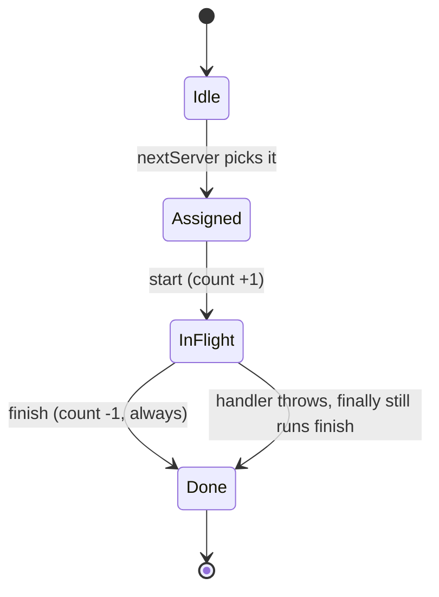
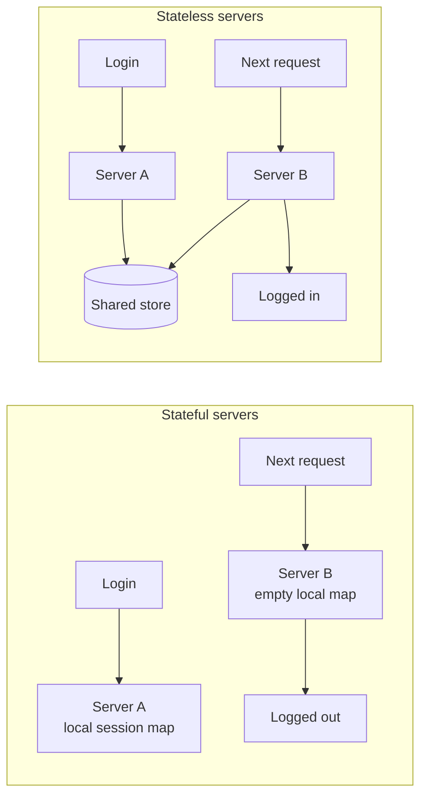

import LevelIntro from "../../../components/LevelIntro.astro";
import Checkpoint from "../../../components/Checkpoint.astro";
import PracticeCheck from "../../../components/PracticeCheck.astro";

export const unit = {
  track: "systems",
  unitSlug: "horizontal-scaling",
};

L2 covered the algorithms a load balancer chooses between, the
sticky-session-vs-shared-store trade-off, and health checks. This level
goes underneath them: how small the selection logic really is (and where
its edge cases hide), why least connections is only as good as its
bookkeeping, and what TicketRush's fix still leaves unsolved.

<LevelIntro
  items={[
    "Selection logic that skips unhealthy servers",
    "Bookkeeping that keeps least connections honest",
    "What a shared store fixes, and what it creates",
  ]}
/>

## How small is the selection logic, and where do the edge cases hide?

**Round robin sounds like one line: `servers[counter % n]`. What breaks the
moment one server is unhealthy?** The cursor has to keep advancing through
the full list, but the pick must land on a healthy server, and the case
where nobody is healthy has to end instead of looping forever.

```js
function pickRoundRobin(servers, cursor) {
  const n = servers.length;
  for (let i = 0; i < n; i++) {
    const index = (cursor + i) % n;
    if (servers[index].healthy) {
      return { id: servers[index].id, nextCursor: (index + 1) % n };
    }
  }
  return null; // nobody healthy: report an outage, don't spin
}
```

Scanning at most `n` slots is the whole safety argument: the loop always
terminates, and `null` forces the caller to deal with a total outage
explicitly. Least connections has the same shape with a different rule: among
the healthy servers, take the one with the fewest in-flight requests, and
let the earliest win ties. An unhealthy server with zero connections must
never win just because it looks idle.

| Edge case                  | Round robin                    | Least connections              |
| -------------------------- | ------------------------------ | ------------------------------ |
| One server unhealthy       | Skip it, keep cursor advancing | Exclude it before comparing    |
| Every server unhealthy     | Return nothing, surface outage | Return nothing, surface outage |
| Tie between servers        | Not applicable (fixed order)   | Earliest in the list wins      |
| State the balancer carries | One integer (the cursor)       | One live counter per server    |

<PracticeCheck
  track={unit.track}
  unitSlug={unit.unitSlug}
  topicId="server-selection"
/>

**Would this selection logic have prevented TicketRush's session bug?** No.
Nothing here decides where session data lives; every algorithm can send a
user's next request to a different server. The bug was an assumption about
state, not a routing choice.

## Why does least connections need careful bookkeeping?

**Least connections trusts a number. What happens when the number is wrong?**



The count is only as accurate as the start and finish calls that feed it.
If a request is assigned but never reported as started, that server looks
idler than it is and attracts even more traffic. If a request ends in an
error and finish is skipped, the server keeps a phantom connection forever
and is starved of traffic it could handle. Neither failure throws; the
balancer just makes steadily worse decisions. That is why finish belongs in
a `finally` path rather than being a call every caller has to remember, and
why the decrement never drops below zero.

<Checkpoint question="Two load balancer instances sit in front of the same three servers, each tracking its own connection counts. Why is least connections unreliable here?">

Each instance only sees the requests it routed itself. Server A may be
saturated by traffic arriving through the other balancer while this one
believes A is idle, so it keeps piling more on. The counts are partial views
of one reality, and unless the balancers share state (or the servers report
their real load), the algorithm optimizes against a picture that is wrong by
design. It is the same lesson as statelessness one level up: state that lives
in only one place cannot be trusted by anyone else.

</Checkpoint>

<PracticeCheck
  track={unit.track}
  unitSlug={unit.unitSlug}
  topicId="connection-bookkeeping"
/>

## What does the shared store fix, and what does it leave behind?

**Here is the L1 bug and its fix side by side. What exactly changed?**



Nothing about routing changed. The fix removed the assumption that the next
request returns to the same server, so it no longer matters which server
handles it. No server checks where a session was created, because the answer
is always "in the store."

That does not make state free. It relocates it, and the new location carries
its own costs:

| What moved                       | New cost or risk                                                       | Typical mitigation                                       |
| -------------------------------- | ---------------------------------------------------------------------- | -------------------------------------------------------- |
| Sessions into one shared store   | Store is a shared dependency; if it is down, every server is useless   | Replication and failover for the store                   |
| Lookup into every request        | An extra network round trip each time                                  | Keep sessions small, cache carefully                     |
| Large state (a big cart) into it | Fetching megabytes per request is slow                                 | Store an id in the session, keep bulk data in a database |
| Local caching of session reads   | A logout on one server is invisible to another until the cache expires | Short TTLs, or accept staleness knowingly                |

<Checkpoint question="The shared session store goes down while every app server is healthy and well under capacity. Would adding more app servers help?">

No. All the extra servers would wait on the same dead dependency, so total
capacity is capped by the store, not by the servers. This is the same shape
as the capacity chart in this unit's demo: adding machines scales throughput
only until a shared resource becomes the limit, and from then on the shared
resource is the thing to scale or protect.

</Checkpoint>

<PracticeCheck
  track={unit.track}
  unitSlug={unit.unitSlug}
  topicId="shared-state-limits"
/>

**Try extending it yourself:** a checkout request now needs the user's cart,
which is large enough to be expensive to fetch on every request. Would you
give up on interchangeable servers, shrink what the session carries, or cache
the cart per server? What does each choice do to correctness when the cart
changes on another server? The case above is one worked example, not the whole
territory: the same questions apply to any state you are tempted to keep
close to the server.

## Failure modes

| Failure mode                                                    | What it gets wrong                                                                                 |
| --------------------------------------------------------------- | -------------------------------------------------------------------------------------------------- |
| Round robin that never terminates when all servers are down     | Spins forever instead of reporting an outage                                                       |
| Updating `activeConnections` only on assignment, not completion | Counts drift, so traffic goes to servers that already have work piling up                          |
| Keeping session data in one server's memory "just for now"      | Works until the second server arrives, then fails in production rather than in testing on one box  |
| Treating the shared store as infallible                         | Moves the single point of failure instead of removing it                                           |
| Health checks that only confirm the process is running          | A server can pass while unable to serve real requests, and keep receiving traffic it cannot handle |
